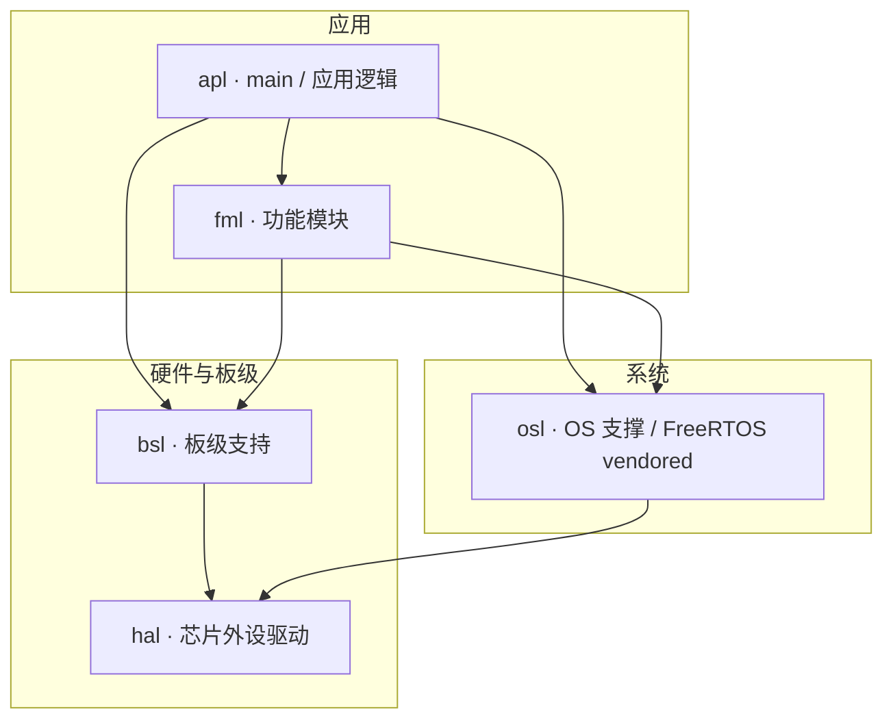
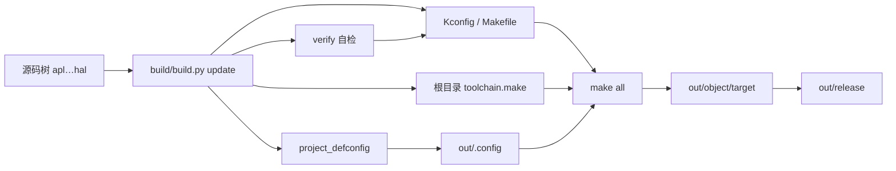
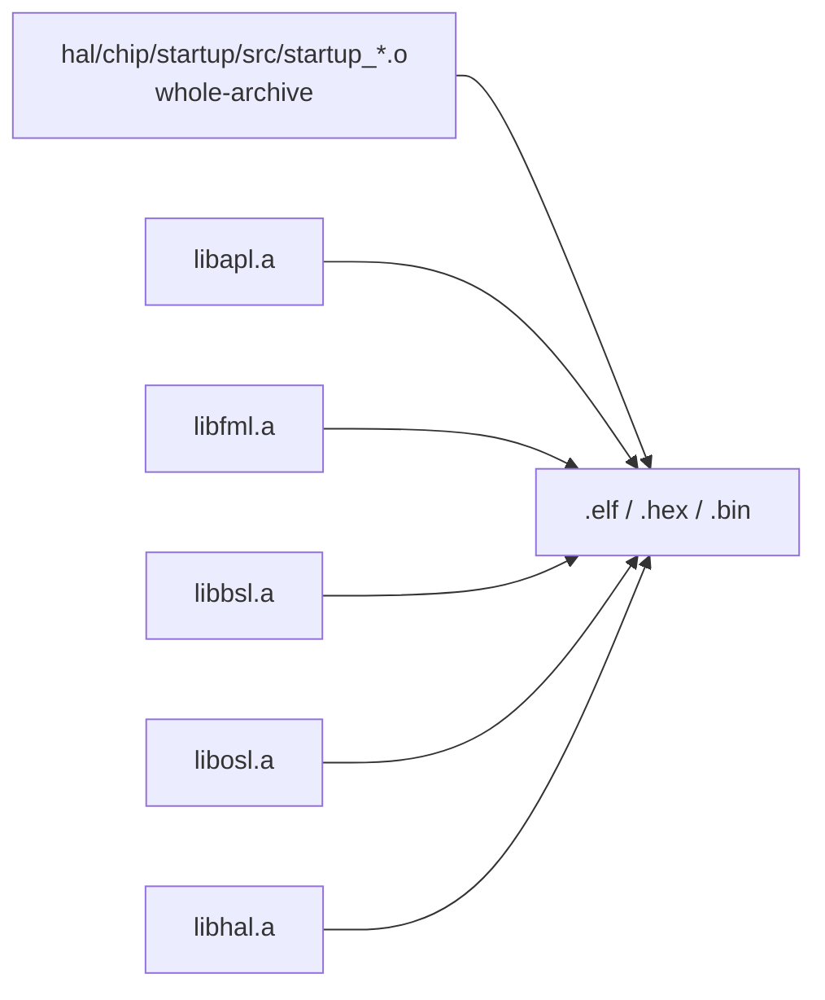

# 工程规格（与当前代码一致）

目标 MCU：**STM32F429IGT6**（Cortex-M4，硬浮点）。工程名默认取**根目录名**（`CONFIG_PROJECT_NAME`）。

本文合并原 **工程规格** 与 **设计手稿**：构建契约、verify 说明与搭建 checklist（含框架图）均以本文为准；给人读的简版见 `doc/design/`。

## 目录

| 目录 | 作用 |
|------|------|
| apl / fml / bsl / hal / osl | 各编 `lib<名>.a`，再链接固件（**bsl**：板级支持，如 LED/按键等板级封装，依赖 hal） |
| 各模块 `src/`、`inc/` | C/C++/汇编源文件放入 `src/`；头文件放入 `inc/`。例如 `apl/src/`、`hal/periph/src/`、`hal/periph/inc/`、`hal/chip/register/inc/`、`hal/chip/startup/src/` |
| proj | `project-info.json`、`project_defconfig` |
| build | `contracts.py` / `generate.py` / `verify.py` / `build.py`（编译 CLI + `install-toolchain`/`set-buildenv`）/ `environment.py`（工具链库）；工具链配置生成到工程根目录 `toolchain.make` |
| out | 解析后的 `.config`、目标文件与发布产物 |
| out/release | 打包输出（`out/release/<YYYY_MM_DD-HH_MM_SS>/*.bin/.elf/.hex/.map`，每 5 日窗口一个子目录），与 `out` 同类：由构建产生，不入库、不参与源码树扫描 |
| hal/chip/linker | MCU 链接脚本（从该目录中选择与 CPU 型号匹配的唯一 `.ld` 文件） |
| tool | `tool/win_x86_64` 与 `tool/linux_x86_64`：Arm 交叉工具链、OpenOCD（`bin/openocd` + `openocd/scripts`）；Windows：`openocd/Drivers/stsw-link009_v3`（WinUSB）；Linux：`openocd/Drivers/stlink_udev`（udev，规则源 `contrib/60-openocd.rules`）；可选 `cubeprg/`；缓存 `tool/.cache/`（见 [搭建环境.md](../doc/design/搭建环境.md)） |
| doc / workspace | 文档与 VS Code 工作区 |
| flash | 刷机与环境（`flash/flash.py`：OpenOCD 安装/刷写/GDB 服务器；依赖 `build/environment.py`） |
| tests | 可选 host 侧辅助目录（不参与交叉编译、不进镜像；`update` 不得往里生成 Makefile/Kconfig） |

### 层依赖

层依赖方向为“上层依赖下层”，由 `build/contracts.py` 的 `LAYER_DEPENDENCIES` 生成根 Makefile 的目标依赖：

```text
apl → fml, bsl, osl（应用使用 FreeRTOS 等 OS 层 API 时；板级初始化/时钟这类板级事实走 bsl 门面 `board_system_init()`，apl 直连 hal 即越级，由 `collect_layer_dependency_errors()` 判）
fml → bsl, osl（功能模块需 FreeRTOS 任务时；fml 只用 bsl 的板级 API，直连 hal 即越级——这条边原先是 `bsl, hal, osl`，但 fml 对 HAL 符号零使用，敞着等于允许绕过 bsl）
bsl → hal
osl → hal
启动汇编位于 `hal/chip/startup/src/`，单独参与最终链接
```

因此构建某层时会先构建其依赖层；依赖层缺席时会自动忽略该边。修改依赖图后运行 `python3 build/build.py update` 刷新生成物。

**扫描排除**：`doc`、`flash`、`proj`、`tool`、`build`、`workspace`、`out`（含 `out/release`）、`tests`、点目录、`__pycache__`。

顶层出现**空目录**时不判为未知目录（空目录 git 根本不跟踪，checkout 后不会存在），只有里面真放了文件才报“未识别的顶层目录”。

## 脚本

| 脚本 | 子命令 / 选项 |
|------|----------------|
| `build/build.py` | `update` · `verify` · `build` · `clean` · `gate-selftest` · `install-toolchain` · `set-buildenv`；`-h` |
| `flash/flash.py` | 默认无子命令即刷写；`install-openocd` · `install-stlink-driver` · `set-buildenv` · `flash` · `debug-server` |

### `build/build.py` 环境子命令

| 子命令 | 作用 | 常用选项 |
|--------|------|----------|
| `install-toolchain` | 解压 Arm GNU 到 `tool/<平台>/`（**合并**，不清空已有 tree） | `--version` · `--make-only` · `--from <Git\\usr\\bin>`（Windows） |
| `set-buildenv` | 检查或打印**工具链**环境变量 | `--check` · `--print bash\|powershell\|json` |

### `flash/flash.py` 子命令（与代码一致）

| 子命令 | 作用 | 常用选项 |
|--------|------|----------|
| `install-openocd` | 解压 xPack OpenOCD 到**同一** `tool/<平台>/`（`merge_tool_tree`，不会 wipe 工具链） | `--platform win_x86_64\|linux_x86_64`（可多次）· `--all-platforms` |
| `install-stlink-driver` | Windows：`Drivers/stsw-link009_v3` + `dpinst`（**需 UAC**）；Linux：`Drivers/stlink_udev/install_udev.sh` → `/etc/udev/rules.d/99-stm32-openocd.rules`（**需 sudo**） | 无 |
| `set-buildenv` | 打印**工具链 + OpenOCD** 环境（`apply_flash`） | `--print bash\|powershell\|json` |
| （默认）/ `flash` | OpenOCD 刷 `out/object/target/<工程名>.elf`（verify reset exit） | `--interface` · `--target` · 可选 ELF 路径 |
| `debug-server` | 前台 OpenOCD（GDB 3333） | 同上 |

环境变量（可选）：`STM32_TOOLCHAIN_ROOT` · `STM32_TOOLCHAIN_PREFIX` · `STM32_OPENOCD_ROOT` · `STM32_GIT_USR_BIN`。CI **不**安装 OpenOCD、不跑 `flash`（无硬件）；刷机流程仅本地文档与人工验证。

### 产物路径（刷机 / 调试）

- **链接输出（权威）**：`out/object/target/<CONFIG_PROJECT_NAME>.{elf,hex,bin,map}`；`flash/flash.py` 默认 ELF 与此一致（读 `project-info.json` 的 `project_name`）。
- **发布快照**：`build` 另拷镜像四文件到 `out/release/<时间戳>/`，供归档；刷机可用 hex/elf 任一，推荐 ELF 以便 verify。

## 工程设计手稿（搭建与生成链）

### 何时阅读

| 场景 | 读本文件「手稿」章节 | 其它 |
|------|----------------------|------|
| 从零复制/搭建工程骨架 | 是 | `doc/design/系统设计.md` 第一部分 |
| 日常编译、加源文件 | 否 | [SKILL.md](./SKILL.md) |
| 修改 `build/generate.py` 或 `build/contracts.py` | 是 | 必须同步更新本文「目录 / 脚本 / 自检」 |

### 工程框架图

#### 仓库目录（构建 vs 非构建）

```text
demo/                          # 工程根（PROJECT_ROOT，CONFIG_PROJECT_NAME 默认取目录名）
├── apl/ fml/ bsl/ osl/            ← 各层参与编译，各产 lib*.a
│   └── src/ inc/                  ← 源文件与头文件分开存放
├── hal/                            ← HAL 与芯片支持层
│   └── src/ inc/                  ← 源文件与头文件分开存放
│   └── chip/linker/               ← MCU 链接脚本（不生成 Kconfig / Makefile）
├── proj/                      # 配置：project_defconfig、project-info.json
├── build/                     # build.py + environment.py；generate/verify/contracts
├── toolchain.make             # 自动生成的工具链配置
├── tool/                      # win_x86_64 / linux_x86_64（工具链 + OpenOCD）
├── out/                       # .config、object/target、release、tmp
├── flash/  tests/  doc/  workspace/
├── Makefile  Kconfig          # 根入口（自动生成）
└── ...
```

#### 分层架构（代码依赖方向）

上层可调用下层；下层不应反向依赖上层。



构建依赖由 `build/contracts.py` 的 `LAYER_DEPENDENCIES` 生成到根 Makefile；`apl` 经 `board_system_init()` 使用 `bsl`，直连 `hal` 由 `collect_layer_dependency_errors()` 判越级。CMSIS 启动汇编位于 `hal/chip/startup/src/`，单独参与最终链接。

#### 构建与生成链



#### 链接模型（`.a` → 固件）

**链接顺序 ≠ 复位后谁先执行**；运行时仍从 `Reset_Handler` 进入。



链接顺序（消费者在前）：

```text
-Wl,--whole-archive  hal/chip/startup/src/startup_stm32f429xx.o  -Wl,--no-whole-archive
  → -Wl,--start-group  libapl.a → libfml.a → libbsl.a → libosl.a → libhal.a  -Wl,--end-group
```

顺序反了时 ld 不会回头解析归档，可能链接出空壳镜像；**静态库中不得有 `main` 的弱定义**。

#### 复位后执行时间线

```text
Reset_Handler → SystemInit() [仅寄存器，先于 RAM 初始化]
  → 初始化 .data / .bss → __libc_init_array() → main()
       → osl_health_init() → board_system_init() → 起 fml 任务 → vTaskStartScheduler()
  → 运行期：vApplicationTickHook、fault 入口
```

### 搭建 checklist

1. **Git**：`.gitignore` 至少忽略 `out/object/`、`__pycache__`、`tool/.cache/`。
2. **目录**：`apl` `fml` `bsl` `hal` `osl`、`doc` `proj` `build` `tool` `workspace`。
3. **`build/`**：`build.py` / `environment.py` / `contracts.py` / `generate.py` / `verify.py`；**不参与** Kconfig 扫描。
4. **生成链**：见上文「脚本」「Kconfig / defconfig」「构建生成物」；`project-info.json` 按 STM32F429IGT6 填写。
5. **CMSIS 启动**：`Reset_Handler` → `SystemInit`（不能写全局变量）→ RAM 初始化 → `main`；时钟在 `board_system_init()` / HAL。`.ccmram` 默认丢弃，见链接脚本 `/DISCARD/`。
6. **文档同步**：见 [文档维护.md](./文档维护.md) 与 [SKILL.md](./SKILL.md)。

## 自检（verify）

- **`update` 结束时会自动调用 `verify`**；也可单独运行 `python3 build/build.py verify`。
- 校验生成物（Makefile、链接行、`project_defconfig`、`out/.config`、根目录 `toolchain.make`）、`project-info.json` 与根目录名、层目录与链接库名，以及 `.skills/工程规格.md`、`SKILL.md` 是否与 `STATIC_LIB_DIRS` / `NORMAL_LINK_LIBS` 及当前树一致。
- 校验 `out/object/**/*.d` 里记录的依赖路径是否仍然存在。`.d` 存的是绝对路径，工程整目录搬到别的机器/根路径后 make 会“看不见”头文件变化（实测：改了 `FreeRTOSConfig.h`，`tasks.o` 仍是三天前的产物，全程无提示）。命中时按提示先 `clean` 再 `build`。
- **校验硬件异常入口**：`osl_panic.c` 是否定义四个 fault handler、startup 是否仍保留弱别名（静态，`update` 内也跑）；产物里四个入口是否为强符号 `T` 且地址不等于 `Default_Handler`（`build` 链接后跑）。这条缺口以前完全静默：异常真的落到 `b Infinite_Loop`。
- **校验文档路径**：`.skills/` 与 `doc/` 下 Markdown 里**两种写法**都必须存在——反引号包住的仓库相对路径（`` `doc/x.md` ``），以及方括号加圆括号的 Markdown 链接（含 `./`、`../` 相对形式，按所在文件目录解析）。历史上曾把工具链文档指到一个根本不存在的 md，又把开发环境文档漏掉 `design/` 前缀；更严重的是第一版只查反引号，链接形式一条都不查，攒出 14 条点开即 404 的相对链接而 `doc-reference` 组照样全绿。裸文件名、`tool/`、`out/`、`examples/`、`doc/reference/` 前缀不判。**计划文档的例外**：写「还没创建的文件」是合法意图，不是写错——只要在反引号路径后**紧邻同一行**写 `（待建）`（或 `(planned)`）即放过这一条。标记必须紧邻，不认「本行任意位置出现『待建』就整行放过」（一句话同时提到已存在与待建文件时，前者会被一起漏检）；也不引入文件级白名单，`doc/` 仍默认全查。此前 `osl模块拆分计划.md` 阶段 3 的 `osl/newlib_port.c`（待建） 就卡在这里，而把它写成 `osl_newlib_port.c`（下划线不匹配 `osl/` 前缀）又能静默绕过——同一条判据既误伤计划文档、又可被写法规避。
- **校验 BSP 接入**：产物里必须能找到 `board_key_init`、`board_key_pressed`、`board_beep_init`、`board_beep_set`。这条针对“实现写完但没人接”的假绿：源码、头文件、`libbsl.a` 全在，可是零引用时 `-Wl,--gc-sections` 会把整段丢弃，板上有按键却按不动，且没有任何报错。触发条件：`fml_button_start()` 被 `main()` 调用（`apl/src/main.c`）。
- `verify` 默认只查生成物与规格文本，不看产物；镜像内容由 `build` 末尾的产物断言把关（见「静态库与链接顺序」）。`verify --artifacts` 可对现有 elf 补跑。
- **三档强度必须分清**（只跑 `build` 会漏断言）：`update` 跑 23 条纯静态断言；`build` 末尾追加 **16 条**产物断言（`collect_artifact_errors` / `heap_artifact` / `lib_member` / `freertos_unit` / `unlinked_member` / `fault_artifact` / `observ_artifact` / `bsp_artifact` / `persist_record` / `boot_init` / `tick_source` / `startup_guard` / `last_write` / `panic_order`）—— 这一组与 `verify` 的 `check_symbols` + `artifacts` 分支**逐条对齐**，所以「`build` 绿」现在**等于**「全部产物断言绿」；`verify --artifacts` 另外还会重跑那 23 条纯静态断言（合计 39 条判定；对应 49 个 `collect_*_errors` 函数（现态，以 `verify.py` 为准） —— `collect_verify_errors` 已按类拆成 6 个，判定条数不变；第四轮新增 `collect_panic_scene_errors()` 后由 42 变 43，第七轮新增 `collect_hal_assert_errors()` / `collect_health_writer_errors()` 后由 43 变 45，本轮新增 `collect_newlib_preboot_errors()` 后由 45 变 46）。**本轮在已有 collector 内部追加了四类判据**（N0 的 `panic_record_t` 字段级 + 落盘级、N1 的 `watchdog_started` 守卫计数、N2 的槽号↔任务身份、N4 的 `HAL_Init` 返回值），`collect_*_errors` 函数数仍随代码演进；**门禁组数以 `gate-selftest --list` 为准**（断言覆盖自检在 `--list` 前跑）。**`verify` 默认还跑 `collect_verify_errors()` 的 64 条工程结构判据**（`collect_layout_errors` / `collect_makefile_errors` / `collect_config_errors` / `collect_topology_errors` / `collect_doc_contract_errors` / `collect_newlib_preboot_errors` / `collect_doc_count_errors` 七类，按 `VERIFY_COLLECTORS` 顺序汇总；第七类 11 条专守 `doc/design/系统设计.md` 第二部分的层边处数）；这 64 条与上面 39 条是两套东西，`update` 那 23 条不含它们。历史：本轮之前 `build` 只跑 9 条，`collect_lib_member_errors` / `collect_observ_artifact_errors` / **`collect_tick_source_errors`（12 条 append、反汇编级）** 三条**只在 `verify` 里跑**，本地只跑 `build` 会漏 —— CI 因为跑 `verify --artifacts` 才没漏。要连静态断言一起判定，仍要再跑一次 `verify --artifacts`。
- **binutils 不可用时短路，不许成批假红**：`run_tool()` / `run_tool_args()` 执行失败只返回空串，下游会把「拿不到输出」当成「符号不在镜像里」。`verify` / `build` 的产物段现在先跑 `artifact_tool_errors()`——**实际执行一次 `nm`/`objdump` 的 `--version` 判可用**，而不是只判文件在不在（`tool/` 下同时有 `linux_x86_64` 与 `win_x86_64`，另一平台的同名二进制在 Windows 上会 `OSError`，存在性判断会误判为可用）；不可用时只报**一条**根因并跳过全部符号级断言。实测：把 `tool/win_x86_64` 移走后，旧行为报 8 条「产物里没有 `g_tick_ms` / 找不到 `SystemClock_Config` 的函数体 / 没有 `g_last_write` ……」，根因「无法执行 nm」埋在最后一条；改后只报 1 条。同一处还修了 `tool_binary()` 的回退 glob：按主机平台过滤（`environment.host_toolchain_dirname()`），不再跨平台取二进制。
- 失败时退出码非 0，并列出待修正项；Agent 维护流程见 [SKILL.md](./SKILL.md)「更新后自检」。
- **门禁自测**：`python build/build.py` 给每一组"会静默消失"的断言各造一个最小破坏（flags 依赖 / `-Wl,-u,_sbrk` / `_Min_Heap_Size` 与产物边界 / BSP 接入 / `Default_Handler` 跳转），要求 `verify` 以非零退出并打出预期关键字，再原样还原。理由：这些断言在代码本来就正确时永远是绿的，**绿一次不能证明它在该报错时会报错**。每组各占一行 PASS/FAIL；**组名与组数以 `gate-selftest --list` 为准**（勿在文档里硬编码过期数字）。改任何一组断言后都应重跑对应 `--only <组>`；`--keep-going` 可选。历史全量耗时与 CI job 数见 [系统设计.md](../doc/design/系统设计.md)「CI / 门禁」与 `.skills/架构缺陷.md`。其中 heap-bound 故意只改链接脚本文本、不重链接，所以产物的 `__heap_start__`/`__heap_end__` 间距仍是旧值（512 B），断言必须报出「实际 512 字节，但脚本声明 1024 字节 …已不一致」。

根目录 `toolchain.make`：若存在 `tool/linux_x86_64/bin/arm-none-eabi-gcc` 或 `tool/arm-gnu-toolchain-*/bin/arm-none-eabi-gcc`，则 `PREFIX` 指向工程内工具链，否则使用 PATH 中的 `arm-none-eabi-`。同一文件按 `OS == Windows_NT` 定义 `PYTHON := python`（否则 `python3`），供各层编译规则末尾的时间戳回写使用：Windows 下 MSYS `sh` 里的 `python3` 往往是失效别名（实测退出码 49），会让**每一个被重新编译的文件**报 `Error 49`。

## 发布构建（`make release`）与体积上限

同一份源码有两套编译档位，都在 `toolchain.make` 里：`OPT ?= -Og` / `DEBUG ?= -g3`（`?=` 而不是 `:=`，命令行能覆盖），默认就是调试态；根 `Makefile` 的 `release:` 目标跑 `-Os -g1`。

- **`release` 目标必须带 `-B`**。`OPT`/`DEBUG` 走命令行覆盖不改 `toolchain.make` 的 mtime，各 `.o` 只依赖 `FLAG_DEPS`，而不带 `-B` 时 make 判定 elf 最新、拿 `-Og` 的旧对象重链一遍：实测打印 `up to date`、退出 0、`text` 仍 10980，产物根本没变。这是**静默假绿**，不是「省了一次编译」。
- **两边实测**：调试态 `text 10980` / `data 16` / `bss 18400`；发布态 `text 9768` / `data 16` / `bss 18400`（相对 `-Og` 小 1212 B，−11.0%），`make release` 23.2 s。
- **档位必须由独立事实来源判定**：`all:` 目标写 `out/object/.buildflags`（内容如 `OPT=-Og DEBUG=-g3`），`_artifact_is_release_build()` 只读这个文件。**不能读 map 判档位** —— map 里有没有 `libgcc.a(_aeabi_ldivmod.o)` 恰恰是判据本身，用它判档位等于让破坏态自证清白；读不到标记一律按 `-Og` 处理（宁可报红）。
- **`_aeabi_ldivmod.o` 按档位容忍**：`LIB_MEMBER_RELEASE_ONLY = {"libgcc.a": ("_aeabi_ldivmod.o",)}`，只有 `release_build` 为真时才并入 `tolerated`；默认 `-Og` 出现它仍是缺陷（HAL_RCC 的 64 位频率计算在 `-Og` 下被折叠成常数，`-Os` 下不折叠，落到 libgcc 软件除法，`.text 0xc9`）。**不许把它直接放进 `LIB_MEMBER_WHITELIST`**：`hard-gate` 组正是用「main 加 int64 除法」探测这条判据，一律放行会把它的检测点吃掉（实测 42 组全量变成 41 PASS / 1 FAIL）。
- **双轨制：指令形态判据只在调试档位（-Og）强制，发布档位（-Os）跳过而不是降级**。`-Os` 下这 3 条按指令形态写死的判据必然假红：`osl_reset_cause_capture` 的条件早退、`osl_panic_report` 的重入闸置位（`movs #1` + `str`）、`iwdg_wait_sync` 的独立符号——`-Os` 会内联/折叠掉它们。处理方式是 `_skip_on_release_build(说明)`：仅当 `_artifact_is_release_build()` 为真时返回 True，`verify` 结尾逐条打印 `[跳过] …`（**跳过必须留痕，否则和「真的通过」在输出上长得一模一样**）。**不许把判据降成符号级**：这三条守的机制恰恰都是「符号一直在、语义没了」型（`osl_panic_report` 的符号永不消失），符号级判据对它们分辨力为零，降级等于用更弱的判据冒充强度没降。所以 `-Og` 下这三条仍逐条强制，破坏仍要红：`boot-init` 215.0 s、`panic-order` 171.9 s、`iwdg-str` 148.6 s，三组实测 PASS。原 `release` 目标的 echo 里那句「发布产物只能人工核对，不能当自检通过」已作废——发布档位 `verify --artifacts` 现在 EXIT=0 并列出 3 条跳过项。另外给 5 个机制函数加的 `__attribute__((noinline))`（`osl_boot.c` 的 `osl_reset_cause_capture` / `iwdg_wait_sync` / `osl_watchdog_feed` / `stack_guard_check`，`osl_panic.c` 的 `osl_panic_report`）把 `-Os` 下 6 条红压到 3 条：`-Og` 下 `text` 仍 10980（基线一字未变），`-Os` 下 +32 B（9736 → 9768）。这 5 处禁内联是否长期保留未拍板：撤掉它，`-Os` 下会多 4 条红。
- **这条路线会到顶**：靠 `objdump` 匹配具体指令的判据越加越多（`add #1`、`bl stack_guard_check`、`bl osl_watchdog_feed`、`movs #1` + `str`、`cmp #7`、条件早退分支、`iwdg_wait_sync` 的 `str`），每一条都把门禁焊死在一个优化档位上——换 `-O2` 或换编译器版本会再撞一批。双轨制是现在的兜底答案；更彻底的做法是改成运行时可观测（用 panic/健康记录里的字段做判据，不绑编译器），但要在 QEMU 或真板上验证，成本高一个量级。新增这类判据前先想清楚它属于哪条轨。
- **手工调 `make` 必须给 `SHELL=`**：`make` 不在 PATH，且不加 `SHELL=D:/Users/Local/stm32-freertos/tool/win_x86_64/bin/sh.exe` 会报 `/bin/sh: No such file or directory`（Error 127）。`build/verify.py`（`gate-selftest`）里的 `find_make()` / `make_env()` 已内置这套（含 `MSYS_MOUNT = "/cygdrive/"`）。
- **只改几个源文件后直接 `build` 会得混合态**：`toolchain.make` 没变时 make 判定大部分 `.o` 最新，产出的是新旧档位混编的 elf，不能当基线读。

## 构建生成物

- `update` 生成：各层 `Kconfig`/`Makefile`、根 `Makefile`/`Kconfig`、根目录 `toolchain.make`、`proj/project_defconfig`（分类区重写 + 保留 `USER_CUSTOM`），并将 defconfig 解析为 `out/.config`。各层 Makefile 按层依赖生成头文件搜索路径，并引入本目录对应的 `.d` 文件。
- 各层编译规则统一为：`mkdir` → `echo "CC <src>"` → `$(CC) $(CFLAGS) -MMD -MP -MF <.d> -c` → `$(PYTHON) -c '<utime 回写>'`（最后一步把 `.o` 与 `.d` 时间戳刷到当前，避免时钟偏差导致反复重编）。规则正文里**不得硬编码 `python3`**，`verify` 会检查。
- 每个 `.o` 除源文件外还必须依赖 **`$(FLAG_DEPS)`**，即 `toolchain.make` 与 `out/.config`：两者一变（编译参数或功能裁剪）所有对象必须重编，否则会把不同 flags 编出的对象混进同一个镜像，链接照样成功。`FLAG_DEPS` 用 `$(wildcard ...)` 计算，因为 `clean` 之后 `out/.config` 不存在，直接列路径会让 make 报 `No rule to make target`。验收：`make -C osl/src -n -W <绝对路径>/toolchain.make all` 必须打印 `CC` 行；动手改一次 `OPT` 后直接 `make`，`.o` 的 mtime 必须变。
- 生成物写入必须“内容未变则不写”（`write_generated_text()`），并由 `restamp_generated()` 只对**本次真正写出**的文件重排时间戳。原因是 `toolchain.make` / `out/.config` 现在是 `.o` 的前置依赖：若 `update` 每轮无条件重写并刷新 mtime，增量构建会退化成每轮全量重编。`out/.config` 也不得当成“排除目录里的误生成”删除。
- **库与最终镜像必须是真文件目标，不能挂在 PHONY 的 `all` recipe 里**：旧写法是 `all: $(LOCAL_OBJS)` 后面无条件 `rm -f` + `AR rcs`，根 `all` 的 recipe 里无条件 `LD` / `objcopy`。结果：`.a` 的 mtime 每次构建都变 → 顶层必然重链 → `.elf`/`.hex`/`.bin` mtime 每次变，零改动的一次 `build` 仍打印 `AR libfml.a` / `AR libapl.a` / `LD`（实测 24.1 s）。现在的形状：
  - 各层（`is_lib`）：`all: subdirs` + `@$(MAKE) --no-print-directory $(LIB)`；`$(LIB): $(ARCHIVE_OBJS)`，recipe 里 `mkdir -p` / `echo "AR $@"` / **`rm -f $@`（放在有更新的分支里，防止归档残留已删成员）** / `$(AR) rcs $@ $(ARCHIVE_OBJS)`。
  - 根：`all:` 无依赖，recipe 两段 —— `@$(MAKE) modules`，再 `@$(MAKE) --no-print-directory $(ELF) $(HEX) $(BIN)`，最后 `SIZE`。`$(ELF): <startup .o> <5 个 .a> $(LDSCRIPT) $(PROJECT_ROOT)/toolchain.make`（链接脚本**与链接参数**都进依赖：改 `.ld`、或改 `LDFLAGS` 里的 `-u` / `--specs`，都必须重链。漏掉 `toolchain.make` 时，`.o` 恰好都比 elf 旧的那次 make 会跳过重链，`write` 组就拿旧镜像假绿 —— 实测同一份代码单跑 PASS 120.3 s、全量 FAIL），`$(HEX)` / `$(BIN)` 依赖 `$(ELF)`。
  - **不能把 `modules` 和 `$(ELF)` 并列写进 `all` 的依赖**：`make -j4` 会并行启动 `$(ELF)`，而 `.a` 还没生成、又没有本目录内规则，make 直接报 `No rule to make target`。同理有子目录的层用 `all: subdirs` + 二次 make，而不是 `all: subdirs $(LIB)`。
  - 实测（2026-11-07）：连续两次 `python build/build.py build`，第二次 `AR`/`LD`/`CC` 行数为 **0**，耗时 22.0 s（首次全量 24.5 s）。注意时间收益只有约 8%：剩余开销主要是 5 层递归 make 的进程启动 + `update` 的静态自检，不是链接本身；这条修复的真实价值是“产物 mtime 不再每轮乱变”，下游按 mtime 判断新旧的东西不会再被误触发。
- 目录中直接包含 `.ld` 链接脚本时，该目录不参与 Kconfig / Makefile 扫描，也不生成这两类文件。
- **纯头目录不生成 Kconfig / Makefile**：一个目录若既没有源文件、也没有子目录（`bsl/inc/`、`fml/inc/`、`apl/inc/`、`hal/arch/inc/`、`hal/chip/register/inc/`、`hal/chip/startup/inc/`、`hal/periph/inc/`、`osl/inc/freertos/portable/GCC/ARM_CM4F/` 这 8 个），它就只需要 `-I`，不需要自己的构建描述 —— 此前也各生成了一份，产物是 `LOCAL_OBJS :=` 空 + 重列 include + `clean` 删一个不存在的目录，外加一条 `comment "无子目录、无源文件"`，8 目录 × 2 文件共 16 个纯噪声（`apl/inc/` 连头文件都没有）。判定由 `needs_build_metadata()` 做（`ROOT` 恒真，否则看 `list_sources()` 或 `child_dirs()`）；**只改生成端，不改 `walk_dirs()`** —— `header_dirs()` 走的是同一遍历，从遍历里剔掉这类目录会连 `-I $(PROJECT_ROOT)/bsl/inc` 一起消失，编译立刻断。父目录 `Kconfig` 的 `source`/`if` 与目录 `Makefile` 的 `subdirs` 也要按同一判定过滤，否则会 `make -C` 进一个没有 `Makefile` 的目录；`project_defconfig` 收起符号时同样跳过。`update` 会把这类目录里带 `GEN_BANNER` 的残留删掉，`collect_layout_errors()` 断言它们**不该**存在。
- 链接脚本从 `hal/chip/linker/` 按 CPU 型号选择；该目录必须有且仅有一个适用 `.ld` 文件，不会自动生成链接脚本。
- 中间文件：`out/object/`（含 `.o`、`.d`、`.su`、`<工程名>.map`）。
- 警告门禁：`CFLAGS` / `CXXFLAGS` 里有 **`-Wall -Wextra -Werror`**。三个 flag 全开时全仓实测 0 条真实告警（上游 FreeRTOS 10.3 与 HAL 1.27 在这套配置下是干净的），所以不需要 `-Wno-*` 白名单；一旦有人加了会告警的代码，构建直接失败而不是留到最后。新增代码若确实无法避免某类告警，先在提交里说明再考虑局部 `#pragma GCC diagnostic`，不要整体降级到 `-Wall`。
- 栈用量：同一行里的 **`-fstack-usage`** 让 GCC 给每个编译单元写一个 `.su`（与 `.o` 同目录），格式 `<源文件>:<行>:<函数>\t<栈字节>\t<static|dynamic|bounded>`。它只是元数据，不参与链接；`clean` 随 `out/object` 一起删。用法示例（找最吃栈的函数）：
  ```powershell
  Get-ChildItem -Recurse out\object -Filter *.su | Get-Content |
    ForEach-Object { $p = $_ -split "`t"; [pscustomobject]@{F=$p[0]; B=[int]$p[1]} } |
    Sort-Object B -Descending | Select-Object -First 10
  ```
  注意 `-fstack-usage` 只统计**本函数自己的帧**，不含被调函数；判断某任务的最坏栈要沿调用链累加。实测（2026-11-07，`-Og`）最大的是 `SystemClock_Config` 88 B，其余都 ≤ 48 B。
- 产物：`out/object/<工程名>.{elf,hex,bin,map}`；`build` 结束后**只把 `.elf` / `.hex` / `.bin` / `.map` 复制到 `out/target/`**。静态库（带 `-g3` 的 `libhal.a` 等近百 MB）属于中间物，不进发布目录。

## 源文件、头文件与自动依赖

- 所有模块源文件按职责放入模块的 `src/`，头文件放入对应 `inc/`；子模块也遵循相同约定。
- 生成器递归扫描 `src/` 中的源文件和 `inc/` 中的头文件；各层 Makefile 的 `INCLUDE_DIRS` 仅包含本层及其传递依赖层的头文件目录。
- GCC 使用 `-MMD -MP` 为每个源文件生成 `out/object/<层>/<文件>.d`；对应目录的 Makefile 通过 `-include` 引入自己的 `.d` 文件。
- `Depend.make` 已移除；头文件搜索路径和 `.d` 依赖分别由各层 Makefile 管理。

## Kconfig / defconfig

- 有**子目录** → 配置项用**子目录名**；无子目录有源文件 → 用**源文件名**（stem）。
- 某目录一旦出现子目录，**同目录源文件**不再单独占 Kconfig 项，随该目录开关编译。
- 直接包含 `.ld` 文件的目录视为链接脚本目录，跳过扫描。
- `project_defconfig` 末尾 **`# >>> USER_CUSTOM` … `# <<< USER_CUSTOM`**：`update` 不覆盖；其中屏蔽的宏不在上方自动区创建。

### 有效配置 `.config`（仅 `out/`）

| 文件 | 位置 | 说明 |
|------|------|------|
| `project_defconfig` | `proj/` | 人工维护 + `update` 重写的分类区；**真源** |
| `.config` | **`out/.config`** | `update` 时由 `project_defconfig` **解析生成**；根与各层 Makefile 通过 `-include $(PROJECT_ROOT)/out/.config` 加载 |
| （勿用） | `build/.config`、工程根 `.config` | 历史残留；`update` 会删除 `build/.config`，`verify` 报错 |

改 Kconfig 或 `project_defconfig` 后须 **`python3 build/build.py update`**，才会刷新 `out/.config` 并参与编译。

## 静态库与链接顺序

链接命令（根 `Makefile` 自动生成，逻辑在 `build/build.py`）：

1. **`hal/chip/startup/src/startup_*.s` 对应 `.o`**：`--whole-archive`（保留向量表与 `Reset_Handler`）。
2. 普通库顺序：**apl → fml → bsl → osl → hal**（消费者在前、提供者在后），并用 `-Wl,--start-group … -Wl,--end-group` 包裹，让 ld 反复扫描该组归档。
3. 启动汇编不进入 `libhal.a`，避免在静态库中丢失向量表。
4. `LDFLAGS` 里带 `-Wl,-Map=$(BUILD_DIR)/$(PROJECT_NAME).map`，map 与 elf 同目录，用于事后审计 Flash 组成。

### 两条必须守住的约束

- **顺序**：ld 单遍扫描归档，只用“当时仍未定义的符号”去拉取成员。把 `hal` 放在最前时，`apl/fml/bsl` 需要的符号在其后再无人解析。
- **静态库中不得存在 `main` 的弱定义**：`hal/chip/startup/src/system_stm32f4xx.c` 曾保留 ST 模板的 `__attribute__((weak)) int main(void)`，它会先满足启动对象对 `main` 的引用，使 `libapl.a` 的强 `main` 永不被提取，最终产出仅 608 字节的空壳镜像。该弱定义已删除，请勿恢复；确需“单独编译该文件”时用构建宏区隔。
- **产物断言**：`build` 在链接后、复制产物之前校验四项，任一不满足即失败退出且不复制：
  1. `arm-none-eabi-nm` 中 `main` 与 `vTaskStartScheduler` 均为 `T`（强符号）；
  2. `.text` 不低于 2048 字节（防空壳镜像）；
  3. `text + data` 不超过链接脚本 `MEMORY` 的 `ROM` 容量；
  4. `data + bss` 不超过 `RAM` 容量（`size` 的 `bss` 已包含 `._user_heap_stack` 预留）。
  容量取自链接脚本 `MEMORY` 块实时解析，改容量不必改断言。`verify --artifacts` 可对现有 elf 复跑同一断言。

## 启动约定

| 文件 | 说明 |
|------|------|
| `hal/chip/startup/src/startup_stm32f429xx.s` | 向量表、`Reset_Handler`，并调用 `SystemInit` 与 `main` |
| `hal/chip/startup/src/system_stm32f4xx.c` | **仅 STM32F429**：`SystemInit`（FPU / 可选 FMC / VTOR）、`SystemClock_Config`、`SystemCoreClockUpdate`；**不含 `main` 弱定义** |
| `apl/src/` | 提供应用入口 `main`（唯一的强定义） |

`system_stm32f4xx.c` 仅供 **STM32F429**；**不提供** `main` 弱定义。时钟**实现**在 hal、**编排**在 `board_system_init()`（bsl）。
链接脚本定义 CMSIS 启动代码需要的 `_sidata`、`_sdata`、`_edata`、`_sbss`、`_ebss` 符号。

`.ccmram` 段**当前不启用**：链接脚本把 `*(.ccmram*)` 放进 `/DISCARD/`，而 startup 只搬 `.data`、只清 `.bss`（CCMRAM 的拷贝/清零循环从未实现）。因此往 `.ccmram` 放已初始化变量现在会在**链接期直接报错**（`defined in discarded section '.ccmram'`），而不是悄悄拿到垃圾值。要启用 CCMRAM 必须三件事一起做：补 startup 的 `_siccmram → _sccmram` 拷贝循环、补 `_sccmram → _eccmram` 清零、并删掉 `/DISCARD/` 里的两条 `*(.ccmram*)`。

这条「不启用」现在由 `collect_ccmram_state_errors()` 守：判据是三处**同态**（`.ccmram` 输出段 / `/DISCARD/` 通配 / startup 三符号），只接受全关与全开，混合态逐一报出缺件。判据前先剥注释（链接脚本 `/* */`、汇编 `@`），否则注释里提到符号名会假绿。它与 `cpu.ccm_kb == CCMRAM` 那条数字对拍是两件事 —— 后者只保证两个数字相等。

`/DISCARD/` **只对段名通配有效**：早期还写有 `libc.a ( * )`、`libm.a ( * )`、`libgcc.a ( * )` 三条「整库丢弃」规则，现已删除。GNU ld 13.3.1 对 `archive ( * )` 形式静默忽略——不报错、不告警，也不比对，实测把 `libc.a` 改成真实归档名 `libc_nano.a` 之后 `build` 仍 0 错误、`text` 10520 一个字节没少。库体积改由 `verify` 的 `LIB_MEMBER_WHITELIST` 把关：`collect_lib_member_errors()` 解析 map 里的 `archive(member)`，与白名单双向比对，多提取一个成员即报「白名单外成员」、少提取即报「按需提取却没进镜像」。

### 系统时钟与启动顺序

启动汇编的顺序是 `Reset_Handler` → `bl SystemInit` → 搬 `.data` → 清 `.bss` → `__libc_init_array` → `bl main`。
`SystemInit` **在 RAM 初始化之前**执行，所以它只能写寄存器，不能写全局变量（写了会被随后的 `.data` 拷贝 / `.bss` 清零覆盖）。

| 顺序 | 位置 | 做的事 |
|------|------|--------|
| 1 | `SystemInit`（startup 调用） | FPU、可选 FMC（`DATA_IN_Ext*`）、可选 `VTOR` |
| 2 | `main` → `board_system_init()` → `HAL_Init()` | NVIC 分组、HAL 时基（DWT） |
| 3 | `board_system_init()` → `SystemClock_Config()`（hal） | HSE 25 MHz → 168 MHz；失败 **2** → `g_boot_stage` → 码 4 |
| 4 | `board_system_init()` → `SystemCoreClockUpdate()` | 刷新 `SystemCoreClock` |

PLL 参数：`M = 25`（VCO 输入 1 MHz）→ `N = 336`（VCO 336 MHz）→ `P = 2`（SYSCLK 168 MHz）；`Q = 7` 得到 **48 MHz**，正好供 USB FS / SDIO 使用。
为什么是 168 MHz 而不是 180 MHz：25 MHz 晶振下 `360 / 48 = 7.5`，PLLQ 只能取整数，所以 180 MHz 主频给不出 48 MHz；`336 / 7 = 48` 是唯一同时满足两个条件的组合，代价是主频降 6.7%。若将来既要 180 MHz 又要 48 MHz，改用 PLLSAI 单独产生 48 MHz（不动主 PLL）。
168 MHz 的两个前提写在 `SystemClock_Config` 里：`PWR` 电压档 `Scale1` 与 `FLASH_LATENCY_5`（2.7–3.6 V）；168 MHz 不需要 over-drive（那是 180 MHz 才要开的）。

### 板级事实（取自 `doc/hardware/sch/` 原理图）

| 项 | 事实 | 出处 |
|----|------|------|
| HSE | Y2 = 25 MHz，C10/C11 = 22 pF，接 `PH0/OSC_IN`、`PH1/OSC_OUT`；`HSE_VALUE = 25000000` | `STM32F429_CORE_V2.pdf` MCU_GHI |
| LSE | 32.768 kHz（`PC14/OSC32_IN` 等，见核心板同一套图） | 同上 |
| KEY1 | `PA0/WK_UP`，按下接 3.3V ⇒ **按下 = 高电平** | `DNF429P_F767P_H743P V2.6.pdf` DEVICE2 + IO 引脚表 |
| KEY2 | `PC13`，按下接 3.3V ⇒ **按下 = 高电平** | 同上 |
| LED | `PB1` 红 / `PB0` 绿（阴极接 GPIO、低电平点亮）；码位第三位 `PB2`（无板载蓝灯） | 同上 + `bsl/src/board_led.c` |
| BEEP | `PI11` → R25(1K) → Q2(SS8050) 基极 | `DNF429P_F767P_H743P V2.6.pdf` DEVICE2 |

按键默认松开为低，`board_key.c` 用 `GPIO_NOPULL`；`pressed_level = GPIO_PIN_SET`。

**按键去抖在 `fml/src/fml_button.c`**：10 ms 采样（`FML_BUTTON_POLL_PERIOD_MS`）、连续 3 次一致（`FML_BUTTON_DEBOUNCE_SAMPLES`，共约 30 ms）才认电平并写蜂鸣器。以前没有去抖，注释写“靠任务周期天然滤掉抖动毛刺”——10 ms 只降低概率，机械抖动本身就在 1~10 ms 量级，落在采样点上时蜂鸣器会跟着咔哒。状态变量是 `stable`（已提交的电平）/ `candidate`（正在确认的电平）/ `agree`（连续一致次数）。

## HAL 配置

- 当前**只启用 6 个模块**：`HAL`（核心 `stm32f4xx_hal.c`）、`RCC`、`GPIO`、`CORTEX`、`PWR`、`FLASH`，对应 `hal/periph/src` 下 **9 个 `.c`**（含 `rcc_ex` / `pwr_ex` / `flash_ex`）。其余 34 个模块开关在 `stm32f4xx_hal_conf.h` 里注释掉，59 个逐文件编译开关在 `proj/project_defconfig` 的 `USER_CUSTOM` 区置 `n`。
- **裁剪的效果（实测）**：编译单元 85 → 26，`out/object` 202.5 MB → 50.3 MB，全量 `clean` 后 `build` 198.9 s → 131.7 s，而 `.text` 保持 **11844 字节**不变（镜像里本来就只用到 9 个 HAL 函数：`HAL_Init`、`HAL_InitTick`、`HAL_GetTick`、`HAL_Delay`、`HAL_GPIO_*`、`HAL_NVIC_*`、`HAL_RCC_*`）。
- 背景：此前 68 个驱动全量编译（201,903 行、81.5 MB `.o`）只为这 9 个函数服务。`-Wl,--gc-sections` 只省镜像体积，**不省编译时间与磁盘**——这是本工程最大的一笔构建浪费。
- HAL 模块开关**只有这一处**（Kconfig 只管"哪个文件参与编译"，不重复定义模块开关）；但同一文件底部还有一列 `#ifdef HAL_X_MODULE_ENABLED / #include "stm32f4xx_hal_x.h"` 块，再加上 `hal/periph/src/stm32f4xx_hal_x.c` 与编出来的 `.o`，一共四处要对得上：

| 位置 | 漏掉时的表现 | 是否会被门禁拦下 |
|------|--------------|------|
| `#define HAL_X_MODULE_ENABLED` | 模块的 `.c` 编成空对象，功能整体缺失 | 否（这是"关闭模块"的正常做法） |
| 底部的 `#ifdef … / #include …` 块 | 顶层头不引入该模块，用到时只得到**隐式声明**（指针实参被当成 int，静默出错，链接还能过） | **是**：`verify` 报"缺 `#ifdef … / #include` 块" |
| `hal/periph/src/stm32f4xx_hal_x.c` | 编译期无提示，只在链接期报 undefined | **是**：报"没有实现文件" |
| `out/object/hal/periph/src/stm32f4xx_hal_x.o` | `periph` 目录没参与编译时同样只在链接期暴露 | **是**：报"没有生成目标文件" |

- 关掉一个模块：在 `stm32f4xx_hal_conf.h` 注释 `#define …_MODULE_ENABLED`，**同时**在 `project_defconfig` 的 `USER_CUSTOM` 区写 `CONFIG_HAL_PERIPH_SRC_STM32F4XX_HAL_X=n`（否则 `.c` 照编不误，只是白花时间）。底部的 `#ifdef` 块**保留**（`verify` 把"既没启用也没注释"的守卫视为开关名拼错）。
- 打开一个模块：三处同时改 —— 放开 `#define`、删掉 `USER_CUSTOM` 里的 `=n`、确认 `hal/periph/src` 下有对应 `.c` 且底部已有 `#include` 块。三处齐了 `verify` 才放行。`USER_CUSTOM` 里出现过的符号会被 `protected_symbols()` 从自动生成区摘掉，所以 `update` 不会把你写的 `=n` 又改回 `=y`。
- 这些检查由 `build/verify.py` 的 `collect_hal_module_errors()` 实现，默认在 `verify` 里跑（不需要 `--artifacts`）。

### `USE_FULL_ASSERT` 与 `assert_failed`

- `hal/periph/inc/stm32f4xx_hal_conf.h` 中 **`USE_FULL_ASSERT` 由本工程主动启用**（关回会静默掉 HAL `assert_param`）；`hal-assert` 门禁组守着这一行。
- 实现：`osl/src/osl_panic.c` 的 **`assert_failed(uint8_t *file, uint32_t line)`** 与 FreeRTOS `vAssertFailed` 共用 `panic_assert_from()`，播报 **码 3**，写入 `g_panic_record.assert_file` / `assert_line`。
- 启用后须 `clean` 再全量 `build`（HAL 大量 `.c` 重编，`text` 约 +880 B）。
- **禁止**在 `assert_failed` / `panic_assert_from` 里调用可能再次 `assert_param` 的 HAL API。
- 判据：`collect_hal_assert_errors()`（剥注释后找 `#define USE_FULL_ASSERT    1U`）；`--only hal-assert` 破坏 = 整行注释该宏。

## osl / FreeRTOS

**osl** 承载 RTOS；当前集成 **FreeRTOS Kernel V11.1.0**（上游：[FreeRTOS/FreeRTOS-Kernel](https://github.com/FreeRTOS/FreeRTOS-Kernel)）。参与编译的是 **`osl/` 内副本**，打进 **`libosl.a`**；`tool/` 下若存在解压的 `FreeRTOS-Kernel-*` 仅为下载对照，**不参与构建**，可删。

### 目录与 Kconfig

| 路径 | 说明 |
|------|------|
| `osl/src/freertos/` | 内核源文件（`tasks`、`queue`、`list`、`timers` 等） |
| `osl/src/freertos/port_m4.c` | Cortex-M4F + 硬浮点移植（与 `toolchain.make` 中 FPU 一致） |
| `osl/src/freertos/heap_4.c` | 动态堆（首次适配 + 相邻空闲块合并） |
| `osl/src/osl_boot.c` | STM32 向量别名与 HAL 时基适配（见下） |
| `osl/inc/FreeRTOSConfig.h` | 工程侧 FreeRTOS 配置（tick、堆、中断优先级等） |
| `osl/inc/freertos/` | 内核公有头文件 |
| `osl/inc/freertos/portable/GCC/ARM_CM4F/portmacro.h` | 移植层头文件 |

- Kconfig：**`OSL_SRC_FREERTOS`**（`osl/src/Kconfig`），默认 **y**；关闭后不再编译 `osl/src/freertos/` 下源文件。
- 增删内核文件或子目录后执行 **`python3 build/build.py update`**。

### 配置要点（`FreeRTOSConfig.h`）

- **`configCPU_CLOCK_HZ`**：绑定全局变量 **`SystemCoreClock`**；改 PLL 后须 **`SystemCoreClockUpdate()`** 再启调度器。
- **Tick**：`configTICK_RATE_HZ` 为 **1000**；SysTick 由 FreeRTOS 占用。
- **堆**：`configTOTAL_HEAP_SIZE` 当前 **16 KiB**（`FreeRTOSConfig.h:55` 是 `(16 * 1024)`；可按 SRAM 调整）。
- **Cortex-M 中断**：`configLIBRARY_MAX_SYSCALL_INTERRUPT_PRIORITY` 为 **5**；高于该优先级的中断里不可调用会阻塞的 FreeRTOS API。实测现状（核查后**不是缺陷**）：自研层一个 `*FromISR` 调用都没有；唯一的周期中断由 `port_m4.c` 的 `xPortStartScheduler()` 把 SysTick / PendSV 设成 `0xFF`（最低）、SVCall 设成 `0`（正常）；`HAL_InitTick` 在本工程被覆盖成“只开 DWT 时基 + 采复位原因”，不再调 `HAL_NVIC_SetPriority(SysTick_IRQn, …)`，所以 `TICK_INT_PRIORITY = 0x0F` 只是个没人用的宏。因此 `vPortValidateInterruptPriority()` 没有调用方、被 `--gc-sections` 丢掉是**正确结果**，不是缺口——它跟着第一个 `*FromISR` 调用进场才生效。真正缺的是防回归：`collect_isr_priority_errors()` 现在扫全部源码，一旦某文件出现 `*FromISR` / `portYIELD_FROM_ISR`，就要求同一文件里有 `HAL_NVIC_SetPriority(...)` 且数值 ≥ 5，否则直接报错；同时要求 `FreeRTOSConfig.h` 必须定义 `configASSERT`（运行时兜底靠它）。这条断言只看文本、不剥注释，注释里提到这些名字同样算命中（有意的：不在构建脚本里写半吊子的 C 词法分析器）。
- **软件定时器**：`configUSE_TIMERS` 为 **0**。工程里零 `xTimer*` 使用方，开着会让 `timers.c` 整个编进来（实测 `text` 12516 → 10152，**−2364 B**；定时器任务的 128 词栈与 TCB 从 32 KB FreeRTOS 堆里动态分配，所以 `size` 报的 RAM 只降 56 B）。`configTIMER_TASK_PRIORITY` / `configTIMER_TASK_STACK_DEPTH` / `configTIMER_QUEUE_LENGTH` 一并删掉，留着只会误导。产物断言 ⑧ 守着“不得重新编进来”。**尺寸数字是采样值**：`text` 会随其它改动浮动（这里记的是 `f18e451` 关闭定时器那一次的读数，之后 N21 的堆/栈水位、N7/A1 的入口屏蔽、A4/A6 又各自改动过），不是常量。
- **向量映射**：在 `FreeRTOSConfig.h` 中将 `vPortSVCHandler` / `xPortPendSVHandler` / `xPortSysTickHandler` 映射到 `SVC_Handler` / `PendSV_Handler` / `SysTick_Handler`，覆盖启动文件中 weak 默认处理。

### 与 HAL 的共存（`osl_boot.c` + `osl_panic.c`）

### 与 HAL 的时基约定（`osl_boot.c`）

- **唯一所有者为 HAL**：SysTick 由 FreeRTOS 占用（中断里只做 `xTaskIncrementTick`），HAL 的 `uwTick` 不再被递增，因此 HAL 时基改由 **DWT 内核周期计数器**提供。
- **`HAL_InitTick`**：只做 DWT 使能（`DEMCR.TRCENA` + `DWT.CTRL.CYCCNTENA`），返回 `HAL_OK`，**不碰 SysTick**。
- **`HAL_GetTick`（两支）**：调度器**未启动**时返回 `DWT->CYCCNT / (SystemCoreClock / 1000)`；调度器**已启动**时直接返回毫秒累加器 `g_tick_ms`，由 `vApplicationTickHook()` → `osl_tick_ms_advance()` 每 1 ms 加一。分流点是 `xTaskGetSchedulerState() == taskSCHEDULER_RUNNING`，不引入新的全局开关；累加器首拍先用当时的 CYCCNT 折算值初始化，否则调度器启动那一刻 tick 会从 0 重来。
- **为什么必须分两支（两条都是现行风险）**：① `SystemCoreClock / 1000` 会随时钟切换从 16000 变 168000，同一个 CYCCNT 读数折算出的毫秒数被压小 10.5 倍 —— tick 在 `SystemClock_Config` 处**倒退**，无符号相减回绕成约 2^32，表现为「这条超时一开始就超时」，而 VOSRDY 那段等待恰好跨在这个窗口里；② CYCCNT 是 32 位按 HCLK 计数，168 MHz 下 25.6 s 回绕，`HAL_GetTick` 跟着归零。累加器标度恒定、49.7 天才回绕，两条都不再有。成本实测：`.bss` +8 B（`g_tick_ms` 4 B + `synced` 1 B，对齐 8）、`.text` +112 B；运行期路径从「`udiv` + 三次内存读（`SystemCoreClock` / `DWT->CTRL` / `DWT->CYCCNT`）」降到一次 `ldr`。
- **测量上限**：运行期由毫秒累加器提供，49.7 天才回绕；只有**启动期**仍受 `CYCCNT` 回绕限制（168 MHz 约 25.6 s），而启动期最长到调度器启动、量级是几十到几百毫秒。超时比较一律用无符号差值，回绕安全。
- **`uwTick` / `uwTickPrio` 不再维护**：`HAL_GetTickPrio()` 会返回无效值 `0xFF`；本工程不使用该语义。若将来要用 HAL 的 tick 优先级（例如为 HAL 独占一个 TIM 时基），必须显式改回 SysTick + `HAL_IncTick` 方案并同步本文。
- 覆盖是**必须守住**的：`libhal.a` 里 `HAL_GetTick` 是 `W`（弱定义）。它之所以能生效，是因为 `vApplicationStackOverflowHook` 让 `tasks.o` 引用了 `libosl.a` 的 `osl_boot.o`，该成员被无条件拉入后才以强定义压过 hal 的弱定义。**不要把钩子挪出 `osl/src/osl_boot.c`**，否则覆盖会静默失效。

### 故障可观测（在 `osl_panic.c`）

- **`g_panic_record` 在 `.noinit` 段，不在 `.bss`**：`magic` / `code` / `xTask` / `pcTaskName` / `assert_file` / `assert_line` / 硬件异常现场，外加 **`seq`（第几次 panic）**、**`reset_cause`（进 panic 前那次复位的原因）**、**`reset_csr`（`RCC->CSR` 原始值，多标志同置时回溯用）**、**`ipsr`（这次 panic 从哪儿来：0=任务上下文，>0=异常号，assert 发生在中断里时能立刻分清）**、**`wd_sync_fail`（进 panic 前 IWDG 同步等待失败次数，0 才说明 32.7 s 真的改成功）**、**`heap_free_min`（panic 时 FreeRTOS 堆的历史最低剩余字节数，`0xFFFFFFFF` = 一次都没采到；码 2 的根因读数）**、**`stack_free_min[OSL_HEALTH_STACK_SLOTS]`（panic 时每个任务栈的历史最低剩余，单位 word，`0xFFFFFFFF` = 一次都没采到；码 7 栈溢出时的真实余量）**、**`stack_slot_err`（进 panic 前槽号越界累计次数，非 0 = 有调用点写错了槽号，那次采样已丢弃）**，调试器直接读即可定位。后六个字段追加在结构体**末尾**，前面字段偏移不变（`magic` 仍是偏移 0），`.noinit` 判据不受影响。**注意：光在结构体里声明这几个字段不够**——`g_panic_record` 在 `.noinit`，而 `g_heap_free_min` / `g_stack_free_min[]` / `g_stack_slot_err` 的源变量都在 `.bss`（复位即清零），`osl_panic_report` 必须显式把值拷进记录才能跨复位；panic 上下文里栈可能已经坏了，所以这段只读全局、不调任何 FreeRTOS API。放 `.noinit` 的理由是复位后现场仍存活：`Reset_Handler` 只清 `_sbss.._ebss`，链接脚本 `stm32f429igx_flash.ld` 的 `.noinit (NOLOAD)` 在 `.bss` 之后、`._user_heap_stack` 之前，输出 `_snoinit` / `_enoinit`，并在 `_snoinit` 后留 8 B 隔离带（.bss 清零循环是“先比后写”`bcc`，隔离带是为了将来改成先写后判也不出事）。首次上电内容随机，因此**判据始终是记录自身的 `magic`**，不能拿 `seq` 当“有记录”的证据。实测（加六个字段后）：`_snoinit 0x20004128`、`g_panic_record 0x20004170`（**140 B = 0x8C**）、`_enoinit 0x200041FC`；`g_stack_slot_err 0x2000002c`（4 B）、`g_stack_free_min 0x20000030`（8 B = 2 个 slot × 4 B）、`g_heap_free_min 0x20000038`（4 B）。`.noinit` 净增 12 B（NOLOAD，不进 `bss`、不占 Flash），前面 `_snoinit + 8` 的隔离带与 `g_last_write[64]` 共 72 B 未动。
- **`g_reset_cause` / `g_reset_csr` 的消费方是 `osl_panic_report()`**：每次 panic 把当前复位原因写进 `g_panic_record.reset_cause`，`seq` 在 `magic` 有效时自增。这样“为什么重启”与“第几次重启”同时留在 `.noinit` 里，不再出现“采集了但没人读”的死全局。
- **播报前必须先把灯脚配成输出**：`panic_leds()` 只写寄存器（`MODER` = PB0/PB1/PB2 各 2 位、`OTYPER`、`OSPEEDR`、`PUPDR`），不走 `HAL_GPIO_Init`。复位后 `MODER` 是 0（输入态），只写 `BSRR` 不会驱动引脚；故障发生在 `board_led_init()` 之前（`HAL_Init` / 时钟配置阶段的 `configASSERT`、早期 HardFault、`_sbrk` 越界）时，不配 `MODER` 就会红/绿灯全灭 + 死循环，播报等于没有。
- **码表只有一份**：`osl/inc/osl_panic.h` 的 `osl_panic_code_t`，osl 与 fml 都调 `osl_panic_report()`。播报方式也唯一：PB1/PB0/PB2 三段位按 `code` 的 3 位二进制逐位闪 4 轮 → 全亮收尾 → 关中断自旋。以前 osl（1 栈溢出 / 2 malloc 失败）与 fml（1 调度器 / 2 任务创建）各一套且 1、2 撞码，现场看到“闪 1 次”分不出来源。
- **码值**：`1` 调度器启动失败、`2` 任务创建失败 / FreeRTOS 堆不足（含原 malloc 失败）、`3` `configASSERT`、`4` 系统时钟配置失败、`5` newlib 堆耗尽（见下节）、`6` 硬件异常（细分见下条）、`7` 任务栈溢出。需要区分来源时读 `g_panic_record`（`fault_kind` / `assert_file` / `task_name`），不再靠闪法。
- **`fml_panic()` 是薄封装**：只做 `osl_panic_report((osl_panic_code_t)code)`，本层不再自己闪灯，也不再调 `board_led_init()`（灯脚由 `panic_leds()` 直接配）。它仍标 `__attribute__((noreturn))`；关中断由 osl 负责——必须关，因为它可能从任务上下文调用（`fml_led_blink_start` 里 `xTaskCreate` 失败），调度器活着时 blink 任务下一拍就会把常亮翻回灭。`main` 在 `vTaskStartScheduler` 返回后补的 `for(;;)` 只是双保险。
- **`fml_panic()` 住在自己的文件里**：`fml/src/fml_panic.c` + `fml/inc/fml_panic.h`，不从属于 `fml_led`。早先它叫 `fml_led_panic` 并定义在 `fml/src/fml_led.c`，`fml_led.h` 为此 include 了 `osl_panic.h`，`fml_button.c` 又为了 `fml_led_panic(2U)` 一行调用而 include `fml_led.h`——按键模块凭空依赖 LED 模块，读名字的人以为播报含 LED 逻辑，而函数体一行都不碰 LED（反汇编实测 3 条指令 `push {r3, lr}` / `uxtb r0, r0` / `bl osl_panic_report`，共 8 B，`uxtb` 就是 `(osl_panic_code_t)code` 那道语义映射）。`collect_panic_entry_ownership_errors()` 守四件事：`fml/src/fml_panic.c` 必须存在、函数体必须出现 `osl_panic_report(`（守「本层只做语义映射，另起一套闪法会撞码」）、函数体不得出现 `board_led_` / `board_beep_`（守「panic 入口不负责执行器」）、`fml/src/fml_led.c` 不得再定义 `void fml_panic(` 且 `fml/src/fml_button.c` 不得再 include `fml_led.h`。
- **硬件异常由本工程接管**：`startup_stm32f429xx.s` 把 `HardFault_Handler` / `MemManage_Handler` / `BusFault_Handler` / `UsageFault_Handler` 都 `.weak` 别名到 `Default_Handler`（`Infinite_Loop: b Infinite_Loop`），所以必须由 `osl_panic.c` 提供强定义压过它——前提同 `HAL_GetTick` 覆盖：该文件因 `_sbrk` / `__malloc_lock` / 钩子被无条件拉进链接。实测镜像里四个入口均为 `T`，向量表 `0x0800000C`/`0x10`/`0x14`/`0x18` 分别指向它们，不再指向 `0x08000236 Default_Handler`。
- **硬件异常现场字段**：`fault_kind`（1 HardFault / 2 MemManage / 3 BusFault / 4 UsageFault）、`fault_cfsr`、`fault_hfsr`、`fault_mmfar`、`fault_bfar`、`fault_exc_return`、`fault_frame_type`、`fault_sp`，以及异常帧里的 `fault_r0/r1/r2/r3/r12/lr/pc/xpsr`。取帧时按 `EXC_RETURN` 的 bit2 选 MSP/PSP，按 bit4 选帧类型：`1` = 基本帧（8 字，R0 在 `+0x00`、PC 在 `+0x18`）、`0` = 扩展帧（26 字，硬件先压 S0..S15/FPSCR，R0 在 `+0x48`、LR 在 `+0x5C`、PC 在 `+0x60`）。M4F port 开了 FPU 且默认懒压栈，被中断的上下文用过浮点就会压扩展帧；恒按 8 字取会把 S6 当 PC。SP 不在 `_sdata.._estack`（RAM 段起点到顶端，两个符号都取自链接脚本，不再写死地址）内、或整帧（最多 `0x68`）越过栈顶则跳过取帧（栈已崩，硬读会二次 fault）。写死地址的坏处两头都不报错：判小了把合法帧判成「栈已崩」而留空现场，判大了把越界 SP 当合法去读、读本身又是一次 fault。
- **三类细分异常已开启**：`HAL_InitTick()` 里调 `fault_monitor_init()` 置 `SCB->SHCSR` 的 `MEMFAULTENA`/`BUSFAULTENA`/`USGFAULTENA`，否则三类都升级成 HardFault，`fault_kind` 分不出来。
- **三灯只闪 `6`**：LED 是 3 位编码（0..7），装不下 4 类细分，类别看 `fault_kind`。
- **`configASSERT`** 已改为调用 `vAssertFailed(__FILE__, __LINE__)`，不再原地死循环。
- **`configUSE_MALLOC_FAILED_HOOK` = 1**，堆耗尽走 `vApplicationMallocFailedHook` → `code 2`（与“任务创建失败”同码，两者都属“内存不够，东西建不出来”）。钩子会先取 `xTaskGetCurrentTaskHandle()` **判空**再 `pcTaskGetName()` 抄任务名进 record：直接传 `NULL` 会解引用 `pxCurrentTCB`，而调度器启动前那个指针还是 NULL，二次 fault 会把现场盖掉；拿不到就留空名，不猜。
- 故障指示灯直接写 `GPIOB->BSRR`，不经 HAL / 板级驱动：栈已溢出时不能再压栈调用多层函数。
- **`_write`** 最小实现：输出落到 `g_last_write[64]` 供调试器查看（本工程没有串口）。它没有调用方，`--gc-sections` 会把 `_write` 与 `g_last_write` 一起丢掉（实测旧镜像里两者都不存在，等于空承诺），所以 `toolchain.make` 的 `LDFLAGS` 里必须有 **`-Wl,-u,_write`**（`write_toolchain()` 生成），产物断言也会核对镜像里有 `T _write`。实测现镜像 `_write` 与 `g_last_write` 各 64 B（地址随每次构建变化，这里不写死；要取地址用 `nm`）。`g_last_write[64]` 带 `__attribute__((section(".noinit")))`，与 `g_panic_record` 同在跨复位保留区：IWDG 复位后调试器读到的仍是上一次运行最后的输出（首次上电随机、没有 magic，读到非零即视为上一次）。实测迁段后 `.bss` −64 B（16720 → 16656）、`.noinit` 136 → 200 B（总 RAM 不变），`g_last_write` 从 `0x20000014` 移到 `0x20004028`；断言靠 `_sbss/_ebss` 地址区间判，不能用 nm 段字母（`.noinit` 是 NOLOAD 段，同样被标成 `B`）。
- **未实现的中断不再静默自旋**：`startup_stm32f429xx.s` 的 `Default_Handler` 原本是 `b Infinite_Loop`，90 个 `.thumb_set …IRQHandler,Default_Handler` 别名和向量表里的空槽位全落在那里，表现和硬故障无法区分。现在该处改成 `b UnhandledIRQ_Handler`（C 侧强定义，`osl_panic.c`）：把 `SCB->ICSR.VECTACTIVE`（**异常号**）写进 `g_panic_record.unhandled_irq`，**先关掉该中断源并清掉挂起**，再按 `code 6` 播报停机。**索引必须减 16**：`ICSR.VECTACTIVE` 在 16..105 之间才是外部 IRQ，而 `NVIC->ICER[n]` 的 n 是 `IRQn >> 5`、`IRQn = 异常号 - 16`；少减这一步就整体偏 16 位 —— 要关的是 IRQ37（异常 53），实际清的是 `ICER[1]` 的 bit21 = IRQ53，真正在拉线的 IRQ37 仍开着（当前被下面的全屏蔽兜着，一旦改成选择性屏蔽它就是唯一防线）。所以函数里是 `uint32_t irqn;` + `irqn = irq - 16U;` 再索引 `NVIC->ICER[irqn >> 5U]` / `NVIC->ICPR[irqn >> 5U]`，条件写成 `16U <= irq && irq < 16U + PANIC_EXTI_IRQ_COUNT`（上界与 IRQ 数量同源，不再写 128 这种魔法数）。单源关闭不够：外设可能同时挂着别的未实现中断源，所以第一句还有 `panic_mask_all_irqs()`（见下条）。`taskDISABLE_INTERRUPTS()` 只把 BASEPRI 提到 `configMAX_SYSCALL_INTERRUPT_PRIORITY`(0x50)，优先级 0~4 的中断仍能进来，挡不住重入。`Infinite_Loop` 标签保留但只是符号。验收：① `0x08000236`（`Default_Handler`，首个别名是 `ADC_IRQHandler`）反汇编为 `b.w UnhandledIRQ_Handler`；② `collect_fault_errors()` 要求函数体含 `NVIC->ICER`／`NVIC->ICPR` 时必须有 `irq - 16`，且出现「异常号直接当索引」（`irq >>` 写在方括号里）即报。
- **关中断必须早于写 record，而且每个入口各自负责**：`osl_panic_report()` 入口的 `panic_mask_all_irqs()`（写 `NVIC->ICER[0..PANIC_NVIC_WORDS-1]` 与 `ICPR` 同范围全 `0xFFFFFFFF`；`PANIC_NVIC_WORDS = (PANIC_EXTI_IRQ_COUNT + 31) / 32 = (90 + 31) / 32 = 3`，反汇编实测循环 `cmp r3, #3` / `bls`，F429 的 90 个外部 IRQ 全在内）只覆盖“已经走到 report”之后。**公式里不许出现 16**：系统异常不在 `NVIC->ICER` 里，最早写成 `(16 + 90 + 31) / 32` 会实算 4 个字（多写的是保留位：不报错、不生效，还把真实上限藏在更大的数字里），`collect_fault_errors()` 现在做值级校验（必须以 `PANIC_EXTI_IRQ_COUNT` 展开、不得含 `16U`／`16UL`、`(count + 31) / 32` 必须等于 3）。6 个入口在调用 report 之前就会先写现场：`fault_report`（magic / `fault_kind` / CFSR / HFSR / MMFAR / BFAR / EXC_RETURN，再写 SP 与 8 个帧寄存器）、`UnhandledIRQ_Handler`（magic / `unhandled_irq`）、`vApplicationStackOverflowHook`（magic / task / 16 B 任务名拷贝）、`vApplicationMallocFailedHook`、`vAssertFailed`、`_sbrk`。这些写全落在优先级 0~4 中断可打断的窗口里，两个 panic 交错就会把同一份 `.noinit` 记录写成一半旧一半新（`magic` 与 `fault_pc` 来自不同事故，调试时无法分辨）。所以每个入口的第一句都是 `panic_mask_all_irqs();`。**第四轮补的是另一半：关中断只防「同一代里两个 panic 交错」，而记录在 `.noinit`、跨复位不清零，所以还要防「上一代的字段冒充这一代」**：`panic_clear_fault_scene()` 一次清 17 个故障族字段（`fault_kind` / `fault_cfsr` / `fault_hfsr` / `fault_mmfar` / `fault_bfar` / `fault_exc_return` / `fault_frame_type` / `unhandled_irq` / `fault_sp` / `fault_r0`–`fault_r3` / `fault_r12` / `fault_lr` / `fault_pc` / `fault_xpsr`），函数注释里显式列出**不清**的跨代际继承值（`seq` / `magic` / `reset_cause` / `reset_csr` / `ipsr` / `wd_sync_fail` / `heap_free_min` / `stack_free_min[]` / `stack_slot_err`）。调用位置固定在 `panic_mask_all_irqs()` 之后、写自己字段之前，且**必须早于读帧那行** `frame = (uint32_t *)(sp + frame_offset);`——放读帧之后会冲掉刚取的帧，放晚了又救不了「SP 非法、根本不读帧」那条分支（那条分支恰恰最需要「本代没有帧」这个明确信号）。另有两处补漏：两个钩子的 `current == NULL` 分支要 `else { g_panic_record.task = NULL; g_panic_record.task_name[0] = '\0'; }`（留旧名比留空名更误导）；`osl_panic_report()` 按码清「别的族」（`raw != OSL_PANIC_ASSERT` 清 `assert_file` / `assert_line`，`raw` 不属 {码 2、码 3、码 7} 时清 `task` / `task_name[0]`）。`_sbrk` 是唯一例外：屏蔽放在 `exhausted:` 标签之后——放函数开头会让**每次 malloc 都关掉全部中断**。
  - 重入闸 `g_panic_reporting` 必须在 `.bss`（初值 0），**不能放 `.noinit`**：放 `.noinit` 时复位后仍是 1，下一次真 panic 会被当重入直接停住，记录永远不写。
  - 门禁：`collect_fault_errors()` 用 `PANIC_ENTRY_POINTS` 取 6 个函数体（先剥块注释与行注释，再按花括号配平），要求 `panic_mask_all_irqs(` 的位置早于函数体内首次出现 `g_panic_record` / `g_last_write`；`build/build.py` 的 `panic-mask` 组删掉 report 入口那次调用、再删掉 `fault_report` 那一行，两处都必须让 `verify` 报错。

### 看门狗与复位原因（`osl/src/osl_boot.c` + `osl/inc/osl_boot.h`）

- **IWDG 只有 1 s 窗口，且启动后不可关闭**：PR = /16（2 kHz）+ RLR = 2000，按 LSI 典型 32 kHz 得 1.0 s（LSI 实际 17~47 kHz，窗口约 0.68~1.88 s）。
- **启动点 = `vApplicationTickHook` 第一次被调用**（`configUSE_TICK_HOOK = 1`），不是 `main` 里无条件启动。理由：**正常运行期不该以默认 1 s 档运行**——1 s 的窗口只适合「调度器已经在跑、SysTick 正常」之后；tick hook 第一次进来正好是这个时刻，从这一刻起的卡死才由 1 s 兜住。**注意这条与后面「panic 时先 `osl_watchdog_relax()`」那条分工不同**：启动期的 panic（码 1 调度器起不来 / 码 2 启动期建任务失败 / 码 4 时钟失败）全部发生在 tick hook 之前，所以它们**根本不经过这条启动路径**——救它们的是 `relax()` 自己写的那句 `0xCCCC`，不是「启动点在哪」。
- **喂狗也在 tick hook（1 kHz）**，不是任务里喂。任务停摆但 tick 仍正常时，任务喂狗方案会掩盖问题；tick 停 = 没人喂 = 1 s 复位。
- **panic 时先 `osl_watchdog_relax()`**：把 PR 改 /256、RLR 改 4095（32.7 s）再喂一次，让“三灯二进制播报 + 全亮停机”能**播完**（168 MHz 下播报约 1.2–1.5 s：`panic_leds()` 的自旋循环反汇编实测 5 条指令/迭代（`nop` / `adds` / `ldr` / `cmp` / `bls`）、上界 `0x1E847F` = 1 999 999 次，× 25 次调用（3 位 × 4 轮 = 24 次亮灭 + 全亮收尾 1 次）≈ 2.0×10⁸ 周期；旧文档写的 0.47 s 是按 4 周期/迭代估的，偏小）。它争取的是播完，不是永久停住：此后没人喂狗，32.7 s 时 IWDG 照样复位，形成“重启 → 再 panic → 再 32.7 s”的循环。F4 的 IWDG 一旦启动无法关闭，这是看门狗与“停机留证据”的固有冲突；之所以还能留证据，是因为现场在 `.noinit` 的 `g_panic_record` 里（复位不清），`seq` 会把循环次数记下来，`reset_cause` 会记下“上一次是 IWDG 复位”。**`relax()` 的最后一句必须是 `IWDG->KR = IWDG_KEY_ENABLE;`（`0xCCCC`）**：`PR` / `RLR` / `KR=0xAAAA` 只是预设超时并重载，**不启动计数器**。正常运行期 tick hook 早已写过 `0xCCCC`，所以这里重复写是幂等的、无副作用；但启动期 panic（码 1 / 码 2 / 码 4）的路径上 IWDG **从未启动**，少了这一句则 `PR` / `RLR` 全部落空、计数器根本不跑，播报完的关中断自旋就永远等不到复位，板上只能断电，`seq` 也不会累积出第二代——这是 A1，已于本提交修好，并加了静态（函数体内必须有 `IWDG_KEY_ENABLE`）与产物（指令流里必须有 `#52428`）两段判据。该函数带 `__attribute__((noinline))`：`-Os` 会把它内联进 `osl_panic_report`，产物判据将找不到独立函数体。
- **PR / RLR 必须等 SR 的 PVU / RVU 清零再写重载键**（`iwdg_wait_sync()`，带 `0xFFFF` 计数上界）：这两个寄存器跨到 LSI 域同步，不等就写 `0xAAAA` 可能仍按旧值重载。旧实现的 `osl_watchdog_start()` 是 5 条连续 store、一次 `IWDG->SR` 都没读，于是 RLR 可能没生效就重载，实际超时退化成复位默认（/4 + 4095 ≈ 0.5 s），`relax()` 同样拉不上去，panic 播报会被复位打断。上界是为了 LSI 没起振时不变成新的死等。
- **同步等待必须能报告失败**（否则“32.7 s 到底有没有拉起来”无法判定）：`iwdg_wait_sync()` 返回 `bool`，循环跑完（计数耗尽或没清零）后再读一次 `SR`，仍有 PVU/RVU 就 `g_iwdg_sync_fail++` 并返回 `false`。调用点全部 `(void)` 丢弃返回值 —— 不能在这里 panic：`osl_panic_report()` 自己会先调 `osl_watchdog_relax()`，而 `relax()` 内部也在等 SR，在里面 panic 就是递归。失败的证据由 `osl_panic_report()` 抄进 `g_panic_record.wd_sync_fail`，**只有 0 才代表超时真的改成了 32.7 s**。
- **复位原因**：`HAL_InitTick()` 的第一件事就是 `osl_reset_cause_capture()`，从 `RCC->CSR` 落盘 `g_reset_csr`（原始值）与 `g_reset_cause`，然后写 `RMVF`（bit24）清标志。判定按 `POR(27) > BOR(25) > PIN(26) > SFT(28) > IWDG(29) > WWDG(30) > LPWR(31)` 的顺序，一个复位可能多位置位。`OSL_RESET_IWDG` 就等价于"上一次有人卡死过，看门狗兜住了"。
- 验收（产物级）：`osl_watchdog_start` 反汇编必须是 `0x5555→KR`、`PR=2`、`RLR=2000`、`0xaaaa→KR`、`0xcccc→KR` 五步且基址 `0x40003000`，**且每步之间必须有 `bl iwdg_wait_sync`**；`iwdg_wait_sync` 自身必须出现 `ldr [0x4000300c]`（SR 偏移 0x0C）+ `tst #3`（PVU|RVU）+ 回跳分支（实测：`ldr r2,[r2,#12]` / `tst.w r2,#3` / `bne` 回循环），**并且必须有两个出口**：循环后再读一次 SR，失败支里对 `g_iwdg_sync_fail`（`0x20000054`）写 `str`，成功支返回 1、失败支返回 0（实测 `0x80008aa: movs r0,#1; bx lr` / `0x80008b4: str r3,[r2,#0]; movs r0,#0; bx lr`）。`osl_reset_cause_capture` 必须出现 `tst` 位 27/25/26/28/29/30 与 `orr #0x1000000`；`osl_panic_report` 的第一条 `bl` 必须是 `osl_watchdog_relax`。**`osl_watchdog_relax` 自己也必须走到 `0xcccc→KR`**（末尾 `movw #52428` / `str [r4,#0]`，实测 `8000802`；`osl_watchdog_start` 的那处在 `80007be`，全镜像共两处）：只查 `PR` / `RLR` 会漏掉「计数器从未启动」这一形态 —— 静态断言看到 `IWDG_KEY_ENABLE` 这个常量、反汇编看到 `#0xaaaa` 就都满足了，而计数器根本没跑（启动期 panic 因此永不复位，见 A1）。
- **MSP 栈底守卫**（`osl/src/osl_boot.c` 的 `stack_guard_check()`，由 `vApplicationTickHook` 每 tick 调一次）：`_Min_Stack_Size = 0x400` 只是 `._user_heap_stack` 里预留 1 KB，**不是保护**——MSP 从 `_estack`(0x20030000) 向下长，跌破后落进 `__heap_end__`(0x200043e8) 到栈顶之间那约 175 KB 真空，不撞任何东西也不报错（`configCHECK_FOR_STACK_OVERFLOW` 只管任务栈）。守卫比较 `__get_MSP() < _estack - _Min_Stack_Size`，成立即调 **`osl_panic_stack_guard_report()`**（`osl/src/osl_panic.c`），**不是**裸 `osl_panic_report(7)`：码 7 有两个来源，`osl_panic_report()` 对码 7 不清任务族（它假定入口已把身份填好），这个前提只对两个任务钩子成立；守卫跑在 SysTick 上下文、没有当前任务，必须自己把 `task` 与 `task_name[0]` 清空，否则记录会显示成「上一次溢出的那个任务」而问题其实在主栈（A3，本提交修）。新入口的指令序固定为 `panic_mask_all_irqs` → 清 `task` → 清 `task_name[0]` → `osl_panic_report(7)`（先 mask 再写，与 report 入口同一条约束）。验收：`vApplicationTickHook` 反汇编里第一条 `bl` 是 `stack_guard_check`；`stack_guard_check` 的 `bl` 目标是 `osl_panic_stack_guard_report` 而不是 `osl_panic_report`（实测 `080006e0` 的 `80006f2 bl 8000d34`，新入口 `08000d34`／size `0x18`）。

### 两套堆的边界（`_sbrk` + `_Min_Heap_Size`）

- 工程里存在两个互不重叠的内存池，**不要混用**：

| 池 | 上限 | 分配接口 | 越界时的表现 |
|----|------|----------|--------------|
| FreeRTOS heap（heap_4） | `configTOTAL_HEAP_SIZE` = 16 KB（原 32 KB，见下条） | `pvPortMalloc` / `vPortFree`，`xTaskCreate` 等内核对象 | `vApplicationMallocFailedHook` → `osl_panic_report(2)` |
| newlib 堆 | `_Min_Heap_Size` = 512 B（`stm32f429igx_flash.ld:42`） | `malloc` / `calloc` / `realloc` / `free`（newlib 内部临时；当前镜像无 printf 系列符号） | `_sbrk` 自己调 `osl_panic_report(5)` |

- **`_sbrk` 由本工程提供**（`osl/src/osl_boot.c`），边界是链接脚本在 `._user_heap_stack` 段内输出的 `__heap_start__` / `__heap_end__`（本次实测 `0x200041e8` … `0x200043e8`，差值正好 512 B；起始地址随 `.bss` + `.noinit` 的大小浮动）。它按 8 字节对齐、越界即 `osl_panic_report(5)`，不再像 `-lnosys` 的空桩那样静默返回 `-1`。
- **FreeRTOS 堆从 32 KB 收到 16 KB**：`ucHeap` 是 `.bss` 里的静态数组，占原 RAM 占用的绝大部分。三个任务（`fml_led_blink_task` 256 词、`fml_button_task` 128 词、IDLE 128 词）加三个 TCB 实测约 2.5 KB，32 KB 里约 29 KB 从未被碰过。收到 16 KB 后 `bss` 34880 → 18496、`size` 报的 RAM 34896 → 18512（17.75% → **9.42%**）；第九轮又降到 `bss` 18392 / RAM 18408（**9.36%**），Flash 不变（heap_4 代码与堆尺寸无关）。余量仍有约 6 倍；再往上调必须同步本表与台账，调小到不够时不会静默——`vApplicationMallocFailedHook` 走 code 2 并把现场写进 `.noinit`。板上真实低水位看 `g_heap_free_min`。
- **堆越界既不撞栈也不报错**：`__heap_end__`(0x200043e8) 到 `_estack`(0x20030000) 之间是约 175 KB 空闲 RAM，栈是从 `_estack` 向下长的，所以“堆紧贴栈”是段声明的意向而非实际布局；大块 `malloc` 越界后什么都不会发生，唯一的墙就是 `_sbrk` 自己的边界判断。
- **`_sbrk` 全程用 `uintptr_t`**：旧写法 `(intptr_t)previous + (intptr_t)incr` 在本机是 32 位有符号（`__PTRDIFF_MAX__ = 0x7fffffff`，指针 4 B），一次超大 `incr` 就是有符号溢出（UB，编译器可假设不发生），回绕后可能重新落回 `[start, end]` 把越界检查绕过去。现在按 `incr >= 0` / `< 0` 分两支，**先比较“要多少 / 剩多少”再动指针**，负支用 `0 - (uintptr_t)incr` 取绝对值（避免对 `PTRDIFF_MIN` 取负），对齐后再查一次上界，任何分支都不依赖回绕值。
- **链接行为关键点**：`--start-group` 扫描时 `_sbrk` 还不是未定义符号（此时只有 `malloc` 未定义），等 `-lc` 拉入 `_sbrk_r` 后，`-lnosys` 的空桩会先满足它，`libosl.a` 再无提取机会。所以 `toolchain.make` 的 `LDFLAGS` 里必须有 **`-Wl,-u,_sbrk`**（由 `write_toolchain()` 生成）——它把 `_sbrk` 声明为强制未定义，保证本工程那份强定义胜出，同时不被 `--gc-sections` 丢弃。实测 map 里 `_sbrk` 归属 `libosl.a(osl_boot.o)`，`libnosys.a(sbrk.o)` 不再被拉入。
- **规则**：跨函数、跨任务、长期持有的分配一律走 `pvPortMalloc`；`malloc` 只配给 newlib 内部的小临时。512 B 装不下 `strdup` 一类的中等缓冲，那类需求要显式改用 `pvPortMalloc` + 拷贝。
- **编译期直接禁用 newlib 分配入口**：`osl/inc/osl_alloc_guard.h` 里 `#pragma GCC poison malloc calloc realloc free strdup`，由 `toolchain.make` 的 `ALLOC_GUARD := -include $(PROJECT_ROOT)/osl/inc/osl_alloc_guard.h` 注入 `CFLAGS` / `CXXFLAGS`（`write_toolchain()` 生成，不进 `ASFLAGS`）。因此 apl / fml / bsl / osl / hal 全层生效，不依赖谁记得手写 `#include`。守卫头必须先 `#include <stdlib.h>` / `<string.h>` 再下毒：顺序反过来会在系统头的**声明**处报 `attempt to use poisoned`，而不是在真正的调用点报错（实测先 poison 后 include，错误指向 `stdlib.h:108`）。红测：在 `apl/src/main.c` 里写 `malloc(64)` → `build` 退出码 2，报 `main.c:51:42: error: attempt to use poisoned "malloc"`。改回原样后 `build` 退出 0，`text=11704`、`.bin` 与加守卫前逐字节相同（`b011b61ffe97c70f`）。
- 门禁：`collect_heap_errors()`（随 `verify` 默认跑）检查链接脚本是否输出两个堆边界、`toolchain.make` 是否带 `-Wl,-u,_sbrk`、`libosl.a` 里 `_sbrk` 是否为强符号、产物里的 `_sbrk` 是否为 `T`。
- 产物级门禁（`collect_artifact_errors()`，随 `build` / `verify --artifacts` 跑）：**产物 elf 不存在时直接报“`--artifacts` 无从校验（先跑 build）”，不许静默返回空表**——否则干净树上 `verify --artifacts` 一次断言都没跑却退出 0，和“全部通过”长得一模一样（这是 CI 里的 `heap-bound` 组在干净检出上暴露出来的：它原本只做 `verify --artifacts`，工作区没有 elf 时就只能“通过”）。① 从 elf 读出 `__heap_start__` / `__heap_end__`，要求间距等于链接脚本 `_Min_Heap_Size`（不一致即报"链接脚本与产物边界已不一致"）；② 检查镜像里是否出现 `_malloc_r` / `_calloc_r` / `_realloc_r` / `_memalign_r`——这些符号是**按需提取**的，出现即等于"有人真在用 newlib 堆"，此时若堆仍小于 `NEWLIB_HEAP_FLOOR`（2048 B）就判失败。当前产物报 `newlib 堆 512 字节（未使用）`。红测：在 `main()` 里引用 `_malloc_r` → `build` 退出 1，报"链接了 newlib 分配器（_malloc_r），但 newlib 堆只有 512 字节（下限 2048）"。注意只往未引用的函数里放探针不会触发：`-ffunction-sections` + `--gc-sections` 会把该函数连同它的引用一起丢掉。③ 从 `nm` 同时取 `_snoinit` / `_enoinit` / `g_panic_record`，要求 `_snoinit <= g_panic_record < _enoinit`，缺任一符号也报错——这条盯的是“panic 现场跨复位存活”，因为把 `section(".noinit")` 属性删掉后构建照样成功、只是现场会静默归零；④ 要求镜像里有强符号 `T _write`，盯的是 `--gc-sections` 把 `_write` / `g_last_write` 丢掉的假绿；⑤ 用 `nm -S` 取 `g_panic_record` 的尺寸，要求 ≥ `PANIC_RECORD_MIN_BYTES`（`0x80` = 128 B）——这是“上下文字段与堆水位真的编进镜像”的唯一产物级证据（比解析 DWARF 字段名便宜几百毫秒，也不依赖调试信息）。**它是下限判据，靠加大破坏幅度而不是抬下限来维持有效性**：结构体现为 `0x8C`（140 B），删 1 个 4 B 字段只到 `0x88`（136 B）、仍在 128 之上，所以 `record-size` 组一次删满 4 个（`ipsr` / `reset_csr` / `wd_sync_fail` / `reset_cause`，140 → 124 B）才真跌破。选字段三条标准：① 4 B；② **不被其它静态断言点名**（`heap_free_min` 被 `collect_panic_scene_errors()` 要求落盘行在场、`stack_free_min` / `stack_slot_err` 被 N0 的字段级判据点名）；③ **删掉后仍编得过**（`assert_line` 被淘汰：删掉它的写入后 `vAssertFailed` 的 `line` 形参变成未使用，`-Werror=unused-parameter` 直接把 `build` 打成退出码 2）。违反②的后果不是判据变弱，而是**假红**：静态断言在 `build` 的 `update` 阶段先报红，还没编到链接，尺寸判据根本没机会跑，自检看到「退出码 1 但关键字不命中」；⑥ 用 `objdump -d --disassemble=iwdg_wait_sync` 检查函数体里至少有一条 `str`（`g_iwdg_sync_fail++` 在 `-Og` 下的落地形态），没有就判“成功与超时共用出口”——旧镜像上这条是**红**的，必须重建后才转绿。找不到 `objdump` 与找不到该函数各有独立文案（函数被内联或改名时不能静默放过）；⑦ 要求镜像里同时有 `xPortGetMinimumEverFreeHeapSize`、`uxTaskGetStackHighWaterMark`、`g_heap_free_min`、`g_stack_free_min` 四个符号——这条盯的是“配置项开着、源码也在，但镜像里什么都没有”的静默失效：`INCLUDE_uxTaskGetStackHighWaterMark=1` 只让函数可编，没人调用时 `--gc-sections` 会连采样函数带记录变量一起丢掉，构建、链接、尺寸全都不报异常。⑧ 要求镜像里**不得**出现 `xTimerCreateTimerTask` / `prvTimerTask` / `prvProcessTimerOrBlockTask`——这条反过来盯“配置开了但没人用”的白占：`configUSE_TIMERS=1` 会让 `timers.c` 整个编进来（timer task 的 `configMINIMAL_STACK_SIZE` 词栈 + TCB、8 项定时器队列、过期链表维护），即使自研代码一次 `xTimer*` 都没调；实测关掉后 `text` 12516 → 10152（**−2364 B**），而 `size` 报的 RAM 只从 34952 降到 34896（−56 B），因为定时器任务的栈与 TCB 是从 FreeRTOS 的 32 KB 堆里**动态分配**的，省下的约 0.6 KB 记在堆里、不进 bss。判据用“符号在场”而不是“有没有调用方”，因为“没人调用”这件事在产物里根本看不出来；哪天真需要软件定时器，必须把这条断言一起删掉并写明理由。
  红测（`build/build.py`，49 组）：`noinit` 组把 `section(".noinit")` 换成 `used` 后要求 `build` 报“不在 .noinit 段”；`write` 组从 `toolchain.make` 去掉 `-Wl,-u,_write` 后用串行 `make all` 重编（绕开 `update` 的静态检查，与 `fault` 组同理）再要求 `verify --artifacts` 报“没有 _write”。`record-size` 组把四个上下文字段（`ipsr` / `reset_csr` / `wd_sync_fail` / `reset_cause`）连同各自那行写入一起删掉后要求报“g_panic_record 只有”（实测 `--only record-size` PASS 142.5 s）。第四轮换过字段：原用 `heap_free_min`，而它被新加的 `collect_panic_scene_errors()` 盯上（要求堆的落盘行在场），于是静态断言在 `build` 的 `update` 阶段先报红、根本没编到链接，尺寸判据没机会跑——自检报的是「退出码 1 但输出里没有 'g_panic_record 只有'」这种假红；`assert_line` 也淘汰，删掉它的写入会让 `vAssertFailed` 的 `line` 形参未使用，`-Werror=unused-parameter` 把 `build` 打成退出码 2。**破坏幅度必须够 16 B**：结构体已是 0x8C（140 B），删 1 个 4 B 字段只掉到 0x88（136 B），仍在 `PANIC_RECORD_MIN_BYTES = 0x80` 之上，断言一声不吭——这正是“下限判据”的脆弱面：它只看够不够大、不看字段在不在，实现一涨就把余量吃掉、破坏点随即失效（本轮 CI 的 `record-size` 就是这样红的，本地却是绿）。，`iwdg-str` 组把 `g_iwdg_sync_fail++` 换成注释后要求报“没有任何 str”，`health` 组做两段破坏（第七轮补第二段）：①（静态）往 `fml_led.c` 的 `osl_health_stack_mark(OSL_HEALTH_SLOT_LED);` 前注入 `g_heap_free_min = 0U;`，要求 `verify` 报「直接引用了 g_heap_free_min」——健康采样只能在 osl 层写，上层再补一个采样点就变成两个写者各自维护自己的下界（`g_panic_record` 六入口各写各写的 M3 形态）。实测手工复现：注入后 `verify` EXIT=1、原文含该句，还原后源文件 sha256 与注入前一致。②（产物）把 `osl_health_stack_mark()` 里的 `uxTaskGetStackHighWaterMark(NULL)` 换成 `0U`（函数还在、只是不再引用采样入口）后要求报“没有 uxTaskGetStackHighWaterMark”，`isr-prio` 组往 `fml_button.c` 末尾加一行注释形式的 `xQueueReceiveFromISR(...)` 后要求 `verify` 报“ISR 版 API”（这条是纯静态断言，不编译、不要产物，7 s 跑完）。`last-write-size` 组把 `g_last_write[64]` 缩成 `[9]`，要求**编译失败**且 stderr 里出现 「needs >= 10 bytes」——判据特意选在编译期：`_Static_assert` 不产生指令、也不进镜像，因此不存在「断言没编进 elf 却仍判绿」的假绿通道，也不会被 `-Werror` 混淆成「破坏把源码写坏了」（编译失败本来就是预期结果）。这条守的是尺寸契约而不是写入者：9 B 前缀是无条件写，再加上末尾那 1 B 终止符，低于 10 B 必然越界；`g_last_write` 与 `g_panic_record` 同在 `.noinit` 且尺寸为 4 的倍数时中间没有对齐填充，越界那 1 B 精确落在 `g_panic_record.magic`，把整条现场读成「从未发生」（实测缩到 `[9]` 前构建全绿、无任何断言能拦）。`fault` 组做四段破坏（前三段纯静态、几秒结束，第四段要真编坏镜像）：① 把 `fault_monitor_init` 里 `SCB_SHCSR_USGFAULTENA_Msk` 那一位删掉（`SCB->SHCSR |= MEMFAULTENA | BUSFAULTENA | USGFAULTENA` 退成两位），要求报「没有置 SCB_SHCSR_USGFAULTENA_Msk」—— 复位后 SHCSR 三位都是 0，关着的那一刻 MemManage / BusFault / UsageFault 全部升级成 HardFault，`fault_kind` 恒为 1，而构建、链接、`size`、产物符号全都不变；② 把 `irqn = irq - 16U;` 换成 `irqn = irq;`，要求报「没有把异常号换算成 IRQn」；③ 把 `PANIC_NVIC_WORDS` 的算式加回 `16U`，要求报「把系统异常（16）也算进了上界」；④ startup 的 `Default_Handler` 改回 `b Infinite_Loop`，要求产物断言报 `Default_Handler`（这一段走 `make` 编坏镜像，不走 `build`，因为 `build` 内部的 `update` 有静态检查会在编译前拦下）。实测 `--only fault` PASS 189.9 s，四段全报。
`boot-init` 组做三段破坏：①/② 两处幂等守卫各删一次（`osl_boot.c` 的 `captured` 守卫、`osl_boot.c` 的 `DWT_CTRL_CYCCNTENA_Msk` 守卫），要求分别报「缺少条件早退」与「CYCCNT 归零前没有…」；③ 把 `#define IWDG_PR_DIV256 6UL` 改成 `2UL`（等于退成 `IWDG_PR_DIV16` 的编码），要求报「IWDG_PR_DIV256 = 2」—— 命名没改、失败分支还在、`iwdg-str` 组照样绿，只有真按 `4 * 2^PR * (RLR+1) / 32000` 算超时秒数才看得出来（播报档退到 ≈2.05 s，1.2–1.5 s 的三灯播报会被 IWDG 复位打断）。实测 `--only boot-init` PASS 219.9 s，三段全报。**本轮加第四段**：把 `bsl/src/board_system.c` 的 `if (HAL_Init() != HAL_OK) { return 1; }` 还原成裸 `HAL_Init();`，要求报「返回值丢掉」——`HAL_Init` 里设的正是 NVIC 优先级分组 `NVIC_PRIORITYGROUP_4`，分组没设成时 FreeRTOS 的 BASEPRI 屏蔽按错位域工作、全程静默（无 panic 无码），而同一函数里 `SystemClock_Config` 失败会 `return 1` 让 `main` 播报码 4，两种失败口径不一致。四段全报实测 `--only boot-init` PASS **243.1 s**（还原校验扩成 `osl_boot.c` / `board_system.c` 两文件）。**本提交再加第五、六段（A1 的启动键）**：⑤ 删掉 `osl_watchdog_relax()` 末尾的 `IWDG->KR = IWDG_KEY_ENABLE;`，要求 `verify` 报「没有写 IWDG_KEY_ENABLE」；⑥ 把同一处改成 `(void)IWDG_KEY_ENABLE;`（保留符号、删掉写入），要求 `build` 报「没有 0xCCCC（52428）」——⑥ 证明静态字符串判据挡不住「保留符号、破坏语义」，产物判据不是前者的复读。**两段的锚点都必须是四行组合**（`IWDG->RLR = IWDG_RLR_RELAXED;` + `(void)iwdg_wait_sync();` + `IWDG->KR = IWDG_KEY_RELOAD;` + `IWDG->KR = IWDG_KEY_ENABLE;`）：`IWDG->KR = IWDG_KEY_ENABLE;` 在整个文件里出现两次，`osl_watchdog_start` 与 `relax` 前面都是 `IWDG_KEY_RELOAD`，只用单行做替换会删掉 `start` 里的那一处、`relax` 毫发无损，判据照样绿、破坏段假过。六段全报实测 `--only boot-init` PASS **194.0 s**。**本提交再加第七段（码 4 分阶段）**：把 `bsl/src/board_system.c` 的 `return 2;`（`SystemClock_Config` 失败）改回 `return 1;`，要求 `verify` 报「失败返回值只有 [1]」—— 码 4 下面两个失败点的排查方向互斥（`HAL_Init` 的 NVIC 分组 vs `SystemClock_Config` 的 HSE/PLL），共用同一个返回码时现场三灯闪 4 次无从分辨，而 `board_system.h` 的注释自己就写着「两种来源、方向完全不同」。这一段只跑 `verify` 的静态判据（不看产物），守的是「返回值是否分开」。配套两条新判据：`osl/src/osl_boot.c` 必须有带 `.noinit` 段属性的 `g_boot_stage`（放 `.bss` 会被每次复位清零，跨不过一次复位），`apl/src/main.c` 必须在 `fml_panic(4U)` **之前**调 `osl_boot_stage_note()`（`fml_panic` 标了 noreturn，排在它后面永远执行不到）；产物侧再加一条按地址判的断言（`g_boot_stage` 必须落在 `_snoinit.._enoinit` 区间，实测 `0x20004128..0x20004200`、符号在 `0x20004130`，与 `tick-source` 组判 `g_tick_ms` 落在 `_sbss.._ebss` 同一手法）。**为什么不用 `g_panic_record` 加字段**：结构体 140 B 只剩 4 B 余量，加到 144 B 后「删四个上下文字段」（16 B）恰好落到 `0x80` 下限上，这条下限判据当场失效；可选作第 5 个破坏点的字段也一个不剩（17 个故障族字段被 `panic_clear_fault_scene()` 点名，`assert` / `task` / `seq` / 堆栈水位各有断言）。七段全报实测 `--only boot-init` PASS **215.1 s**。
`board-polarity` 组做三段破坏：① LED 极性反一次、② 蜂鸣器极性反一次（都要求报「极性」）；③ 把 `bsl/src/board_led.c` 的 `led_pin[]` 第 3 个脚 `GPIO_PIN_12` 换成 `GPIO_PIN_9`，要求报「PANIC_LED_MASK =」—— panic 侧的三个掩码（`PANIC_LED_MASK` / `PANIC_LED_MODE_MASK` / `PANIC_LED_MODE_OUT`）与 `led_pin[]` 是同一组脚的三份独立定义，改脚之后 panic 仍写旧掩码：PH9 永不亮、另两位里有一位已不是灯，而原有的数量/极性断言一声不吭。实测三条同时命中（`0x1C00→0x0E00`、`0x03F00000→0x00FC0000`、`0x01500000→0x00540000`）；`--only board-polarity` PASS 126.5 s。
`panic-mask` 组做四次破坏：删掉 `osl_panic_report` 入口那次 `panic_mask_all_irqs()` 要求报 `panic_mask_all_irqs()`；删掉 `fault_report` 预写前那一行要求报 `fault_report`（第三轮起该行与 `g_panic_record.magic` 之间夹了 `panic_clear_fault_scene()` 及其注释块，原先「连写三行」的固定锚点随即失配、`patched()` 抛 RuntimeError，改成按 `static void fault_report(` 结构定位删第一处 `panic_mask_all_irqs();`）；把 `__set_BASEPRI(configMAX_SYSCALL_INTERRUPT_PRIORITY)` 的实参换成 `0U`（调用还在、符号没变，只有语义没了）要求报「BASEPRI 写成」；删掉 `SCB->ICSR = SCB_ICSR_PENDSVCLR_Msk | SCB_ICSR_PENDSTCLR_Msk` 那一行要求报「挂起位」（纯静态，含收尾重建约 53 s；第三轮现态 `--only panic-mask` PASS **192.6 s**）。`period` 组做三次破坏（纯静态：改回去不影响任何产物，符号照样在、尺寸几乎不变）：① 把 `fml_led_blink_task` 里的 `vTaskDelayUntil(&last_wake,` 换回 `vTaskDelay(`，要求 `verify` 报 `vTaskDelayUntil`；② 保留调用名、只把 `last_wake = xTaskGetTickCount();` 从循环外挪进 `for (;;)` 内，要求报 `放在了循环内`——这一条盯的正是旧断言只判调用名的假绿通道（`vTaskDelayUntil` 的语义整个挂在基准变量上，每拍重取等于退化成 `vTaskDelay`，实测旧断言此时仍然“自检通过”）；③ 把 `fml_button_task` 里的 `vTaskDelayUntil(&last_wake,` 换回 `vTaskDelay(`，要求报 `fml_button_task`——断言以前只读 `fml_led.c`，同机制在第二个周期任务里不被覆盖。断言本身查的是结构（基准变量在函数体内恰好赋值一次、且位于首个循环之前），不是查有没有那个调用名。`ccmram-state` 组删掉 `/DISCARD/` 里那条 `*(.ccmram*)`，要求 `verify` 报「没有段名通配」——删通配而不是删精确名那条，因为 `*(.ccmram*)` 是 `*(.ccmram)` 的超集，只删精确名不会有任何行为变化；当前无人用 `.ccmram`，破坏不改变任何产物（`objdump -h` / `nm` 都不动），判据本身是纯静态的；但这一组在破坏前必须先 `build` 一次 —— 干净检出（CI 每个 job 都是）没有 `out/object/*.elf`，还原后那条 `verify` 会去校验产物里 `g_last_write` 的生产者并报「找不到 *.elf」，本地有残留产物时才会显得只要 52 s。`clean` 之后实测 104.0 s。`tick-source` 组把 `osl_tick_ms_advance()` 里的 `g_tick_ms += 1U` 改成 `+= 0U`，要求 `verify --artifacts` 报「没有 add #1」—— 判据取反汇编里的 `add #1`，因为累加器停摆时符号、调用关系、链接全都不变，静态判据一律看不出来；破坏后必须先 `build` 一次再 `verify`（判据在产物分支里，`build` 自己不跑它，否则判的是上一轮的 elf）。`clean` 后 `--only tick-source` 实测 PASS 122.9 s；反证：摘掉 `verify()` 里的注册行后该组立即 FAIL。`line-ending` 组往 `doc/design/README.md` 注入一处 CRLF（只把首个 `\n` 换成 `\r\n`；破坏前先 `build` 一次拿到 elf，否则干净检出上 verify 会先报「找不到 *.elf」，破坏态无论断言有没有叫都会非 0），要求 `verify` 报「处 CRLF，但 .gitattributes 钉了 eol=lf」。第二段守生成端，但**判据必须是源码形态而不是运行期行为**：最初写成「删掉 `write_generated_text()` 的 `newline="\n"` + 删 `out/.config` 逼 `update` 真写，要求报 `out/.config: 工作区有`」，本地 Windows PASS、CI 直接 FAIL（「预期失败，但退出码是 0」）—— Linux 上 `os.linesep` 就是 `\n`，删掉 newline 照样写 LF，这个破坏在 CI 上根本不成立。改成静态后两边都命中：删掉 `newline="\n"` 即报「没有显式 newline」。断言本体按函数体切片查 `load_info()` / `write_generated_text()` / `fold_root_in_map()` 三处写盘；不能数全文 `write_text(` 出现次数——docstring 里的字样会干扰，实测数出 5 处而真实调用只有 4 处，断言自己先假红了一次。`clean` 后 `--only line-ending` 实测 PASS 93.6 s；反证：摘掉注册行后该组立即 FAIL（「预期失败，但退出码是 0」）。本轮新增 7 组，补的是此前**完全没有破坏态覆盖**的六条断言，外加把 `fault_range` 独立成组：`hal-module` 删掉 `stm32f4xx_hal_conf.h` 里 `#include "stm32f4xx_hal_gpio.h"` 那一行（该模块的 .c 仍在编译，所以编译和链接都不报错，只是顶层头不再引入它、用到的地方退化成隐式声明），要求 `verify` 报 `HAL_GPIO_MODULE_ENABLED`；`stale-dependency` 往 `out/object/apl/src/main.d` 末尾追加 ` /tmp/gate-probe-absent-header.h`，要求报「记录的路径已不存在」（守的是整目录搬动后 make 静默漏编头文件）；`warning-gate` 从 `toolchain.make` 删掉 `-Werror`（CFLAGS 与 CXXFLAGS 两行都删），要求报「里没有 -Werror」；`memory-metadata` 把 `project-info.json` 的 `flash_kb` 从 1024 改成 2048，要求报「cpu.flash_kb = 2048」（json 只被生成器读取，写错不会有任何构建报错）；`doc-reference` 做两段破坏，对应两种写法：① 往 `工程规格.md` 末尾加一条 doc/gate-probe-absent.md 引用，要求报「引用的路径不存在」；② 再往末尾加一条 Markdown 链接，指向同级探针 `../doc/gate-link-probe-absent.md`，要求报「链接指向的路径不存在」（两段的探针名都不在反引号里写全，否则断言会把规格自己扫红；第二段是补漏的：第一版断言只抓反引号，链接形式一条都不查，实测全仓库攒了 14 条点开即 404 的相对链接而本组仍绿）；`lib-member` 往 `stm32-freertos.map` 追加 `libgcc.a(_gate_probe_outside.o)`，要求报「白名单外的成员 _gate_probe_outside.o」（这是 `/DISCARD/` 那三条无效规则的替代判据，往 map 里插一行不改变任何产物）；`fault-range` 把 `sp <= (uint32_t)(uintptr_t)_estack - PANIC_FRAME_MAX_BYTES` 换成 `sp <= 0x20030000U - PANIC_FRAME_MAX_BYTES`，要求报「把 RAM 地址写死成」——关键字与 `panic-ctx` 第二段的 `写死` 区分开，证明叫的是 `collect_fault_range_errors` 而不是别的断言。`stale-dependency` 与 `lib-member` 读 `.d` / map，干净检出上前置一次 `build`（`ensure_artifacts()`）；其余五组纯静态。逐组 `--only` 实测 7 组全 PASS（破坏态红 + needle 命中 + 原文哈希复核）。`layer-deps` 组做五段破坏：① 往 `apl/src/main.c` 的 `#include "board_system.h"` 之后加回 `#include "stm32f4xx_hal.h"`，要求 `verify` 报「越级 include」——这正是架构复查实测的两处越级之一（另一处是 `system_stm32f4xx.h`，两处都已收进 `bsl` 的 `board_system_init()`）；② 往 `bsl/src/board_led.c` 加 `#include "fml_led.h"`（反向依赖自己的消费者），同样要求报「越级 include」，证明判据不只盯 `apl` 一处；③ 往 `fml/src/fml_led.c` 的 `board_led.h` 之后加 `#include "stm32f4xx_hal.h"`，要求报「越级 include」——`fml: hal` 原先敞在声明里却零使用，这条边收紧后第三段才有意义；④ 往 `apl/src/main.c` 加**尖括号形式**的 `#include <stm32f4xx_hal.h>`（真越级），要求报「用尖括号引用本仓层头 <stm32f4xx_hal.h>」而**不是**「越级 include」。第四段守的是判据的**书写形式盲区**：越级判定只认 `#include "..."`，而 `-I` 对两种写法都生效，所以尖括号引本仓层头可以整段绕过越级判定（实测未加该段前，`verify` 对这个破坏 **EXIT=0、一条都不报**）。这里刻意不要求它报「越级」：尖括号的默认语义是系统头（`<queue.h>` 可能是 POSIX 的），直接判越级会把合法用法报错；但工程里不会同时有两个同名层头，引层头必是同一目标且一定绕过了判定，于是报**写法违规**并要求改成引号形式。**⑤** 往 `bsl/src/board_led.c` 的 `void board_led_init(void)` 前插一句 `extern void fml_button_start(void);`（`bsl` 允许依赖只有 `hal`，这是确定的 `bsl→fml`），要求报「用 extern 声明引用 fml 层符号 fml_button_start」——第五段守的是判据的**依赖形态盲区**：前四段全部围绕 `#include` 边，而手写 `extern` 同样建立一条依赖边，却在编译期（不 include 就没有 `-I` 校验）、链接期（`--start-group` 之内一律连得上）、层判据（只认 include）三处全部静默；实测未加该段前，`verify` 对 `extern void fml_button_start(void);` + 调用 **EXIT=0、一条都不报**。加段后的基线不误伤：全仓自研 `.c` 里只有 1 处 `extern` 函数声明（`osl/src/osl_boot.c:165` 的 `osl_tick_ms_advance`，**同层**），基线仍 EXIT=0。五段都只跑 `verify`：源码改动不参与编译，产物断言读的是既有 elf。`clean` 后实测 PASS 98.2 s；加第四段后 `--only layer-deps` PASS **93.6 s**（四段全命中、源码按字节还原），加第五段后 `--only layer-deps` PASS **100.6 s**（五段全命中、源码按字节还原），`--assert-map` 映射为 `{"layer-deps": ["collect_layer_dependency_errors"]}`；反证做过两种形态（现态两处越级时 `EXIT=1` 且恰好报 `main.c:3` 与 `main.c:7`，收口后 `EXIT=0`，再加回 hal 头立即 `EXIT=1`）。`layout` 组往纯头目录 `bsl/inc/` 里凭空造一个带 `GEN_BANNER` 的 `Makefile`，要求 `verify` 报「纯头目录 bsl/inc/ 不该有自动生成的 Makefile」（它没有源文件也没有子目录，只需要 `-I`），`finally` 里删除并复查文件确已不在。判据在源码/目录层，不跑 `build`，单跑实测 PASS 71.3 s；`--assert-map` 实测映射为 `{"layout": ["collect_layout_errors", "collect_verify_errors"]}` —— 第二条是组合器跟着命中（布局判据在 `VERIFY_COLLECTORS` 七类里，插桩如实记录），不是它有判据，所以它仍留在 `UNCOVERED` 里并注明这一点。

  本轮再加 4 组（`board-polarity` / `board-key` / `freertos-unit` / `unlinked-member`），并把 `hal-module` 扩到第三段。`board-polarity` 把 `board_led_set` 的 `on ? GPIO_PIN_RESET : GPIO_PIN_SET` 反成 `on ? GPIO_PIN_SET : GPIO_PIN_RESET`、再把 `board_beep_set` 反一次，要求 `verify` 报极性错（灯共阳低电平点亮、蜂鸣器高电平响，两者方向相反）；`board-key` 把 `key_hw[]` 里 KEY2 的按下电平 `GPIO_PIN_SET` 改成 `RESET`，要求报出该项电平与 `board_key_pressed` 的比较方向不一致（KEY2 历史上真写过 `RESET`，源码注释里还留着痕迹）；`freertos-unit` 把 `FreeRTOSConfig.h` 的 `configUSE_EVENT_GROUPS` 改 0 而 `event_groups.o` 仍在归档，要求 `verify` 报「仍被编译」—— 方向必须是「开关关了、单元还在编」，这一层产物符号判不出来（`#if` 掉 + `--gc-sections` 后符号本来就会消失）；`unlinked-member` 删掉 `UNLINKED_MEMBER_WHITELIST` 里的 `queue.o`，要求 `verify` 报「queue.o 没有被链接」，这条破坏改的是 `build/contracts.py` 的审计清单本身，用 `expect_failure` 证明清单真会叫；`hal-module` 第三段凭空写一个 `stm32f4xx_hal_adc.o` 到归档目录，要求报「HAL_ADC_MODULE_ENABLED 没有启用」（反方向：禁用模块不许混进归档）。`--only` 实测：`board-polarity` 64.2 s（带 `--assert-map`）、`board-key` 49.2 s、`freertos-unit` 64.7 s、`unlinked-member` 57.6 s、`hal-module` 95.6 s，五组均 PASS 且 `--assert-map` 无漂移。

  `release-size` 组做两段破坏，守的是新加的两条体积上限：① 把 `build/contracts.py` 的 `ARTIFACT_TEXT_CEIL` 从 16384 压到 8192，要求 `verify --artifacts` 报「字节上限」（现态 `text` 10980 必然超）；② 把 `ARTIFACT_FLASH_CEIL` 从 65536 压到 1024，要求报「Flash 用量」。两段都**只改常量、不重编**：判据读的是既有 elf，破坏点在生成器的上限常量上，产物不用重建（这也是这两条断言能快速自证的原因）。前置 `ensure_artifacts()`（干净检出上没有 elf 时 `verify --artifacts` 会先报「无从校验」，破坏态无论断言有没有叫都会非 0，属另一类假红）。反证做过：`ARTIFACT_TEXT_CEIL` 压到 8192 时 `verify` 恰好报「产物 stm32-freertos.elf 的 .text 为 10980 字节，超出 8192 字节上限；先确认是不是整包拖进了未裁剪的模块（新功能若确实必需，同步抬高 ARTIFACT_TEXT_CEIL）」，字节还原后 `EXIT=0`。`--only release-size` 实测 PASS 110.9 s（重建产物后单跑 128.4 s），`--assert-map` 映射为 `{"release-size": ["collect_artifact_errors"]}`。
`panic-ctx` 组做三处破坏：① 删掉 `vApplicationMallocFailedHook` 里取任务名的整个 if/else 块要求报 `pcTaskGetName`——删掉之后构建、链接、`size` 全都不变，码 2 的现场又退回“只说堆不够、说不出哪个任务”；② 把 `fault_report` 里的 `_estack` 换回 `0x20030000U` 字面量要求报「写死」，这一条特意保留 `_sdata` 那半句，用来证明断言是分别检查两个符号、不是“看见一个符号就放行”；③ 删掉 `vAssertFailed`（码 3）里那一行取名要求报 `panic_copy_task_name`——码 2 修了、码 3 忘了是同一类半修，判据只认 `OSL_PANIC_ASSERT` 这一个出口，不会误伤码 2 那段。**第一段与第三段的锚点必须是结构定位，不能用固定字符串**：第四轮给两个钩子各加了 `} else {` 分支后，原来以 `"    }\n"` 收尾的锚点立刻失配、`patched()` 抛「破坏没有生效（锚点没匹配上）」。现在第一段用 `re.subn` 匹配整个 if/else（`.*?` 配 `re.S`，不会停在 `} else {`，因为它不满足「4 空格缩进的 `}` 加换行」），第三段按 `osl_panic_report(OSL_PANIC_ASSERT);` 出口定位、再往前找最近的一处取名行（同一段文本在 malloc 钩子里也有一份，只用固定锚点会落错函数）。三段全报实测 `--only panic-ctx` PASS **120.3 s**。
`health-slot` 组做五处破坏（纯静态）：① 把 `osl_health_stack_mark` 越界分支的 `g_stack_slot_err++` 改成注释，要求报「静默 return」——`patched()` 认的是锚点，注释保留符号的写法正好证明断言盯的是“有没有真的累加”，不是“有没有这个名字”；② 把 `fml_led.c` 的 `osl_health_stack_mark(OSL_HEALTH_SLOT_LED)` 改成 `(9U)`，要求报「槽号 9 超出」；③ 把同一个调用点退回裸字面量 `(0U)`，要求报「裸字面量」——槽号必须在 `osl/inc/osl_health.h` 的 `OSL_HEALTH_SLOT_LED` / `OSL_HEALTH_SLOT_BUTTON` 里有单一出处，调用点不再写数字；④ 把 `OSL_HEALTH_STACK_SLOTS` 改回 4，要求报「永远写不进值」；⑤ 把 `osl_health_init` 里 `g_heap_free_min = OSL_HEALTH_UNSET;` 改成 `= 0U;`（“bss 本来就是 0，不用写”这种想法），要求报「没有把两组记录都复位」—— 两个记录都落在 `.bss`、上电即 0，而采样判据是 `now < min`：min 从 0 起步就永远不成立，板上读到的「历史最低」恒为 0（读起来像“余量为 0”，比没有读数更误导），而此时构建、`size`、产物符号以及前四条断言全绿。实测 `--only health-slot` PASS 163.5 s，五段全报。**第三轮加四段（第六～九段）**：⑥ 把 `fml_led.c` 的 `osl_health_stack_mark(OSL_HEALTH_SLOT_LED)` 改成 `(OSL_HEALTH_SLOT_BUTTON)`，要求报「槽号与任务身份对不上」——对调后 `used` 仍是 `{0,1}`、基数仍是 2，旧基数判据一条都不会叫，而调试器读 `g_stack_free_min[0]` 会以为是 LED 任务、实际是 button；⑦ 用 `re.subn` 把 `#define OSL_HEALTH_SLOT_LED 0U` 后那截 `/* fml_led_blink_task */` 删掉，要求报「没有在行内注释里写明所属任务」——绑定表一删，⑥那条判据就自动失效，所以要连「必须写明」一起守；⑧ 用 `re.subn` 切掉 `panic_record_t` 里 `stack_free_min[...]` 与 `stack_slot_err` 两行声明，要求报「没有 stack_free_min 字段」——`nm -S` 的 `g_panic_record >= 0x80` 是**下限**判据，加字段只会更大、永远绿，这条从结构体定义里切出来单独查；⑨ 再 `re.subn` 切掉 `osl_panic_report` 的搬移循环与 `stack_slot_err` 赋值，要求报「没有把 g_panic_record.stack_free_min 落盘」——字段声明了没人搬，复位后一样读到 0。九段全报实测 `--only health-slot` PASS **270.3 s**（还原校验扩成 `osl_health.h` / `osl_health.c` / `fml_led.c` / `osl_panic.c` 四文件）。**⑥的判据必须用剥注释版源码**：`fml_button.c:31` 的注释里就写着「与 fml_led_blink_task 同理」，第一版拿原文匹配实测只报 `fml_led.c` 一条（button 那侧静默假阴性），改成 `_strip_comments_keep_offsets` 后的 `code` 才两处各报一条。

`persist-record` 组把 `g_last_write[64]` 的 `section(".noinit")` 属性去掉后要求 `build` 报「落在清零区间」（属性影响内存布局，必须重编；与 `noinit` 组分守两个符号）。`panic-beep` 组删掉 `panic_leds()` 里 `GPIOI->BSRR = (uint32_t)GPIO_PIN_11 << 16U` 那一行后，要求 `verify` 报「没有把蜂鸣器」（纯静态，不编译也不要产物）。
`task-priority` 组做四次破坏：把 `configMAX_PRIORITIES` 从 2 放宽到 7（用法仍是优先级 1）要求报「纯白占」，再把 `fml_button_task` 的优先级改成 `tskIDLE_PRIORITY + 2U`（越过上界 1）要求报「超出上界」；第九轮追加两处——把 `configMAX_TASK_NAME_LEN` 放宽到 16 要求报该宏名（`TCB_t.pcTaskName[]` 每任务多 6 B，18 B 全落在 FreeRTOS 堆里，`size` 的 bss 完全不反映），收到 8 要求报「被截断」（`"led_blink"` 是 9 字符）。这条断言同时守两个方向：`configMAX_PRIORITIES` 直接决定 `pxReadyTasksLists[]` 的元素数（`List_t` 20 B/项），配得比用法宽就是纯 RAM 白占——而 `size` 只报 bss 总量，看不出哪几项永远挂不上任务；配得比用法窄则 `xTaskCreate` 直接失败、走 panic 码 2。破坏块内不得提前 `return`：那会把半成品镜像留在工作区，让其后的组连着挂。**每轮结束（`== restore ==`）无条件按当前源码重建一次并跑 `verify --artifacts`**：`patched()` 只还原源码字节与 mtime，管不到 `out/`，单跑一组（`--only`）之后产物停在破坏版本，此后任何产物级断言都可能假红或假绿；进程被 SIGKILL 时这一步同样不会执行，只能人工重建。

`panic-code` 组做四次破坏：把 `osl_panic_report` 的钳位改成 `shown = raw`（`shown`、`raw` 两个符号都还在，删掉的只是 `> OSL_PANIC_STACK_OVERFLOW ? …` 那半句语义）要求报「没有引用 OSL_PANIC_STACK_OVERFLOW」—— 第三轮起这条判据改成查 `shown` 的赋值语句（从 `shown =` 切到第一个 `;`），不再只查「函数体出现该宏」：新增的「按码清别族」段里也有 `raw != (uint32_t)OSL_PANIC_STACK_OVERFLOW`，只查出现会让 `shown = raw` 的破坏静默通过（CI run `42822702226` 实测：退出码 1 了，但报的是别的项，本组判 FAIL）；把 `main.c` 的 `fml_panic(4U)` 改成 `(9U)` 要求报「超出 0..7」；把 `fml_panic` 的定义塞回 `fml/src/fml_led.c` 要求报「里又定义了 fml_panic」（定义本身合法、符号也还在，构建与产物断言一声不吭，只有归属判据能红）；把 `fml_button.c` 的 `#include "fml_panic.h"` 改回 `fml_led.h` 要求报「又 include 了 fml_led.h」（这正是 A5 的原状，同样不影响构建）。后两段只跑 `verify`：源码改动不参与编译。第二处尤其能说明这条为什么需要门禁：`unsigned` 传给 `osl_panic_code_t` 形参在 C 里是静默转换，`-Wall -Wextra -Werror` 一个字都不报，镜像只多几条指令；只有断言能拦。三灯会把 9 播成 1（撞「调度器起不来」），所以修复侧把**播报值**钳到上界、原始值仍写 `g_panic_record.code`——反汇编实测 `cmp r4,#7` / `movcs r6,#7`，`str r4,[r3,#4]` 保原始码。现态 `--only panic-code` PASS **89.5 s**（四段全红过、四文件按字节还原，含收尾重建与 `verify --artifacts`）。
`observ` 组做十一处破坏（第二轮四段、第四轮补到八段、第五轮补到十一段）：把 `configUSE_TICK_HOOK` / `configCHECK_FOR_STACK_OVERFLOW` / `configUSE_MALLOC_FAILED_HOOK` 各置 0（一次一个）要求报对应宏名；再把 `vApplicationTickHook` 里的 `stack_guard_check();` 那一行删掉（宏还是 1、函数也还在，只是没人查）要求报 `stack_guard_check`。这四处都不会让构建、链接、`size` 或产物断言变红：关掉一条通道只让符号被 `--gc-sections` 丢掉几十字节，只有静态断言能红。**本轮加第五段**：把 `if (watchdog_started == 0U) { watchdog_started = 1U; osl_watchdog_start(); }` 三行拆成裸 `osl_watchdog_start();`，要求报「只启动一次」——`osl_watchdog_start` 要写 5 步且每步之间等 `SR` 的 `PVU/RVU` 清零（各约 5 个 LSI 周期），1 kHz 的 tick 上跑两次跨域同步吃掉的是 tick 中断自己的预算；而产物断言只查 `bl` 在不在、**不看调用条件**，每 tick 重跑与只跑一次在反汇编调用图里长得一样。**第四轮再加第六～八段，守 panic 现场的「代际清理」与「初值补采」**：⑥ 删 `g_panic_record.fault_pc = 0U;` 整行，要求报 `panic_clear_fault_scene() 没有清`——整族清理漏一条，漏的那条就是上一次的值，而「漏了哪条」无法从现场反推（读到的旧 PC 看起来完全正常）；⑦ 删掉 `UnhandledIRQ_Handler` 里的 `panic_clear_fault_scene();`（用三行连写锚点保持括号配平），要求报该函数名——它自己不写 `fault_kind`，不清就继承上一次 HardFault 留下的 `fault_kind = 1`，归因直接指向「硬件框架帧故障」；⑧ 把 `if (g_heap_free_min == (uint32_t)OSL_HEALTH_UNSET) { … } else { … }` 整块换成 `heap_min = g_heap_free_min;`，要求报「没有识别 OSL_HEALTH_UNSET」——码 1（调度器起不来）与码 2 的启动期分支都发生在 tick hook 与 LED 任务之前，`g_heap_free_min` 必然是 `osl_health_init()` 置的 `0xFFFFFFFF`，而它正是文档写给码 2 的根因读数。这三段的共同点：构建、链接、`size`、产物断言（符号在不在镜像里）**一处都不变**，只有静态判据能红。**第五轮再加第九～十一段，守「记录只带这一次的证据」**：⑨ 删掉 `if (raw != (uint32_t)OSL_PANIC_HARDWARE_FAULT) { panic_clear_fault_scene(); }` 整块，要求报「没有为非硬件码清故障族」—— 码 1/2/4/5/7 不经过两个硬件入口，上一次 HardFault 的 `fault_pc` 会留在这一次的栈溢出现场里；⑩ 在 `fault_report` 的 `panic_clear_fault_scene();` 之后插回 `g_panic_record.magic = PANIC_MAGIC;`，要求报「在调用 osl_panic_report 之前就写了」—— `seq` 靠 magic 判断「上一轮有没有记录」，提前写让判据恒真，首次上电的 `seq` 变成 `.noinit` 随机值 + 1；⑪ 删掉 `if (heap_min == 0U) { heap_min = (uint32_t)OSL_HEALTH_UNSET; }` 整块，要求报「没有区分「堆未初始化」与「堆已耗尽」」—— `heap_4` 的 `xMinimumEverFreeBytesRemaining` 初值就是 0，码 4 发生在任何 malloc 之前时补采得到 0，读起来像「堆正好抽干」。十一 段全报实测 `--only observ` PASS **337.8 s**（新增 `before_port = digest(PANIC_STORE_C)` 与还原校验，收尾 `== restore ==` 与 `verify --artifacts` 亦 PASS）。**第八段的判据本轮收紧**：原写 `"OSL_HEALTH_UNSET" not in report_body`，而 M5 新加的 `heap_min = (uint32_t)OSL_HEALTH_UNSET;` 让这个符号继续出现，破坏生效了判据却不叫（首跑 FAIL 336.4 s，报「退出码 1 正确，但输出里没有 '没有识别 OSL_HEALTH_UNSET'」）；改成匹配整句 `if (g_heap_free_min == (uint32_t)OSL_HEALTH_UNSET)`，`unset_at` 的定位同步改。这与上一轮 `panic-code` 是同一类错误（查符号出现被同函数里的无关引用满足）—— **第二次咬人**，所以新写的判据一律限定到承载语义的那一条语句。另外第七段（未实现中断的整族清理）的锚点原本连写三行含 `g_panic_record.magic = PANIC_MAGIC;`，M4 删掉 magic 后锚点失配，改成只匹配 `panic_clear_fault_scene();` + `g_panic_record.unhandled_irq = irq;` 两行。
  **每组必须自包含**（CI 的每个 job 都是干净检出）。依赖已有产物的组在 `case_*` 里调 `ensure_artifacts()` 自行 `build`；**登记在 `NEEDS_ARTIFACTS`（`build/verify.py`），由 `assertion_coverage()` 双向交叉核对**（漏登记、登记了却不调、登记不存在的组都会拦下） —— 按 AST 取函数体找 `ensure_artifacts` 调用（不靠文本匹配，空格换行都吃），漏登记、登记了却不调、登记了不存在的组三种都报；`assertion_coverage()` 在 `--list` 之前执行，所以 CI 的 `gate-list` job 会拦住。**早前这里只写「唯一依赖产物的是 `heap-bound` 组」，那句话早已过期**：`doc-reference` 从纯静态改成需要产物后，第一次推送就因为缺前置 build 而 CI 红（`expect_success` 被判成「找不到 elf」）。新增组时先问一句“这组在刚 clone 出来的树上会怎样”，答「需要产物」就同时登记进 `NEEDS_ARTIFACTS`，自检会核对。
  **CI 红测**（`.github/workflows/build.yml`）：`gate-list` 用 `gate-selftest --list` 输出驱动矩阵，**勿在 workflow 硬编码组名**。每组 job 须先 `build/build.py install-toolchain` 并自包含重编。流水线含 `build`、`release-package`（`make release` + `verify --artifacts`）、与 `--list` 等长的 `gate-selftest` 矩阵；job 总数随组数变化，见 [系统设计.md](../doc/design/系统设计.md) CI 小节。
- **`malloc` 的锁由本工程提供**：`libc_nano.a` 的 `mlock.o` 是"空锁"（`__malloc_lock` 只转调 `__retarget_lock_acquire_recursive`，反汇编就是一条 `b.w`）。`osl/src/osl_boot.c` 覆盖了 `__malloc_lock` / `__malloc_unlock`，用 `taskENTER_CRITICAL()` / `taskEXIT_CRITICAL()`（临界区天然可嵌套，符合 newlib 的"可递归"语义，调度器启动前也可用）。代价是 malloc 期间屏蔽 ≤ `configMAX_SYSCALL_INTERRUPT_PRIORITY` 的中断；newlib 堆是 ≤512 B 的首次适配，耗时在微秒级。它不保护更高优先级的 ISR——ISR 里本来就不允许 malloc。
- **`-Wl,-u,__malloc_lock` 不能省**（`write_toolchain()` 已生成）：和 `_sbrk` 同理，不强制引用的话 `mlock.o` 会先满足 `_malloc_r` 的引用，本工程的锁根本不会进镜像。实测 map 里出现 `libc_a-mlock.o` 就说明锁没生效。
- **`-Wl,-u,_write` 同理不能省**：`_write` 没有调用方，不强制引用就会被 `--gc-sections` 连同 `g_last_write` 一起丢掉。`collect_heap_errors()` 会静态检查 `toolchain.make` 里有没有这条。
- 门禁：`collect_heap_errors()`（随 `verify` 默认跑）检查链接脚本是否输出两个堆边界、`toolchain.make` 是否带 `-Wl,-u,_sbrk` / `-Wl,-u,__malloc_lock` / `-Wl,-u,_write`、`libosl.a` 里 `_sbrk` 是否为强符号、产物里的 `_sbrk` 是否为 `T`。
- **行尾规则（`.gitattributes` / 生成端 / 断言三处必须一致）**：`.gitattributes` 顶部是 `*       text=auto eol=lf`，**必须排在所有 LFS `-text` 规则之前**——gitattributes 是「后匹配覆盖先匹配」，挪到后面会让 PDF 的 `-text` 被这条盖掉、被当文本处理。原来只枚举 `*.c` / `*.h` / `*.py` / `*.ld` 四个扩展名，结果 startup 的 `*.s`、`.skills` 与 `doc/` 的 `*.md`、以及 69 个 `update` 生成的 `Kconfig` / `Makefile` 的行尾全凭本机 `core.autocrlf` 决定；实测 `git ls-files --eol` 覆盖 343 个跟踪文件，其中 80 个是 `i/lf w/crlf attr/`（**无任何属性**），同一 `.skills` 目录里 3 个 md 是 CRLF、1 个是 LF。而 `build/verify.py` 的 `gate-selftest` 改源码、文档回填改 `.skills` 都按字节锚点，换台机器换行尾就是静默失配「锚点没匹配上」。**只改规则不够**：`write_generated_text()` 与 `ensure_layout()` 的 `write_text` 默认 `newline=None`，在 Windows 上把 `\n` 写成 `\r\n`，每次 `update` 都会把 LF 打回 CRLF、断言每轮都红 —— 两处必须显式 `newline="\n"`（`build/build.py` 用的是二进制 `out.write(block)`，不受影响）。断言 `collect_line_ending_errors()`（随 `verify` 默认跑）自己读 `.gitattributes` 并复刻匹配语义（含 `/` 的 pattern 用 `fnmatchcase` 锚定仓库根、不含的只匹配 basename，后匹配覆盖先匹配；`-text` / `binary` 清 `text` 与 `eol`），**不调 `git` 可执行文件**：本机 `git` 不在 PATH，`shutil.which` 拿不到就会让断言静默跳过，那等于本地判一套、CI 判另一套。二进制口径是「前 8 KB 有 NUL 或不是 UTF-8」，解码**必须**走增量解码器 `decode(head, final=False)`：直接 `head.decode("utf-8")` 会因 8192 正好切在多字节序列中间抛错，把普通中文文档误判成二进制（实测 `doc/hardware/datasheet/mcu/STM32F429-系统存储器自举模式.md` 就是这样带着 234 处 CRLF 通过断言的）。遍历排除只有 `.git` / `tool` / `__pycache__` 与 `out/object`、`out/target`：`out/.config` 是被跟踪的文本生成物、规则要求 LF，原来把整个 `out/` 排除正是它留着 116 处 CRLF 却没人管的原因。规则侧另有四条独立断言（`collect_eol_contract_errors()`，注册在 `collect_line_ending_errors()` 之前）：① 必须存在兜底行（`*` + `text=auto` + `eol=lf`）—— 它一被注释掉，其余规则只剩 4 条扩展名与 7 条 LFS，绝大多数文件被解析成 `(text=False, eol=None)` 后直接被 `collect_line_ending_errors()` 跳过，**断言全绿而契约整个消失**（反证实测：注释掉该行报「缺少兜底规则」，还原后 `verify` EXIT=0）；② 该行必须排在所有 `-text` / `binary` 规则之前（挪到后面 PDF 的 `-text` 被盖掉、被当文本处理，而二进制判据会跳过，静态侧零红；实测报「排在它之前」）；③ `*.hex` / `.map` 必须有非 `*` 的显式 `text eol=lf` 规则（它们确实是纯 ASCII：Intel HEX 是文本记录行、map 是链接器打印的文本；只靠兜底等于把「文本还是二进制」留给下一个人推）。④ 生成端三处写盘（`load_info()` / `write_generated_text()` / `fold_root_in_map()`）必须显式带 `newline="\n"`，且这条只能查源码形态：Linux 上 `os.linesep` 就是 `\n`，删掉 newline 照样写 LF，运行期破坏在 CI 上不成立（本地 Windows PASS、CI 报「预期失败，但退出码是 0」）；按函数体切片查，不数全文 `write_text(` 出现次数（docstring 里的字样会让计数假红）。
- **堆与任务栈的水位**（`osl/inc/osl_health.h` + `osl/src/osl_health.c`）：板上没有可用输出通道（`_write` 只把最近 64 B 抄进 `g_last_write`，没有串口/SWO 出口，自研代码零 `printf`），所以“还剩多少”只能用调试器读 RAM 变量回答。两个记录都是**历史最低**而不是瞬时值——一次性的峰值分配（例如 `vTaskStartScheduler` 同时建 IDLE 与 Timer 任务那一瞬）最能说明余量够不够，瞬读会漏掉它。
  - `g_heap_free_min`（4 B，字节）：**唯一采样写者是 tick hook**（每 1 ms 调 `xPortGetMinimumEverFreeHeapSize()` 取历史最低）。第七轮删掉了 `osl_health_heap_mark()`——它挂在 fml 的 LED 任务上每 1 s 写同一个变量，而两处读的是同一个单调不增量，1 Hz 的刷新只可能是 1 kHz 的子集，还会把采样点绑在"这条任务必须活着"上；删掉后 `fml` 不再参与采样，`collect_health_writer_errors()` 守着这条层边界（`apl` / `bsl` / `fml` 剥注释后不得出现 `g_heap_free_min` / `g_stack_free_min`）。`osl_panic_report()` 把它抄进 `g_panic_record.heap_free_min`，于是码 2（任务创建失败 / 堆不足）的现场能直接看到“当时还剩几字节”。
  - `g_stack_free_min[2]`（8 B，单位 **word** 不是字节）：`osl_health_stack_mark(slot)` 里调 `uxTaskGetStackHighWaterMark(NULL)`；slot 0 = `led_blink`（每 1 s），slot 1 = `button`（每 100 次轮询 ≈ 1 s，`uxTaskGetStackHighWaterMark` 要扫描整段栈，10 ms 一拍纯属浪费）。0 表示栈已用尽，1 表示只剩 4 字节。槽数必须等于实际调用点用到的槽数：多一个槽就是 4 B 永远写不进值（verify 断言会报「永远写不进值」）。
  - `g_stack_slot_err`（4 B，次数）：`osl_health_stack_mark(slot)` 收到越界槽号时只 `++` 再返回。**非 0 就说明有人写错了槽号**——那次采样已丢弃，`g_stack_free_min[]` 里对应槽停在初值，读起来和「栈很富余」一模一样，所以必须单独记一笔才有可读的证据。`osl_health_init()` 里清零（`.bss` 本来也是 0，显式写是为了将来挪段时不出事）。
  - 两个变量都在 `.bss`，必须在调度器启动前 `osl_health_init()` 复位成 `0xFFFFFFFF`：`.bss` 初值 0 会让“历史最低”永远记成 0（每次采样都比它大）。
  - `INCLUDE_uxTaskGetStackHighWaterMark` 必须为 1（`FreeRTOSConfig.h`），但**开了不等于进镜像**：没人调用时 `--gc-sections` 会把采样函数与记录变量一起丢掉，产物断言 ⑦ 就是盯这个。
  - 调试器读法：运行中读 `g_heap_free_min`（堆历史最低字节）与 `g_stack_free_min[0..1]`（word）；`g_stack_slot_err` 非 0 表示槽号写错；**跨复位**读 `g_panic_record.heap_free_min` / `stack_free_min[]`。

### 应用层用法

- **`build/build.py`** 中 **`apl` 依赖 `osl`**，以便 `apl` 的 `INCLUDE_DIRS` 含 `osl/inc` 并链到 `libosl.a`。
- 入口在 **`apl/src/main.c`**：创建任务 → **`vTaskStartScheduler()`**；调度器启动后勿再依赖裸 **`for(;;)`** 作为主逻辑。
- 业务任务可放在 **apl / fml / bsl**；使用 FreeRTOS API 的编译单元需能包含 **`FreeRTOS.h`**（经层依赖或本层可见的 `osl/inc`）。

### 升级内核

1. 从上游 [Releases](https://github.com/FreeRTOS/FreeRTOS-Kernel/releases) 取新版本。
2. 覆盖 `osl/inc/freertos`、`osl/src/freertos` 中对应文件；对照上游 `examples/template_configuration/FreeRTOSConfig.h` 检查配置项变更。
3. **`python3 build/build.py update`** 后 **`build`**。

## 工具链

- 安装：`python3 build/build.py` → `tool/linux_x86_64/` 或 `tool/win_x86_64/`；Windows 本机 `make`/`sh` 见 `doc/design/搭建环境.md`。
- 调试：`tool/win_x86_64/bin/arm-none-eabi-gdb.exe`（本工程只带 GDB 客户端，不含 OpenOCD / J-Link server），用法见 `doc/design/搭建环境.md`。

### 可复现构建

- `toolchain.make` 里 `REPRO := -ffile-prefix-map=$(PROJECT_ROOT)=.` 同时挂在 `CFLAGS` / `CXXFLAGS` / `ASFLAGS` 上（由 `write_toolchain()` 生成）。
- 原因：`osl/inc/FreeRTOSConfig.h` 的 `configASSERT` 把 `__FILE__` 传给 `vAssertFailed`，`-g3` 又把源码路径写进调试段，两者都会让同一提交在不同目录编出不同镜像。实测同一提交 Windows 与 Linux 的 `.text` 曾相差 136 字节，差异**全部**落在 `.rodata` 的绝对路径字符串上（`D:/Users/Local/stm32-freertos/osl/src/freertos/tasks.c` 之类）。
- 加上后：两侧 `.text` 从 11844（Windows）/ 11980（Linux）收敛到**都是 11704**；`.rodata` 里的路径折叠成 `./osl/src/freertos/tasks.c`，`.rodata`（260 B）与 `.data`（16 B）两侧 SHA256 完全一致。
- **边界（重要）**：这只消除"路径依赖"。同一版本（13.3.1）的 Windows 包与 Linux 包里 `libc_nano.a`（978112 B vs 947800 B）和 `libgcc.a`（1628370 B vs 1628134 B）本身就不是同一份二进制，所以两侧 `.text` 仍非逐位相同、`.bin` 哈希不同。实测 26 个目标文件用 `objcopy -O binary` 取出的纯镜像内容两侧逐一相同（尺寸与 SHA256 全等），差异确实只来自工具链自带库。**结论：同包内可复现；跨 OS 包不保证。** CI 跑 Linux 包，与 Linux 本地同源，故 CI 产物在 Linux 侧可复现。
- `.map` 单独处理：链接器只记录它收到的路径，`-ffile-prefix-map` 管不到 map，所以 `copy_outputs()` 在复制时调用 `fold_root_in_map()` 把工程根折成 `.`（归一化前 Windows 266831 / Linux 325007 B；归一化后 201449 / 202467 B，绝对路径残留 0）。两侧 map 仍差 1018 B，差的是 `./tool/win_x86_64` 与 `./tool/linux_x86_64` 这类**工具链包自身路径**，与镜像同一个边界。
- **守卫头的副作用（尺寸，不是内容）**：`-include osl/inc/osl_alloc_guard.h` 让每个编译单元多一条源码条目，`.o` 与 elf 的 debug 段随之变大 —— 实测 Windows elf 1108020 → 1115344 B、map 201449 → 232411 B，而 `.bin`（11724 B / `b011b61f…`）与 `.hex`（33033 B / `045cb9f3…`）逐字节不变。所以引用可复现的绝对数字时以 `.bin`/`.hex` 为准，elf/map 的尺寸会随调试信息条目变化。
- **CI 已实证（run `42238094483`，提交 `ebd0625`）**：runner 上的编译命令带 `-ffile-prefix-map=/home/runner/work/stm32_freertos/stm32_freertos=.`，自报 `text=11704 bytes`、bin `11724` 字节；下载 artifact 后与本机 Linux 克隆逐字节相同 —— bin `a978303a6d9d4211`、elf `1e535042688cdc2c`、hex `d29bdbf77d5f3ea7`。两个完全不同的绝对路径（`/home/runner/work/...` 与 `/home/user/Doubao/...`）编出同一份镜像，即"同包内可复现"成立。
- **map 归一化后的二次实证（run `42247790533`，提交 `d5ada9b`）**：artifact 四个文件全部与本机 Linux 一致 —— bin `a978303a6d9d4211`、elf `1e535042688cdc2c`、hex `d29bdbf77d5f3ea7`、**map `202467 B / c85bc17666ebf28b`**。所以 Linux 侧"整个 artifact 可复现"，Windows 侧只到"镜像可复现"。

## 配置元数据

- `proj/project-info.json`：CPU 型号、架构、FPU、Flash/SRAM/CCM 容量等。
- `hal/chip/linker/*.ld`：MCU 链接脚本；生成器按 `project-info.json` 的 CPU 型号从此处选择，不生成或覆盖链接脚本。
- **容量必须以链接脚本为准**：`cpu.flash_kb` / `cpu.sram_kb` / `cpu.ccm_kb` 要分别等于 `MEMORY` 里 `ROM` / `RAM` / `CCMRAM` 的 `LENGTH`。JSON 只被生成器读取，写错了不会有任何构建报错（历史上 `flash_kb` 曾写 2048 而 `ROM` 只有 1024K），因此 `collect_memory_metadata_errors()` 在 `verify` 里逐项比对，不一致直接报错并指出两边数值。字段写成 `null` / 字符串 / `true` 时同样直接报「不是整数」——旧实现遇到非 int 会 `continue`，等于这条断言不存在（唯一例外是字段被整个删掉：`load_info()` 的 `setdefault` 会把缺失的键补回默认值）。
