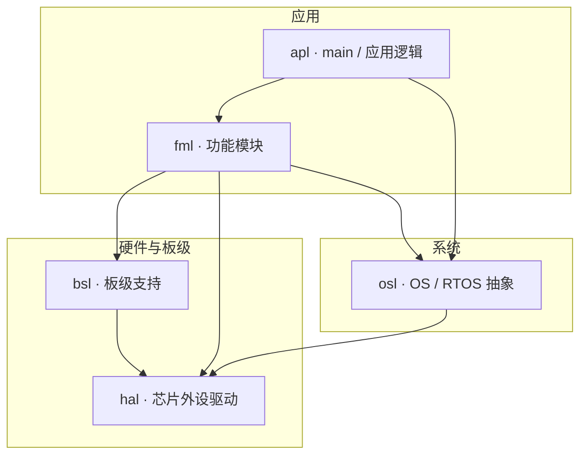
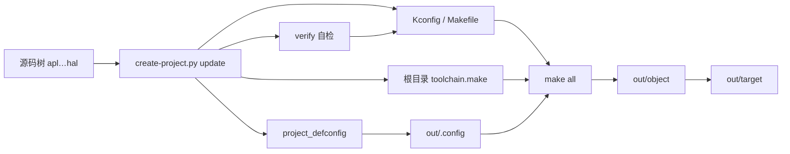
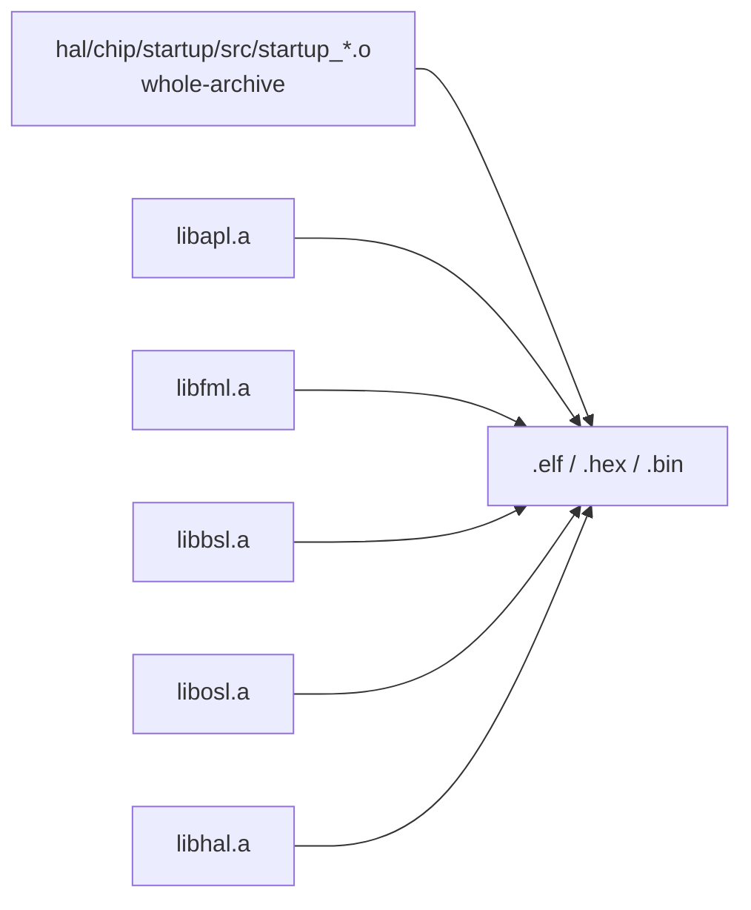

# 工程设计手稿

本文件是**设计与搭建 checklist**。与 [工程规格.md](./工程规格.md) 冲突时，以**工程规格**（当前代码行为）为准。

## 何时阅读

| 场景 | 读本手稿 | 读工程规格 |
|------|----------|------------|
| 从零复制/搭建工程骨架 | 是 | 可选 |
| 日常编译、加源文件 | 否 | 是（+ [SKILL.md](./SKILL.md)） |
| 修改 `build/create-project.py` 生成规则 | 是 | 必须同步更新 |

---

## 工程框架图

### 仓库目录（构建 vs 非构建）

```text
demo/                          # 工程根（PROJECT_ROOT，CONFIG_PROJECT_NAME 默认取目录名）
├── apl/ fml/ bsl/ osl/            ← 各层参与编译，各产 lib*.a
│   └── src/ inc/                  ← 源文件与头文件分开存放
├── hal/                            ← HAL 与芯片支持层
│   ├── src/ inc/                  ← 源文件与头文件分开存放
│   └── chip/linker/               ← MCU 链接脚本（不生成 Kconfig / Makefile）
├── proj/                      # 配置：project_defconfig、project-info.json
├── build/                     # create-project.py、install-toolchain.py、set-buildenv.py（不参与 Kconfig 扫描）
├── toolchain.make             # 自动生成的工具链配置
├── tool/                      # 可选：arm-gnu-toolchain-* 或 linux_x86_64 工具链目录
├── out/
│   ├── .config                # project_defconfig 解析后的有效配置
│   ├── object/                # .o .d .elf .hex .bin lib/
│   └── target/                # build 后复制的发布产物
├── doc/  workspace/           # 文档与工作区（不扫描；doc 可选）
├── Makefile  Kconfig          # 根入口（自动生成）
└── ...
```

### 分层架构（代码依赖方向）

上层可调用下层；下层不应反向依赖上层。



构建依赖由 `build/create-project.py` 按上述代码依赖方向生成到根 Makefile：`apl: fml osl`、`fml: bsl hal osl`、`bsl: hal`、`osl: hal`。CMSIS 启动汇编位于 `hal/chip/startup/src/`，作为独立对象参与最终链接；各模块头文件统一放在对应 `inc/`。

### 构建与生成链



### 链接模型（`.a` → 固件）

**链接顺序 ≠ 复位后谁先执行**；运行时仍从 `Reset_Handler` 进入。



链接顺序（与 `build/create-project.py` 一致，消费者在前）：

```text
-Wl,--whole-archive  hal/chip/startup/src/startup_stm32f429xx.o  -Wl,--no-whole-archive
  → -Wl,--start-group  libapl.a → libfml.a → libbsl.a → libosl.a → libhal.a  -Wl,--end-group
```

顺序反了（如 `hal` 在最前）时，ld 不会回头解析已扫描过的归档，`apl/fml/bsl` 的引用会落空；若同时存在 `main` 的弱定义，则连“未定义符号”都不会出现，链接静默收工、产出空壳镜像。故：**顺序必须消费者在前，且静态库中不得有 `main` 的弱定义**。

### 复位后执行时间线

```text
hal/chip/startup/src/startup_stm32f429xx.s : Reset_Handler
  → SystemInit()     [hal/chip/startup/src/system_stm32f4xx.c]   ← 先于 RAM 初始化，只能写寄存器
  → 初始化 .data / .bss
  → __libc_init_array()
  → main()           [apl]
  → HAL_Init()       [设 NVIC 分组 + HAL 时基(DWT)]
  → SystemClock_Config()   [HSE 25 MHz → PLL 180 MHz]
  → apl / fml / bsl / hal / osl …
```

---

## 1. 初始化 Git

- 初始化 Git 仓库
- 添加 `.gitignore`（至少忽略 `out/`、`__pycache__`）

## 2. 创建工程目录

在工程根目录创建：

```text
apl  fml  bsl  hal  osl
doc  proj  build  tool  workspace
```

- 在 `workspace/` 下创建 VS Code 工作区文件（如 `*.code-workspace`，`folders` 指向工程根）

## 3. build 目录

生成器与工具链脚本均位于 **`build/`**（原 `scripts/` 已合并至此，根下不再保留 `scripts` 目录）。

| 文件 | 职责 |
|------|------|
| `build/create-project.py` | 生成 Kconfig / Makefile / defconfig；子命令 `build` · `update` · `verify` · `clean`（`-h`） |
| `build/install-toolchain.py` | 安装 Arm GNU 工具链到 `tool/`（`-h`） |

**排除规则**：`build/` **不参与** Kconfig / Makefile 扫描；不得保留 `build/Makefile` 或 `build/Kconfig`（`update` 应删除误生成文件）。直接包含 `.ld` 链接脚本的目录同样不参与扫描，且不生成 `Kconfig` / `Makefile`。

---

## 4. create-project.py 生成链（`build/create-project.py`）

### 4.1 proj/project-info.json

- 按 **STM32F429IGT6** 定义 CPU 型号、架构（如 `cortex-m4`）、FPU、Flash/SRAM/CCM 等

### 4.2 proj/project_defconfig

- 定义 `CONFIG_PROJECT_NAME`、`CONFIG_CPU_*`、芯片宏配置等工程信息；**有效配置仅** `out/.config`（`update` 从本文件解析生成，不在 `build/` 或工程根生成 `.config`）
- 各层 Kconfig 宏按目录**分类**写回；**重新生成分类区**，不在旧分类上重复追加
- 保留 **`# >>> USER_CUSTOM` … `# <<< USER_CUSTOM`**：`update` 不覆盖；其中屏蔽的宏不在自动区创建

### 4.3 根目录 toolchain.make

- 工具链：`CC` / `CXX` / `AS` / `AR` / `GDB` / `SIZE` / `OBJCOPY`
- 编译、优化参数；`LDSCRIPT` 指向 `hal/chip/linker/` 下匹配 CPU 的 ld 文件
- 若 `tool/arm-gnu-toolchain-*` 或 `tool/linux_x86_64` 已安装，`PREFIX` 指向工程内 `bin/arm-none-eabi-`

### 4.4 层 Makefile 中的头文件与自动依赖

- 按层依赖图生成 `INCLUDE_DIRS` / `INCLUDES`：每层只能包含本层及其传递依赖层的头文件目录；工程根目录头文件对所有层可见。
- gcc 使用 `-MMD -MP` 为源文件生成 `out/object/<层>/<文件>.d`，并由对应目录 Makefile 通过 `-include` 引入。
- `Depend.make` 不再生成；头文件搜索路径和 `.d` 依赖分别由各层 Makefile 管理。

### 4.5 Kconfig 规则

扫描范围：工程根向下递归，**排除** `doc`、`proj`、`tool`、`build`、`workspace`（及 `out`、点目录、直接包含 `.ld` 链接脚本的目录等，见 [工程规格.md](./工程规格.md)）。

| 目录情况 | 配置项命名 |
|----------|------------|
| 有子目录 | 以**子目录名**为配置项，上层 `source` 子目录 Kconfig |
| 无子目录、有源文件 | 以**源文件名**（stem）为配置项 |
| 有子目录后 | 同目录源文件**不再**单独占 Kconfig 项，随该目录开关编译 |

### 4.6 Makefile 规则

- 扫描范围同 Kconfig
- `include $(PROJECT_ROOT)/toolchain.make`、`-include out/.config`
- 编译输出信息；`.d` 放在 `out/object/`
- 模块化递归 `make`；有源文件的目录把源写入变量，并与 Kconfig 项对应
- 静态库目录：`osl`、`apl`、`fml`、`bsl`、`hal` → `out/object/lib/lib<名>.a`
- `hal/chip/startup/src/startup_*.s` 编译为独立 `.o`，链接时使用 `--whole-archive`，不归档进 `libhal.a`
- 顶层链接产物：`<项目名>.elf`、`.hex`、`.bin`

### 4.7 编译选项（create-project.py 子命令）

| 选项 | 行为 |
|------|------|
| `update` | 刷新 Makefile / Kconfig / 根目录 toolchain.make / project_defconfig / out/.config；清理排除目录误生成文件；**自动 `verify`**。**不**作为参数传给 `make` |
| `verify` | 校验生成物与 `.skills` 规格（层、链接顺序、元数据）；失败则非 0 退出 |
| `build` | **先 `update`**（含 verify），再全量 `make`；产物复制到 `out/target/` |
| `clean` | 删除 `out/` 等编译产物 |

中间文件目录：`out/object/`（含 `.o`、`.d`、`<项目名>.map`）。`out/.config` 是从 `proj/project_defconfig` 解析出的有效配置；`out/target/` 只放发布产物 `.elf` / `.hex` / `.bin` / `.map`，静态库留在 `out/object/lib/`（带 `-g3` 的 `libhal.a` 近百 MB，不再复制到发布目录）。

---

## 5. CMSIS 启动

复位流程：`Reset_Handler`（`hal/chip/startup/src/startup_stm32f429xx.s`）→ `SystemInit` → 初始化 `.data` / `.bss` → `main`。链接脚本需定义启动文件使用的 `_sidata`、`_sdata`、`_edata`、`_sbss`、`_ebss` 符号。

注意 `SystemInit` 在 `.data` / `.bss` 初始化**之前**执行（ST 模板即如此），因此 `SystemInit` 里不能写全局变量；时钟配置放在 `main` 里的 `SystemClock_Config()`，它依赖 RAM 已初始化，而且要调用 `HAL_RCC_*` 这层 HAL 接口。

`.ccmram` 不启用：链接脚本把 `*(.ccmram*)` 丢进 `/DISCARD/`，startup 也没有 CCMRAM 的拷贝/清零循环。放进 `.ccmram` 的已初始化变量会在链接期报 `defined in discarded section`，而不是运行时拿到垃圾值。启用需同时补拷贝循环、清零循环并去掉 `/DISCARD/` 的两条 `*(.ccmram*)`。

---

## 6. 文档同步

实现或生成逻辑变更后，按 [文档维护.md](./文档维护.md) 更新：

- [工程规格.md](./工程规格.md)
- `doc/` 下用户文档（见 [SKILL.md](./SKILL.md)）

未同步文档视为变更未完成。
