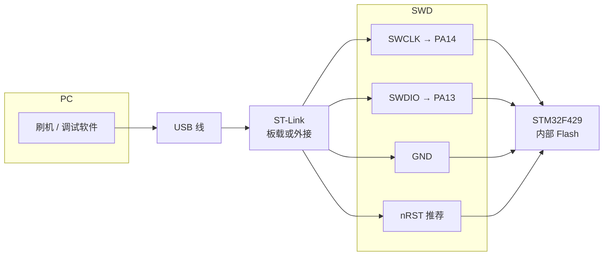
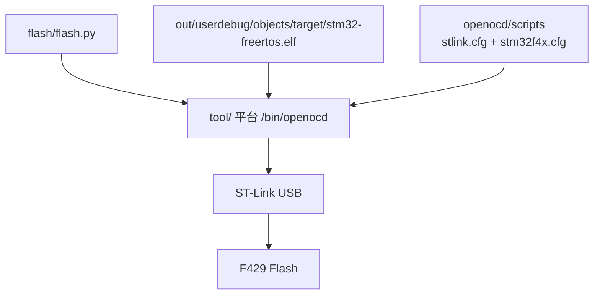
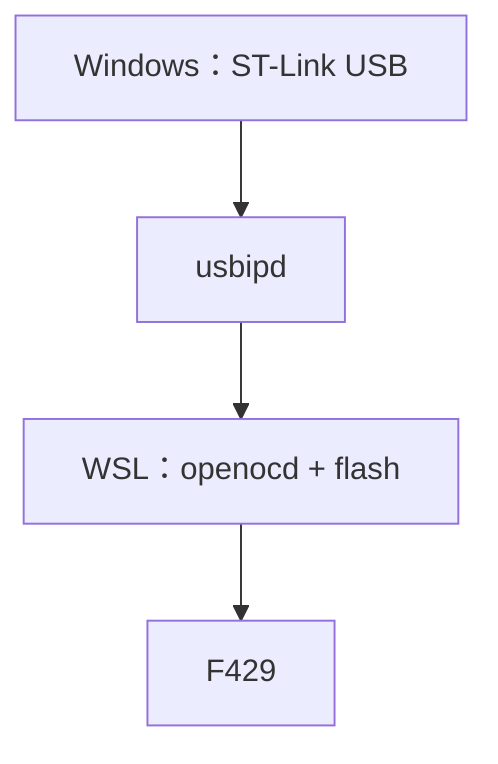

# 搭建环境

目标 MCU：**STM32F429IGT6**。本文说明在本机搭建**编译**、**刷机**、**调试**三类环境；架构与故障码见 [系统设计.md](./系统设计.md)，契约见 [.skills/工程规格.md](../../.skills/工程规格.md)。

链接产物默认名为 `out/userdebug/objects/target/<CONFIG_PROJECT_NAME>.elf`（本仓库根目录名为 `stm32-freertos`，故下文示例多用该文件名；复制工程后请随根目录名或 `proj/project_defconfig_userdebug` 中的 `CONFIG_PROJECT_NAME` 替换）。

---

## 编译环境

### 需要装什么

| 组件 | Linux | Windows |
|------|--------|---------|
| Python 3 | 系统 `python3` | 系统 `python` |
| GNU Make | `sudo apt install make` | 随工具链装入 `tool\win_x86_64\bin\make.exe`（见下） |
| Arm 交叉工具链 | `tool/linux_x86_64/` | `tool/win_x86_64/` |

**编译入口**：`python build/build.py <子命令>`（含 `install-toolchain` · `set-buildenv`）  
**刷机入口**：`python flash/flash.py <子命令>`（无子命令时即默认烧录）

| 入口 | 子命令 | 作用 |
|------|--------|------|
| `build/build.py` | `update` · `verify` · `build` · `clean` | 生成物、自检、编译、清理 |
| `build/build.py` | `gate-selftest` | `--list` · `--only <组>` · `--keep-going` |
| `build/build.py` | `install-toolchain` | 下载/解压 Arm GNU 到 `tool/`；`--make-only` · `--from` · `--version` |
| `build/build.py` | `set-buildenv` | 工具链：`--check` · `--print bash\|powershell\|json` |
| `flash/flash.py` | （无子命令）或 `flash` | 默认 `out/userdebug/objects/target/<CONFIG_PROJECT_NAME>.elf`（读 `project-info.json`） |
| `flash/flash.py` | `install-openocd` | 合并 xPack 到 `tool/<平台>/`；`--platform` · `--all-platforms` |
| `flash/flash.py` | `install-stlink-driver` | Win=WinUSB / Linux=udev（`openocd/Drivers/…`） |
| `flash/flash.py` | `set-buildenv` | 工具链 + OpenOCD：`--print bash\|powershell\|json` |
| `flash/flash.py` | `debug-server` | 前台 OpenOCD（GDB 3333） |

### 推荐步骤

**Windows**

```powershell
python build/build.py install-toolchain
# 若缺 make/sh，可从本机 Git 的 MSYS 拷入：
python build/build.py install-toolchain --make-only --from "D:\ExPrograms\DevelopTool\Git\usr\bin"
python build/build.py set-buildenv --check
python build/build.py build
```

`build` 会把 `tool\win_x86_64\bin` 置于 PATH 最前；MSYS 使用 `out\tmp` 作临时目录。

**产物路径**：链接输出在 `out/userdebug/objects/target/stm32-freertos.{elf,hex,bin,map}`；`build` 为 userdebug/user 各拷四文件到 `out/<档位>/release/<时间戳>/`。**刷机默认** userdebug 的 `objects/target/` ELF；量产用 **user** 档 hex。

**Linux**

```bash
python3 build/build.py install-toolchain
python3 build/build.py update
python3 build/build.py verify
python3 build/build.py build
```

### 环境变量（可选）

`STM32_TOOLCHAIN_ROOT` / `STM32_TOOLCHAIN_PREFIX` / `STM32_GIT_USR_BIN`；亦可：

```powershell
python flash/flash.py set-buildenv --print powershell | Invoke-Expression
python flash/flash.py
```

### 发布构建与档位

发布：`make release`（须 `-B`）；双轨自检与 `[跳过]` 三条见工程规格「发布构建」。切换优化档位后须 `clean` 再全量 `build`。增量构建出现 `Nothing to be done` 不能当验证。

### 编译环境常见问题

| 现象 | 处理 |
|------|------|
| `ModuleNotFoundError: environment` | 在仓库根用 `python build/build.py build`（会加载 `build/environment.py`） |
| 缺 `make.exe` / `sh.exe` | `python build/build.py install-toolchain --make-only --from "<Git>\usr\bin"` |
| WSL 与 Windows 共用同一工程目录 | Windows 侧 `install-openocd --platform linux_x86_64` 预装 Linux 包；WSL 内用 `tool/linux_x86_64` 编译与刷机（见下节） |
| 只有本次改过的文件报 `Error 49` | MSYS `sh` 里 `python3` 失效 → `toolchain.make` 的 `PYTHON := python`，再 `update` |
| 头文件改了不重编 | `.d` 绝对路径失效 → `verify` 提示后 `clean` + `build` |
| 编译 warning 即失败 | `-Werror`；修代码 |
| `tool/tmp` 或 `tool/win_x86_64/tmp` 空目录 | MSYS 副作用；正式临时目录是 `out/tmp`。可手动删，或 `build`/`clean` 后会删**空**目录 |

---

## 刷机环境

本仓库可通过 `install-openocd` 把 **OpenOCD** 装进 `tool/<平台>/`（与 Arm 工具链并列）。**ST-Link 驱动/权限**：

| 平台 | 目录 | 安装 |
|------|------|------|
| Windows | `tool/win_x86_64/openocd/Drivers/stsw-link009_v3/` | `python flash/flash.py install-stlink-driver`（UAC） |
| Linux | `tool/linux_x86_64/openocd/Drivers/stlink_udev/` | 同上或 `bash …/install_udev.sh`（sudo，规则来自 `openocd/contrib/60-openocd.rules`） |

`install-openocd` 在 Linux 平台会把 `stlink_udev` 同步进 `tool/linux_x86_64/`。勿与已移除的顶层 `tool/win_x86_64/Drivers/` 杂项混淆。也可选用 **STM32CubeProgrammer** 或 **pyOCD**。

| 方式 | 准备 | 命令要点 |
|------|------|----------|
| **OpenOCD（推荐）** | `python flash/flash.py install-openocd` + ST-Link | 见下节「OpenOCD 使用指南」 |
| **STM32CubeProgrammer** | 本机安装或解压到 `tool/win_x86_64/cubeprg/`（可选，仓库未承诺长期维护） | GUI：选 `out/userdebug/objects/target/stm32-freertos.hex` |
| 同上（CLI） | 同上 | `tool/win_x86_64/cubeprg/bin/STM32_Programmer_CLI.exe -c port=SWD -w out/userdebug/objects/target/stm32-freertos.hex -v -rst` |
| **pyOCD** | `pip install pyocd`，板载 ST-Link | `pyocd flash -t stm32f429igtx out/userdebug/objects/target/stm32-freertos.hex`（target 以 `pyocd list --targets` 为准） |

烧录前确认 **BOOT0 接运行 Flash**（从内部 Flash 启动用户程序）。镜像路径以 `build` 后 `out/userdebug/objects/target/` 为准。

### 刷机连接示意

目标芯片 **STM32F429IGT6**，调试口为 **SWD**（非 JTAG 全口）。正点原子阿波罗 **V2 核心板**常见为 **板载 ST-Link**：MCU 侧 SWD 已在板上连好，只需 **USB 线接 PC**（供电 + 调试）。外接 ST-Link / J-Link 时须飞线到 SWD 座或排针。

#### 物理链路（共性）



板载 ST-Link 时 **不必** 再飞 SWD；外接仿真器时目标板须 **共地**，VCC 按仿真器说明（有的仅检测、不给目标供电）。

#### 阿波罗核心板（板载 ST-Link）

```text
  ┌────────── PC ──────────┐
  │ flash/flash.py         │
  │ flash/flash.py         │
  └───────────┬────────────┘
              │ USB（供电 + 调试）
              ▼
  ┌───────────────────────────────┐
  │ 阿波罗 F429 核心板              │
  │  ┌─────────┐   SWD（板上已连）   │
  │  │ ST-Link │◄─────────────────┼──► U1 STM32F429IGT6
  │  └─────────┘                   │
  │  Type-C USB 口                   │
  └───────────────────────────────┘
```

#### 方式 A：OpenOCD + ST-Link（本仓库推荐）



OpenOCD 以前台 **一次性** 刷写时执行 `program … verify reset exit`；`flash/flash.py debug-server` 则常驻并开 **GDB :3333**（物理线仍为 USB → ST-Link → SWD）。

#### 方式 B：STM32CubeProgrammer

物理连接与方式 A 相同（**port=SWD**），PC 端换成 ST 官方工具；镜像常用 **`.hex`**（见上表 CLI）。


#### 方式 C：pyOCD

同样 **USB → ST-Link → SWD**；需本机 `pip install pyocd`，目标名以 `pyocd list --targets` 为准（文档示例 `stm32f429igtx`）。


#### 方式 D：WSL2 内刷机（usbipd）

ST-Link 先插在 **Windows USB** 上；WSL2 通过 **usbipd bind/attach** 把设备交给 Linux，再在 WSL 内跑 `tool/linux_x86_64` 的 OpenOCD 与 `flash/flash.py`。须配置 **udev**（`tool/linux_x86_64/openocd/contrib/60-openocd.rules`）。无法在 WSL 识别设备时，先在 Windows 用 `flash/flash.py` 验证线材与驱动。



#### 方式 E：外接 ST-Link / J-Link（飞线）

核心板仅用 USB **供电**、或调试口在外部座子上时：

```text
  外接仿真器 ── SWCLK ──► PA14 / SWD 座
            ├── SWDIO ──► PA13
            ├── GND   ──► GND
            └── nRST  ──► NRST（推荐）
            ▼
         STM32F429
```

OpenOCD 接口脚本多为 `interface/stlink.cfg`；**J-Link** 用 `interface/jlink.cfg`（本仓库调试节亦列举 J-Link GDB Server，刷机工具任选其一，链路仍为 SWD）。

#### 方式对比

| 方式 | PC 软件 | 物理链路 | 本仓库常用镜像 |
|------|---------|----------|----------------|
| OpenOCD（推荐） | `flash/flash.py` / `flash/flash.py` | USB → ST-Link → SWD | `.elf` |
| STM32CubeProgrammer | ST 官方 GUI / CLI | 同上 | `.hex` |
| pyOCD | `pyocd` | 同上 | `.hex` |
| WSL + OpenOCD | Linux `openocd` + usbipd | USB 经 Windows 转给 WSL | `.elf` |
| 外接仿真器 | 上表任选 | USB → 仿真器 → 飞线 SWD | 同左 |

### OpenOCD 使用指南

目标芯片 **STM32F429IGT6**，调试接口 **SWD**；正点原子开发板通常板载 **ST-Link**（或外接 ST-Link 仿真器均可）。

#### 安装与目录

```powershell
python flash/flash.py install-openocd
# 与 Windows 共用仓库、在 WSL 刷机时，可在 Windows 上预装 Linux 包：
python flash/flash.py install-openocd --platform linux_x86_64
```

| 平台 | 可执行文件 | 脚本目录（`-s` 参数） |
|------|------------|----------------------|
| Windows | `tool/win_x86_64/bin/openocd.exe` | `tool/win_x86_64/openocd/scripts` |
| Linux | `tool/linux_x86_64/bin/openocd` | `tool/linux_x86_64/openocd/scripts` |

安装包缓存在 `tool/.cache/`。重复执行 `install-openocd`：若当前平台的 `bin/openocd` 已存在则只打印版本，不重新下载。**`install-openocd` 使用 `merge_tool_tree`，不会清空已有工具链文件。**

同一目录内还有 OpenOCD 脚本 `openocd/scripts/`、Windows 可选驱动包 `openocd/Drivers/stsw-link009_v3/`。`install-stlink-driver` 会请求管理员权限（`/LM`）；若 `dpinst` 报 0x3「找不到路径」，检查 `tool/<平台>/` 是否被设为「目录区分大小写」（`fsutil file queryCaseSensitiveInfo`），或查看 `C:\Windows\DPINST.LOG`（`Drivers` 被小写化为 `drivers` 时尤为常见）。

#### WSL 刷机（与 Windows 共用仓库）

1. 在 Windows（或 WSL）仓库根执行：`python3 build/build.py install-toolchain` 与 `install-openocd`（WSL 内默认 `linux_x86_64`；也可在 Windows 上 `install-openocd --platform linux_x86_64`）。
2. Linux 下 ST-Link 需 **udev**：将 `tool/linux_x86_64/openocd/contrib/60-openocd.rules` 复制到 `/etc/udev/rules.d/`，执行 `sudo udevadm control --reload-rules && sudo udevadm trigger`，用户加入 `plugdev`（或发行版等效组），重新插拔 USB。
3. WSL2 访问 USB 调试器需 **usbipd**（Windows 侧绑定设备后在 WSL 内 attach）；无法在 WSL 里看到 ST-Link 时先在 Windows 用 `flash/flash.py` 验证硬件与驱动。
4. WSL 内刷写：`python3 flash/flash.py set-buildenv` 后 `python3 flash/flash.py`，或见下节 Linux 等价命令。

Windows 下可在当前 PowerShell 会话里设变量（路径按仓库根修改）：

```powershell
$ROOT = "D:\Users\Local\stm32-freertos"   # 改成你的仓库根
$OCD  = "$ROOT\tool\win_x86_64"
$SCR  = "$OCD\openocd\scripts"
$ELF  = "$ROOT\out\object\target\stm32-freertos.elf"
$HEX  = "$ROOT\out\object\target\stm32-freertos.hex"
```

Linux（在仓库根目录）：

```bash
ROOT="$(pwd)"
OCD="$ROOT/tool/linux_x86_64"
SCR="$OCD/openocd/scripts"
ELF="$ROOT/out/userdebug/objects/target/stm32-freertos.elf"
```

#### 刷写固件（一次性退出）

用 **`.elf`** 可校验并复位；**`.hex`** 与 CubeProgrammer 同类用法。接口脚本以本机 ST-Link 为准（板载多为 v2/v2-1，先试 `stlink.cfg`）：

```powershell
& "$OCD\bin\openocd.exe" -s "$SCR" `
  -f interface/stlink.cfg -f target/stm32f4x.cfg `
  -c "program `"$ELF`" verify reset exit"
```

Linux 等价命令：

```bash
"$OCD/bin/openocd" -s "$SCR" -f interface/stlink.cfg -f target/stm32f4x.cfg \
  -c "program $ELF verify reset exit"
```

仅烧 **hex**、不复位时可把末行改为：

```text
-c "program /path/to/stm32-freertos.hex verify exit"
```

成功时 OpenOCD 会打印 `Verified OK` 后进程退出；失败常见为 `Error: libusb_init() failed`（驱动未装或线未接）或 `Error: open failed`（目标未上电）。

#### 作为 GDB 服务器（调试）

终端 1（前台占用，勿关）：

```powershell
& "$OCD\bin\openocd.exe" -s "$SCR" -f interface/stlink.cfg -f target/stm32f4x.cfg
```

默认 GDB 端口 **3333**（`telnet` 4444）。若接线是 ST-Link v2-1 且 `stlink.cfg` 连不上，可改为 `interface/stlink-v2-1.cfg`。

终端 2 连接本仓库 GDB，见下节「连接示例（OpenOCD + 本仓库 GDB）」。

#### 常用 OpenOCD 片段

| 场景 | GDB / monitor 命令 |
|------|---------------------|
| 停机 | `monitor reset halt` |
| 烧录并校验 | `monitor program out/userdebug/objects/target/stm32-freertos.elf verify` |
| 继续运行 | `monitor reset run` 或 `continue` |
| 读故障现场 | 板子已 panic 时**不要** `load` / `program`；`monitor reset halt` 后直接 `p g_panic_record`（仅当 RAM 尚未掉电） |

#### 刷机常见问题

| 现象 | 处理 |
|------|------|
| `openocd.exe` 找不到 | 先 `install-openocd`；或检查 `tool/win_x86_64/bin` |
| `Can't find target/stm32f4x.cfg` | 补上 `-s` 指向上表脚本目录（xPack 布局在 `openocd/scripts` 下） |
| 能识别 ST-Link 但认不到芯片 | 确认 SWD 线、目标上电、BOOT0 从 Flash 启动 |
| 刷完不跑 | 使用带 `reset` 的 `program … reset exit`，或上电复位 |
| `dpinst` / 0x3、`drivers` 路径 | 对 `tool\win_x86_64` 关闭目录区分大小写，或运行 `install-stlink-driver`（脚本内会尝试 `fsutil`） |
| Linux `open failed` / 无权限 | 检查 udev 规则与 `plugdev`；WSL 需 usbipd |

**CI 说明**：`.github/workflows/build.yml` 只跑 `install-toolchain` 与编译/门禁，**不**安装 OpenOCD、不执行 `flash`；刷机环境无自动化回归，依赖本机按本文验证。

---

## 调试环境

### 本仓库提供什么

| 项 | 位置 / 说明 |
|----|-------------|
| GDB 客户端 | `tool/win_x86_64/bin/arm-none-eabi-gdb.exe`（Linux 为 `tool/linux_x86_64/bin/arm-none-eabi-gdb`） |
| 符号工具 | 同目录 `nm` / `objdump` / `size` |
| 带符号 elf | `out/userdebug/objects/target/stm32-freertos.elf`（size 见 [系统设计.md](./系统设计.md)「现态读数」） |
| 故障现场变量 | `g_panic_record`（`.noinit`）、`g_boot_stage`、`g_last_write[64]` |

### 本仓库不提供什么（需本机安装）

调试需 **GDB Server**，任选其一：

| Server | 典型用法 |
|--------|----------|
| **OpenOCD + ST-Link** | `install-openocd` 后见 [刷机环境 · OpenOCD](#openocd-使用指南) |
| **pyOCD** | `pyocd gdbserver --target stm32f429igtx`（默认 `:3333`） |
| **STM32CubeProgrammer** | 自带 GDB server 模式 |
| **J-Link** | `JLinkGDBServer`（默认 `:3333`） |

### 连接示例（OpenOCD + 本仓库 GDB）

终端 1 已按刷机节启动 OpenOCD（`interface/stlink.cfg` + `target/stm32f4x.cfg`）。

终端 2（Windows）：

```text
tool\win_x86_64\bin\arm-none-eabi-gdb.exe out\object\target\stm32-freertos.elf
(gdb) target extended-remote :3333
(gdb) monitor reset halt
(gdb) load
(gdb) monitor reset run
```

板子已停在故障路径、需要读现场时**不要** `load`（会擦掉 RAM），`monitor reset halt` 后直接：

```text
(gdb) p g_panic_record
```

### 连接示例（pyOCD + 本仓库 GDB）

终端 1：

```text
pyocd gdbserver --target stm32f429igtx
```

终端 2（Windows 路径示例）：

```text
tool\win_x86_64\bin\arm-none-eabi-gdb.exe out\object\target\stm32-freertos.elf
(gdb) target extended-remote :3333
(gdb) monitor reset halt
(gdb) load
```

板子已停在故障路径、需要读现场时**不要** `load`（会擦掉 RAM），直接：

```text
(gdb) p g_panic_record
```

### 读现场与码表

`(gdb) p g_panic_record` 可读全部字段；硬件异常先看 `fault_cfsr` 分组，再看 `fault_pc` / `fault_lr`。结构定义见 `osl/inc/osl_panic_record.h`。

**码 1–7** 含义见 [系统设计.md](./系统设计.md) §「故障汇流」。

#### 码 4 的两个失败点（GDB）

| `g_boot_stage` | 失败点 | 先查什么 |
|---|---|---|
| 1 | `HAL_Init()` 失败 | NVIC 分组与 HAL 时基 |
| 2 | `SystemClock_Config()` 失败 | HSE 25 MHz 晶振与 PLL |

### 无调试器时的静态核查

```text
tool\win_x86_64\bin\arm-none-eabi-nm.exe out\object\target\stm32-freertos.elf | findstr /i "Handler"
```

---

## 附录 · 运行期故障排查

| 现象 | 原因 | 处理 |
|------|------|------|
| `make` 绿但 `main` 是弱符号 | 库顺序或弱 `main` | 链接顺序 `apl→fml→bsl→osl→hal`；靠 `build` 产物断言 |
| `undefined reference to vApplicationStackOverflowHook` | 钩子未在 `osl_boot.c` | 勿挪层 |
| 板子静默 | 栈/堆/assert/异常 | 三灯码见系统设计 §故障汇流；GDB 读 `g_panic_record` |
| 约 32.7 s 后反复重启 | IWDG 设计行为 | `wd_sync_fail` 须为 0 |
| 三灯码 6 却无应用故障 | 未实现中断 | 看 `unhandled_irq` |
| 按键/蜂鸣无反应 | bsl 被 gc | `verify` BSP 接入 |
| 链接 `HAL_xxx` | 模块被裁 | `hal_conf.h` + `project_defconfig_userdebug` / `_user`（USER_CUSTOM 同步） |

更多契约级说明见 [.skills/工程规格.md](../../.skills/工程规格.md)。

---

## 附录 · 板上验收

补充静态门禁与真机勾选，**不替代** `python build/build.py build`。无勾选不入台账「已关闭」。

**前提**：已烧录 `out/userdebug/objects/target/stm32-freertos.{hex,bin}`；调试器可读 RAM。

### 1. 基本功能

| # | 步骤 | 预期 | 通过 |
|---|------|------|------|
| 1.1 | 上电，不接调试器 | **DS0 红 / DS1 绿** 互斥：一方亮 1 s、另一方灭，再切换（整圈 2 s） | ☐ |
| 1.2 | 短按 KEY | 按住**持续响**、松开即停 | ☐ |

### 2. 时钟与启动

| # | 步骤 | 预期 | 通过 |
|---|------|------|------|
| 2.1 | 读 `SystemCoreClock` | 168000000 | ☐ |
| 2.2 | 实验：时钟配置失败 | 码 4；32.7 s 后 IWDG 复位，`seq` 递增 | ☐ |

### 3. Panic 与 `.noinit`

| # | 步骤 | 预期 | 通过 |
|---|------|------|------|
| 3.1 | 触发码 3 | 三灯播报；`magic` 有效 | ☐ |
| 3.2 | 等 IWDG 复位 | `seq` 递增；`reset_cause` 含 IWDG | ☐ |

### 4. 堆 / 栈水位

| # | 步骤 | 预期 | 通过 |
|---|------|------|------|
| 4.1 | 读 `g_heap_free_min` | 非 `0xFFFFFFFF` | ☐ |
| 4.2 | 读 `g_stack_free_min[]` | 非 0（**word**） | ☐ |

### 5. 记录

- `git rev-parse --short HEAD` = __________
- 构建档位（`out/userdebug/objects/.buildflags`）= __________
- `size`：text / data / bss = __________
