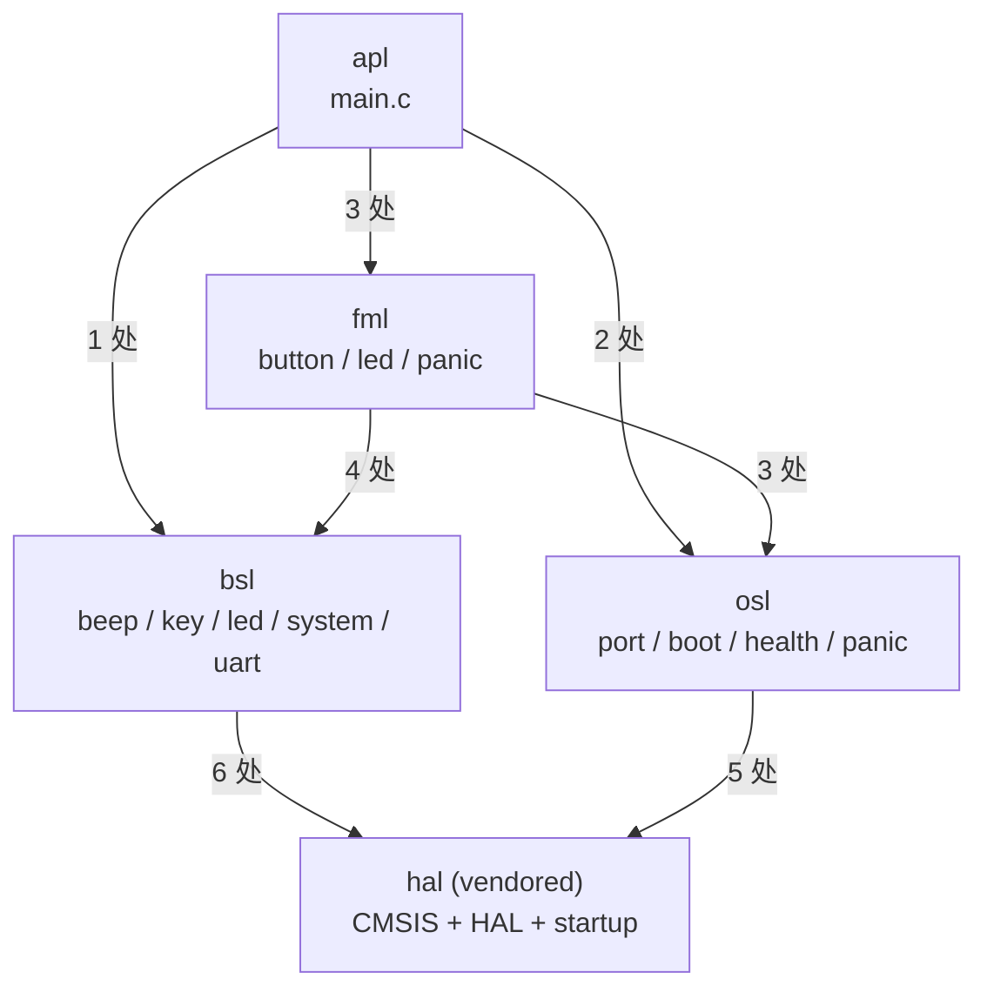
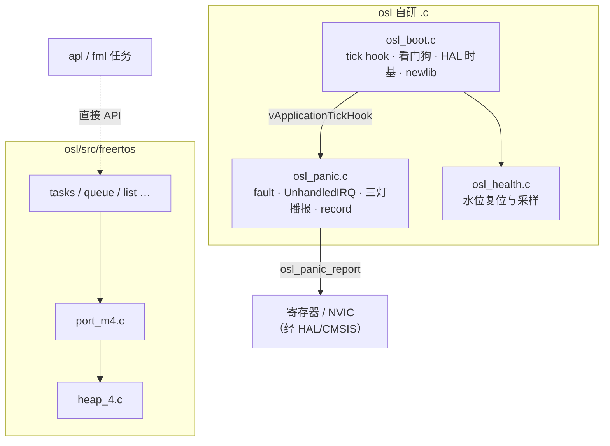
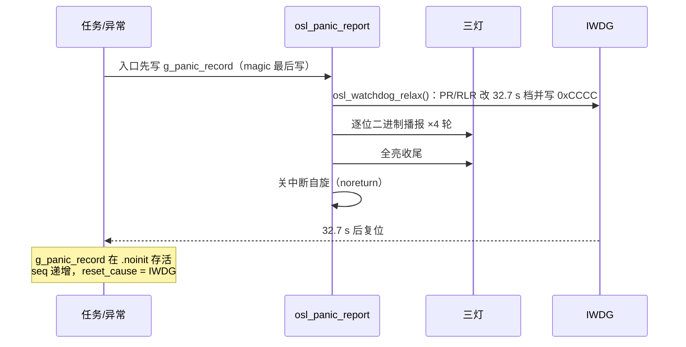

# 工程与系统设计

本文档合并**工程搭建索引**与**系统运行期设计**。搭建 checklist、框架图、生成链与 CMSIS 约定的**权威全文**在 [.skills/工程规格.md](../../.skills/工程规格.md)「工程设计手稿（搭建与生成链）」；本文第一部分只保留阅读路线与命令速查，避免与规格双份维护。第二部分给出可从判据复核的五层架构、跨层边、门禁链、启动时序与稳态行为；数字来自 `python build/build.py verify` 与 `arm-none-eabi-nm` / `objdump` 的实测读数。与工程规格冲突时，以**工程规格**（当前代码行为）为准；架构取舍与守门见 [.skills/架构缺陷.md](../../.skills/架构缺陷.md)。

---

# 第一部分 · 工程搭建（索引）

## 何时阅读

| 场景 | 读本节 | 读工程规格 / 其它 |
|------|--------|-------------------|
| 从零复制/搭建工程骨架 | 路线 | [工程规格.md](../../.skills/工程规格.md)「工程设计手稿」全文 |
| 装工具链 / OpenOCD / 刷机 / GDB | 否 | [搭建环境.md](./搭建环境.md) |
| 日常编译、加源文件 | 速查命令 | 工程规格 + [SKILL.md](../../.skills/SKILL.md) |
| 修改 `build/generate.py` 或 `build/contracts.py` | 是 | 必须同步工程规格「目录 / 脚本 / 自检」 |
| 复核层边处数、故障码、size 上限 | 否 | **第二部分**（机器校验层边表在此） |

**手稿真源**（框架图、生成链、链接序、CMSIS、搭建 checklist）：[工程规格.md](../../.skills/工程规格.md)「工程设计手稿（搭建与生成链）」——与 `collect_doc_contract_errors` 对齐。

## Git 与 `tool/`（本仓库）

- 根目录 [.gitignore](../../.gitignore) 至少忽略 `out/user/`、`out/userdebug/`、`__pycache__`、`tool/.cache/`。
- **本仓库**在 `tool/linux_x86_64/` **入库**了 Linux 交叉工具链；CI 仍执行 `build/build.py install-toolchain` 并缓存。`tool/.gitignore` 另忽略 `.cache/` 与可选 `win_x86_64/cubeprg/`。
- 从零搭**空白模板**时，常见做法是忽略整个 `tool/<平台>/` 解压体；勿与「本仓 vendoring 策略」混为一谈。

## 快速命令

```text
python build/build.py update          # 生成物 + verify(check_symbols=False)
python build/build.py verify          # 静态判据；-a/--artifacts 时查 elf/map
python build/build.py build           # update + userdebug/user 双档编译 + release 拷贝
python build/build.py build --fast --variant userdebug   # 日常增量
python build/build.py clean           # 删 out/
python build/build.py install-toolchain [--make-only]
python flash/flash.py install-openocd [--platform linux_x86_64]
python build/build.py set-buildenv [--print bash|powershell|json]
python flash/flash.py
python flash/flash.py
python build/build.py gate-selftest [--list | --only <组> | --keep-going]
```

门禁组数以 `gate-selftest --list` 为准。`update` 生成分档 `out/<variant>/.config`；**增量 `Nothing to be done` 不算验证**，须 `clean` 后全量 `build`。

## 文档同步

实现或生成逻辑变更后，按 [文档维护.md](../../.skills/文档维护.md) 更新 [工程规格.md](../../.skills/工程规格.md) 与 `doc/`（见 [SKILL.md](../../.skills/SKILL.md)）。未同步视为变更未完成。

---

# 第二部分 · 系统架构与运行期设计

## 五层栈

| 层 | 目录 | 自研 `.c` | 自研 `.h` | 职责 | 允许依赖 |
|---|---|---|---|---|---|
| `apl` | `apl/` | 1 | 0 | 应用入口：只做「初始化 → 起任务 → 起调度器」，不写任何板级或 RTOS 细节 | `fml`、`bsl`、`osl` |
| `fml` | `fml/` | 3 | 3 | 功能逻辑：周期任务、去抖、灯/蜂鸣器策略、故障入口的语义映射 | `bsl`、`osl` |
| `bsl` | `bsl/` | 5 | 5 | 板级事实：引脚、极性、时钟、USART1 调试；把 HAL 收在本层 | `hal` |
| `osl` | `osl/` | 3 | 7 | OS **支撑**层：panic、看门狗、tick、健康水位、`_sbrk` 与 newlib 垫片。**不提供任务/队列抽象**——FreeRTOS 内核 API 由 `apl` / `fml` 直接调用（见下文「口径之外」） | `hal` |
| `hal` | `hal/` | — | — | vendored：CMSIS + STM32F4 HAL + startup，只被 `bsl` / `osl` 引入 | 无跨层引用 |

自研源码合计 **12 个 `.c`**（`apl` 1 / `fml` 3 / `bsl` 5 / `osl` 3），`.h` 合计 **15 个**（`fml` 3 / `bsl` 5 / `osl` 7）。`fml` 的 3 个源文件是 `fml_button.c` / `fml_led.c` / `fml_panic.c`；`osl` 的 3 个是 `osl_boot.c` / `osl_health.c` / `osl_panic.c`。

## 允许的跨层边：7 条 / 24 处

判据的唯一事实源是 `build/contracts.py` 的 `LAYER_DEPENDENCIES` 与 `LAYER_SYMBOL_PREFIXES`；下面这张表是它的实例化实测结果（只统计 `#include "..."` 与 `#include <...>` 两种写法里的**跨层**引用，同层引用与 vendored 内部引用不计）。**口径注意**：`_self_layer_header_owners()` 只认**自研层的头**，所以 `FreeRTOS.h` / `task.h` 这类 vendored 内核头不进这张表——它们另有 6 处直接引用，见下一节。

| # | 边 | 处数 | 具体引用 | 这条边为什么存在 |
|---|---|---|---|---|
| 1 | `apl → fml` | 3 | `apl/src/main.c` → `fml_button.h` / `fml_led.h` / `fml_panic.h` | 应用层起两个功能任务，并在三条失败路径上按码报障 |
| 2 | `apl → bsl` | 1 | `apl/src/main.c` → `board_system.h` | `main()` 只调一次 `board_system_init()`（HAL 初始化 + 时钟 + 主频刷新），从而把 HAL 头挡在 `apl` 之外 |
| 3 | `apl → osl` | 2 | `apl/src/main.c` → `osl_boot.h` / `osl_health.h` | 水位记录必须先复位成「未采样」，且必须早于 `HAL_Init()`；`osl_boot_stage_note()` 在启动早期记录里程碑 |
| 4 | `fml → bsl` | 4 | `fml_button.c` → `board_beep.h` / `board_key.h`；`fml_led.c` → `board_led.h` / `board_debug_uart.h` | 功能层通过板级门面碰硬件，不直接 include HAL |
| 5 | `fml → osl` | 3 | `fml_button.c` / `fml_led.c` → `osl_health.h`；`fml_panic.c` → `osl_panic.h` | 栈水位采样与故障播报的唯一实现都在 osl |
| 6 | `bsl → hal` | 6 | 各 `board_*.c` → `stm32f4xx_hal.h`；`board_system.c` → `system_stm32f4xx.h` | 板级层就是 HAL 的收纳处（含 `board_debug_uart.c`） |
| 7 | `osl → hal` | 5 | `FreeRTOSConfig.h` → `stm32f4xx.h`；`osl_boot.c` / `osl_panic.c` → `stm32f4xx_hal.h`；`osl_boot.c` / `osl_panic.c` → `system_stm32f4xx.h` | 端口层需要寄存器与 CMSIS 内建函数 |

合计 **7 条边 / 24 处**（3+1+2+4+3+6+5）。`fml → hal` **不是**允许边：`LAYER_DEPENDENCIES["fml"]` 只声明 `("bsl", "osl")`，任何人往 `fml` 里 include 一个 `stm32f4xx_hal.h` 都会被 `collect_layer_dependency_errors()` 判为越级。

依赖矩阵（行 = 引用方，列 = 被引用方；格内是处数，空 = 不允许或零使用）：

|            | `apl` | `fml` | `bsl` | `osl` | `hal` |
|------------|:-----:|:-----:|:-----:|:-----:|:-----:|
| **`apl`**  | —     | 3     | 1     | 2     | —     |
| **`fml`**  | —     | —     | 4     | 3     | —     |
| **`bsl`**  | —     | —     | —     | —     | 6     |
| **`osl`**  | —     | —     | —     | —     | 5     |
| **`hal`**  | —     | —     | —     | —     | —     |

7 个非零格子，与上表 7 条边一一对应。`apl → bsl` 是**有意保留**的边：它的作用是让「应用层碰 HAL」这件事在源码里有唯一一个合法出口（`board_system_init()`），而不是让 `apl` 直接写寄存器；反向的 `bsl → fml` 则被明确禁止（`bsl` 的允许依赖只有 `hal`），并由 `layer-deps` 组的第二、五段破坏守着（第二段塞 `fml_led.h`、第五段用 `extern` 声明引 `fml_` 符号）。



## 口径之外：6 处 vendored 内核头依赖

上面 24 处只数**自研层头**之间的引用。`osl` 名义上是 OS 层，但它**不提供任务/队列抽象 API**，所以 `apl` 与 `fml` 直接引 FreeRTOS 内核头，共 **6 处**：

| 层 | 文件 | 引用 | 用来做什么 |
|---|---|---|---|
| `apl` | `apl/src/main.c` | `FreeRTOS.h` / `task.h` | `vTaskStartScheduler()` |
| `fml` | `fml/src/fml_led.c` | `FreeRTOS.h` / `task.h` | `xTaskCreate` / `vTaskDelayUntil` / `uxTaskGetStackHighWaterMark` |
| `fml` | `fml/src/fml_button.c` | `FreeRTOS.h` / `task.h` | 同上 |

这 6 处**不是越级**：FreeRTOS 头是 vendored 内核头，不在 `_self_layer_header_owners()` 的 owner 表里，`collect_layer_dependency_errors()` 本来就不管它。但后果要说清楚——**换 RTOS 或换内核版本时，改动面是 `apl` + `fml` + `osl` 三层，不是只有 `osl`**。

在本仓库里这是**有意的取舍**：`osl` 的定位是「OS 支撑」（panic / 看门狗 / tick / 健康水位 / newlib 垫片），不是「内核抽象」。真要隔离内核，得引入 `osl_task.h` 一类门面，把 3 处 `xTaskCreate`、2 处 `vTaskDelayUntil` 收进去；当前没有换 RTOS 的需求，收益不抵成本。

## osl 层模块边界（细图）

自研三个编译单元 + vendored FreeRTOS（`osl/src/freertos/`，含 `port_m4.c`、`heap_4.c` 与内核源）。现行边界见下表；历史拆分以 git 为准，机制见 [.skills/架构缺陷.md](../../.skills/架构缺陷.md)。

| 模块 | 文件 | 主要职责 |
|---|---|---|
| 启动与运行时基础设施 | `osl_boot.c` | 启动阶段、`g_reset_cause`、IWDG、HAL 时基（DWT / `HAL_GetTick`）、`vApplicationTickHook`、malloc/栈溢出钩子、newlib（`_sbrk`、锁、`_write`） |
| 故障与播报 | `osl_panic.c` | `osl_panic_report`、`panic_mask_all_irqs`、四类 fault 与 `UnhandledIRQ_Handler`、`vAssertFailed`、`g_panic_record` / `g_last_write` |
| 健康水位 | `osl_health.c` | `osl_health_init`、堆/栈槽采样落盘约定（与 `osl_health.h` 配合） |
| 内核与移植 | `freertos/*.c`、`port_m4.c` | 调度器、Cortex-M4F 移植、`heap_4` |



门禁锚点：`build/contracts.py` 里 `OSL_PORT_ST_SOURCE` / `OSL_BOOT_C` 指向 `osl_boot.c`；`PANIC_STORE_C` 等 panic 相关锚点在 `osl_panic.c`。

## 门禁链

`build/verify.py` 内嵌 **49 组** `gate-selftest`，经 `build/build.py gate-selftest` 调用。每组一次「破坏 → 期望 `verify` / `build` 报红 → 按字节还原」：

- 组名唯一来源是 `CASES`；`gate-selftest --list` 打印 JSON 数组。CI 的 `gate-list` job 用它生成矩阵，**一组一个 job**，组名不硬编码。
- `ASSERTION_GROUPS` 声明「哪组破坏时应触发哪些 `collect_*_errors`」；`assertion_coverage()` 用 AST 从 **`build/verify.py`** 取全部 `collect_*` 名字做双向比对。
- `--assert-map` 实测每组破坏触发的 collector，与声明比对，防断言改弱仍绿。
- 每组收尾无条件 `build` + `verify --artifacts`：破坏只还原源码字节，不自动清 `out/<档位>/objects/`。

`.github/workflows/build.yml` 为 **52 个 job**：`build` + `release-package` + `gate-list` + 49 个 `gate-selftest (<组名>)`（已无 `unit-test` job；host 快测曾由 `tests/test_build_helpers.py` 承担，已移除，纯逻辑改由门禁与 `verify` 覆盖）。

## 启动时序

```text
Reset_Handler
  └─ SystemInit
  └─ __libc_init_array
  └─ main()
       ├─ osl_health_init()                 // 必须早于 HAL_Init()：把「历史最低」复位成 UNSET 而不是 0
       ├─ board_system_init()               // HAL_Init + SystemClock_Config(16 MHz HSI → 168 MHz) + SystemCoreClockUpdate
       │     └─ 失败 → fml_panic(4U)        // 系统时钟配不起来
       ├─ fml_led_blink_start()             // board_led_init + 起 led_blink 任务（xTaskCreate 失败 → fml_panic(2U)）
       ├─ fml_button_start()                // board_beep_init/board_key_init + 起 button 任务（失败 → fml_panic(2U)）
       ├─ vTaskStartScheduler()             // 只起 IDLE 任务；configUSE_TIMERS = 0，没有 Timer 任务
       │     └─ 返回 → fml_panic(1U)        // 堆不足，调度器起不来
       └─ for (;;)                          // 双保险；fml_panic 已是 noreturn
```

运行期还有两条不经过任务链的入口：`vApplicationTickHook`（1 kHz，在 `osl_boot.c`：喂 IWDG + 查栈 + 采堆水位）与四个硬件异常入口 plus `UnhandledIRQ_Handler`（均在 `osl_panic.c` 强定义，压过 startup 弱别名），两者最终都汇到 `osl_panic_report()`：三灯按 3 位二进制逐位闪 4 轮 → 全亮 → 关中断自旋，并把现场写进 `.noinit` 的 `g_panic_record`。

`fml_panic()` 是这条汇流上唯一的 fml 侧入口，住在 `fml/src/fml_panic.c`，函数体只有一行 `osl_panic_report((osl_panic_code_t)code)`（反汇编实测 3 条指令 8 B）。它**不**负责闪灯、也**不**碰 `board_led_*`——播报方式与码表都只有 osl 一份。

## 现态读数

采样：`arm-none-eabi-size out/userdebug/objects/target/stm32-freertos.elf`（userdebug `-Og -g3`）；user 档约 text 10820：

| 指标 | 读数 |
|---|---|
| `text` | 11984 B（上限 `ARTIFACT_TEXT_CEIL = 16384`，余量 **4400**） |
| `data` / `bss` | 16 B / 18416 B |
| Flash | 12000 / 1048576（**1.14%**） |
| RAM | 18432 / 196608（**9.38%**） |
| newlib 堆 | 512 B（未使用） |
| `.noinit` | `_snoinit 0x20004128` / `g_last_write 0x20004130`（64 B）/ `g_panic_record 0x20004170`（140 B）/ `_enoinit 0x200041fc` |

## 这份图的边界

- 只画**跨层 include 边**。符号级引用（手写 `extern` 声明）在源码里目前只有 1 处且是同层（`osl/src/osl_boot.c` 的 `osl_tick_ms_advance`），但判据已覆盖这种形态（`layer-deps` 第五段破坏）。
- 不画 vendored FreeRTOS 内部（`osl/src/freertos/` 与 `osl/inc/freertos/`，移植为 `port_m4.c` + `heap_4.c`），它整体算在 `osl` 层内；自研边界见上文「osl 层模块边界」。
- 不画数据流与时序交互；追单条调用链时用 `arm-none-eabi-nm` / `objdump -d out/userdebug/objects/target/stm32-freertos.elf`（见 [搭建环境.md](./搭建环境.md)）。
- 零硬件实测的项（168 MHz 起振、USB 枚举、IWDG 真复位、`.noinit` 跨复位存活、panic 三灯时序、FPU 扩展帧）本图无法证明，见 [搭建环境.md](./搭建环境.md#附录--板上验收)。

---

## 运行期稳态

调度器启动之后的稳态（任务、中断、看门狗、故障码）。


## 1. 任务

| 任务 | 栈（word） | 优先级 | 周期 | 栈水位槽 |
|------|-----------|--------|------|---------|
| `led_blink` | 256（`configMINIMAL_STACK_SIZE * 2U`） | 1 | **1 s** 切换红/绿互斥，`vTaskDelayUntil` | 0 |
| `button` | 128（`configMINIMAL_STACK_SIZE`） | 1 | 10 ms 轮询，连续 3 次一致 ≈ 30 ms 去抖 | 1 |
| IDLE | 128 | 0 | 无人可跑时由内核调度 | — |
| Timer | **不存在** | — | — | — |

三件容易踩的事：

- **没有 Timer 任务**。`configUSE_TIMERS = 0`，自研代码里一次 `xTimer*` 调用都没有，整段
  软件定时器没编进镜像。
- **两个应用任务同优先级 1**，靠 `configUSE_TIME_SLICING = 1` 轮转，不是「谁先创建谁占着 CPU」。
- **`configMAX_PRIORITIES = 2`**，只有 0 / 1 两档。它决定 `pxReadyTasksLists[]` 的元素数，
  改大只多占 RAM；`verify` 的 task-priority 断言会把「配置比用法宽」直接报红。

两个任务都顺手采自己的栈余量，但节拍不同：`led_blink` 每拍（1 s）采一次；`button` 每 100 次
轮询（约 1 s）采一次——`uxTaskGetStackHighWaterMark` 要扫描整段栈，跟着 10 ms 走纯属浪费。
堆水位**不在这两个任务里采**（见第 3 节）。

## 2. 调度与中断优先级

| 项 | 值 | 含义 |
|---|---|---|
| `configUSE_PREEMPTION` | 1 | 就绪态出现更高优先级任务立刻抢占 |
| `configUSE_TIME_SLICING` | 1 | 同优先级任务每 tick 轮转 |
| `configUSE_PORT_OPTIMISED_TASK_SELECTION` | 1 | 用 CLZ 指令选下一个任务 |
| `configUSE_IDLE_HOOK` | 0 | IDLE 里没有用户代码 |
| `configPRIO_BITS` | 4 | 4 位优先级，16 档 |
| `NVIC_PRIORITYGROUP_4` | 4 位抢占 / 0 位子优先级（`HAL_Init` 里设） | 所有中断只有抢占优先级 |
| `configLIBRARY_LOWEST_INTERRUPT_PRIORITY` | 15 | 内核自身（SysTick / PendSV）用这一档 |
| `configLIBRARY_MAX_SYSCALL_INTERRUPT_PRIORITY` | 5 | 折算成 `BASEPRI = 0x50` |

**能调 FreeRTOS API 的中断，抢占优先级数值必须 ≥ 5**（5..15）。数值 0..4 的 ISR 不在
`BASEPRI` 屏蔽范围内，在里面调 `xQueueSendFromISR` 或 `portYIELD_FROM_ISR` 会让内核临界区失效，
而这类越界通常不报错、只在罕见时序下丢事件。这组数字从 `osl/inc/FreeRTOSConfig.h` 推导，
不是各驱动随手填的。

## 3. tick hook：1 kHz 上做四件事

`configUSE_TICK_HOOK = 1`，`vApplicationTickHook()` 在 SysTick 中断上下文每 1 ms 跑一次，
顺序固定（实现见 `osl/src/osl_boot.c`）：

1. `osl_tick_ms_advance()` —— 推进毫秒累加器；调度器起来之后 `HAL_GetTick` 完全依赖它
2. `stack_guard_check()` —— 比 MSP，跌破 `_estack - _Min_Stack_Size` 按码 7 播报
3. 读 `xPortGetMinimumEverFreeHeapSize()` 更新 `g_heap_free_min`（**唯一写入口**）
4. 第一次进来启动 IWDG，此后每 tick `osl_watchdog_feed()`

第 1 步放最前面：后面任何一步 panic，这条 tick 都不会再被记账，而那时 HAL 时基本身已经没有意义。

第 3 步的采样点选在 tick 而不是某个任务里：1 kHz 读一个单调不增的全局量，不依赖任何任务
是否还活着，也不存在两个采样点互相覆盖、把下界抬高一个 tick 的窗口。

## 4. 看门狗：两档超时

| 档 | PR | RLR | 超时（LSI 32 kHz） | 用途 |
|---|---|---|---|---|
| 正常 | 2（/16） | 2000 | 1.0 s | 运行期卡死 |
| 播报 | 6（/256） | 4095 | 32.7 s | panic 后留够播报与复位的时间 |

- **启动点**是 tick hook 第一次被调用，不是 `main` 里无条件启动——正常运行期不该以 1 s 档开始计数。
- **启动期 panic（码 1 / 2 / 4）从不经过 tick hook**，IWDG 此时一次都没 ENABLE。救它们的是
  `osl_watchdog_relax()` 末尾那句 `IWDG->KR = IWDG_KEY_ENABLE`（`0xCCCC`）：少了它，播报完的
  关中断自旋永远等不到复位，板上只能断电，`seq` 也攒不出第二代。
- `0xCCCC` 幂等：运行期重复写不重启计数器、也不改超时，代价只是故障路径上多一条 store。
- `PR` / `RLR` 跨 LSI 域，写完要等 `SR` 的 `PVU` / `RVU` 清零才重载。等不到时只累加
  `g_iwdg_sync_fail`（抄进 `g_panic_record.wd_sync_fail`），不在那里 panic——panic 路径自己
  也会等 `SR`，会递归。

## 5. 水位记录

| 变量 | 口径 | 写入口 |
|---|---|---|
| `g_heap_free_min` | 字节，`xPortGetMinimumEverFreeHeapSize()` | tick hook（1 kHz） |
| `g_stack_free_min[0]` | **word**（不是字节），`led_blink` | 该任务每 1 s |
| `g_stack_free_min[1]` | **word**，`button` | 该任务每约 1 s |
| `g_stack_slot_err` | 槽号越界次数 | 越界分支 |

初值统一是 `OSL_HEALTH_UNSET`（`0xFFFFFFFF`），由 `osl_health_init()` 在 `main` 最前面置位——
`.bss` 初值 0 对「历史最低剩余」无意义（每次采样都比它大，最低值永远记成 0）。

槽号越界只累加计数、不写数组：写错槽号必须是一个可读的事件，不能退化成「没有采样」
（否则数组停在上一次的值，看起来像「栈很富余」）。

这两个值描述的是「这次上电以来」的用量，所以**不放在 `.noinit`**：跨复位保留的是 panic 现场，
不是运行统计。

## 6. 故障汇流

七个码全部汇到 `osl_panic_report()`，播报方式只有一种（三灯逐位二进制 ×4 轮 + 全亮 + 关中断自旋），
不再靠「闪法不同」区分来源。

| 码 | 入口 | 上下文 | 备注 |
|---|---|---|---|
| 1 | `apl/src/main.c` 里 `vTaskStartScheduler()` 返回 | main | 调度器起不来，堆不足 |
| 2 | `fml_led_blink_start` / `fml_button_start` 的 `xTaskCreate` 失败；`vApplicationMallocFailedHook` | 启动期 / 运行期 | 同时覆盖 FreeRTOS 堆不足与原 malloc 失败 |
| 3 | `configASSERT` → `vAssertFailed`；HAL `assert_failed` | 任意 | 文件名/行号进 record |
| 4 | `board_system_init()` 返回非 0（1 = `HAL_Init` 失败 / 2 = `SystemClock_Config` 失败；该值写进 `.noinit` 的 `g_boot_stage`） | main | 不进 tick hook；两个失败点排查方向互斥，读 `g_boot_stage` 分辨 |
| 5 | newlib `_sbrk` 越界 | 任意 | 是 newlib 堆，不是 FreeRTOS 堆 |
| 6 | HardFault / MemManage / BusFault / UsageFault；`UnhandledIRQ_Handler` | 异常 | 细分读 `fault_kind` / `unhandled_irq` |
| 7 | `vApplicationStackOverflowHook`（带任务名）/ MSP 守卫（`task` 为 NULL） | 任意 / 中断 | 两个来源共用码 7 |

码表的唯一事实源是 `osl/inc/osl_panic.h` 的 `osl_panic_code_t`，记录结构是
`osl/inc/osl_panic_record.h`（31 个字段）。**读者版码表以本节为准**；
[搭建环境.md](./搭建环境.md#调试环境) 只保留 GDB 字段说明与码 4 的 `g_boot_stage` 表，不再重复 1–7 简表。

## 7. 一次故障的完整时序



`g_panic_record` 落在 `.noinit`（`_snoinit`…`_enoinit`），复位不清，所以「重启 → 再 panic →
再 32.7 s」这个循环能靠 `seq` 数出来，`reset_cause` 能读出上一次是 IWDG 复位。

## 8. 未覆盖边界

- 以上全部来自源码、配置头与产物读数，**没有一条是硬件实测**：1.0 s 档是否真的咬、32.7 s 档
  是否真的拉起来、`.noinit` 是否真的跨复位存活、三灯码现场是否与本表一致，都要靠
  [搭建环境.md](./搭建环境.md#附录--板上验收) 逐项打勾才算闭合。
- `configUSE_TICKLESS_IDLE = 0`，没有低功耗态，本文不涉及唤醒源与 tick 补偿。
- `configQUEUE_REGISTRY_SIZE = 0`，没有队列/信号量名字注册，`vTaskList` 一类调试手段不可用，
  任务状态只能用调试器逐个读 TCB。
