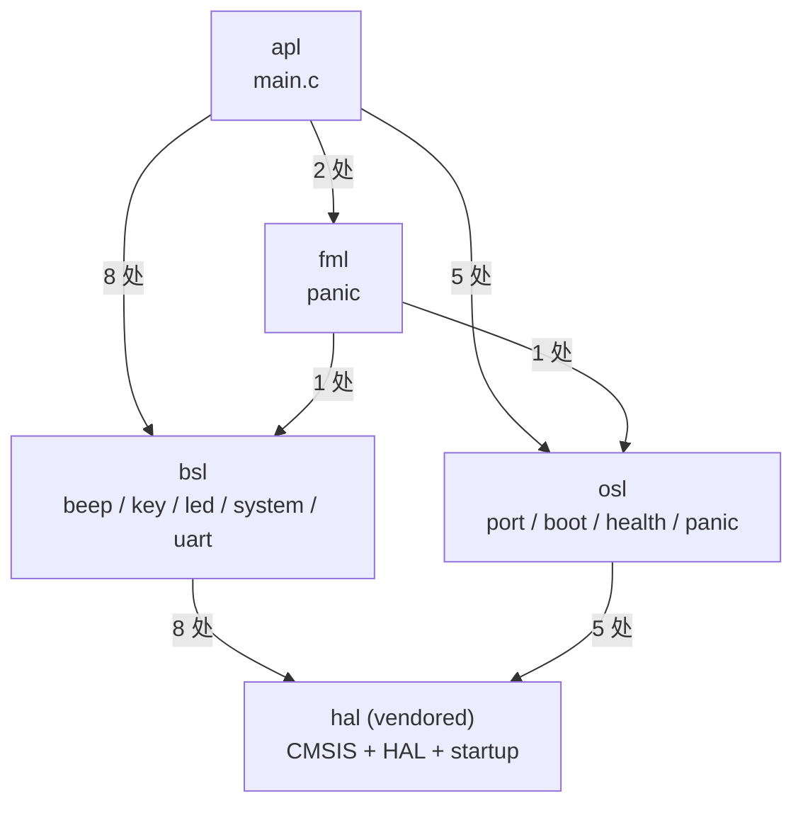
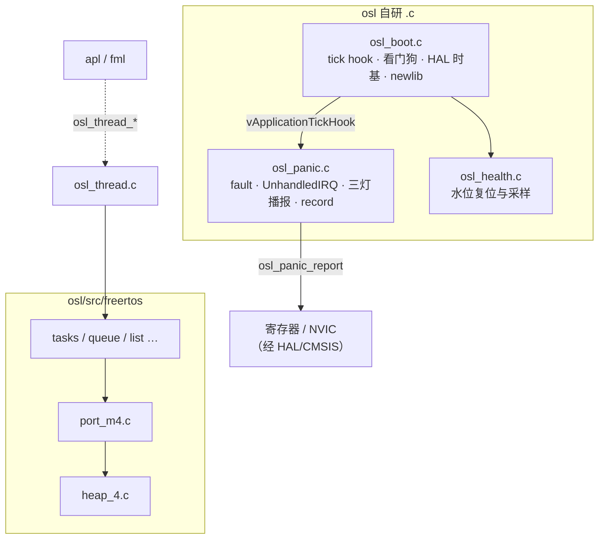
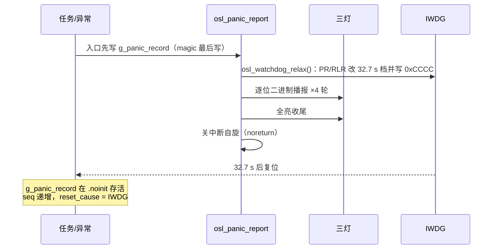

# 工程与系统设计

本文档合并**工程搭建索引**与**系统运行期设计**。搭建 checklist、框架图、生成链与 CMSIS 约定的**权威全文**在 [.skills/工程规格.md](../../.skills/工程规格.md)「工程设计手稿（搭建与生成链）」；本文第一部分只保留阅读路线与命令速查，避免与规格双份维护。第二部分给出可从 `nm` / `objdump` 复核的五层架构、跨层边、启动时序与稳态行为；数字来自 `arm-none-eabi-nm` / `objdump` 的实测读数。**门禁（`verify` / `gate-selftest`）已于 2026-11-22 整体删除，待重新构建**，文中凡残留的旧判据描述仅作历史参考。与工程规格冲突时，以**工程规格**（当前代码行为）为准；架构取舍见 [.skills/架构缺陷.md](../../.skills/架构缺陷.md)。

---

# 第一部分 · 工程搭建（索引）

## 何时阅读

| 场景 | 读本节 | 读工程规格 / 其它 |
|------|--------|-------------------|
| 从零复制/搭建工程骨架 | 路线 | [工程规格.md](../../.skills/工程规格.md)「工程设计手稿」全文 |
| 装工具链 / OpenOCD / 刷机 / GDB | 否 | [搭建环境.md](./搭建环境.md) |
| 日常编译、加源文件 | 速查命令 | 工程规格 + [SKILL.md](../../.skills/SKILL.md) |
| 修改 `project/generate.py` | 是 | 必须同步工程规格「目录 / 脚本 / 自检」 |
| 复核层边处数、故障码、size 上限 | 否 | **第二部分**（机器校验层边表在此） |

**手稿真源**（框架图、生成链、链接序、CMSIS、搭建 checklist）：[工程规格.md](../../.skills/工程规格.md)「工程设计手稿（搭建与生成链）」——两者一致性靠人工核对（原 `collect_doc_contract_errors` 已随门禁删除）。

## Git 与 `tool/`（本仓库）

- 根目录 [.gitignore](../../.gitignore) 至少忽略 `out/user/`、`out/userdebug/`、`__pycache__`、`tool/.cache/`。
- **本仓库**在 `tool/linux_x86_64/` **入库**了 Linux 交叉工具链；CI 仍执行 `build/build.py install-toolchain` 并缓存。`tool/.gitignore` 另忽略 `.cache/` 与可选 `win_x86_64/cubeprg/`。
- 从零搭**空白模板**时，常见做法是忽略整个 `tool/<平台>/` 解压体；勿与「本仓 vendoring 策略」混为一谈。

## 快速命令

```text
python build/build.py update          # 刷新 Makefile/Kconfig + pinmap 脚本产 DTS → dtc 编 apollo.dtb
python build/build.py build           # update + userdebug/user 双档编译 + release 拷贝
python build/build.py build --fast --variant userdebug   # 日常增量
python build/build.py clean           # 删 out/
python build/build.py install-toolchain [--make-only]
python flash/flash.py install-openocd [--platform linux_x86_64]
python build/build.py set-buildenv [--print bash|powershell|json]
python flash/flash.py
```

`update` 生成分档 `out/<variant>/.config`；**增量 `Nothing to be done` 不算验证**，须 `clean` 后全量 `build`。
门禁（`verify` / `gate-selftest`）已于 2026-11-22 整体删除，待重新构建；现口径是 `update` 零 dtc 诊断 + `build` 零告警。

## 文档同步

实现或生成逻辑变更后，按 [文档维护.md](../../.skills/文档维护.md) 更新 [工程规格.md](../../.skills/工程规格.md) 与 `docs/`（见 [SKILL.md](../../.skills/SKILL.md)）。未同步视为变更未完成。

---

# 第二部分 · 系统架构与运行期设计

## 五层栈

| 层 | 目录 | 自研 `.c` | 自研 `.h` | 职责 | 允许依赖 |
|---|---|---|---|---|---|
| `apl` | `apl/` | 1 | 0 | 应用入口：只做「初始化 → 起任务 → 起调度器」，不写任何板级或 RTOS 细节 | `fml`、`bsl`、`osl` |
| `fml` | `fml/` | 3 | 3 | 功能逻辑：周期任务、去抖、灯/蜂鸣器策略、故障入口的语义映射 | `bsl`、`osl` |
| `bsl` | `bsl/` | 10 | 11 | 板级事实 + `bsl_gpio` / `bsl_i2c_gpio` / `bsl_init` / `bsl_log` / `bsl_fdt` / `board_rt`；板级事实的唯一真源是 `docs/hardware/pinmap/*.xlsx` → `gen_dts.py` → `out/dts/apollo.dts` → **dtc** 编 `apollo.dtb`，经 `bsl/src/board_dtb.s` 的 `.incbin` 内嵌进 `.dtb` 段，运行期由 `bsl_fdt.c` + `board_rt.c` 读到端口/脚/极性/波特率。C 侧不再有生成的引脚头（`board_device_registry.h`、`osl/inc/board_panic_hw.h` 为手写；后者是 panic 专用） | `hal` |
| `osl` | `osl/` | 4 | 8 | OS **支撑**（含 `osl_thread` 门面）；panic / 看门狗 / 健康 / newlib 垫片；内核 API 经 `osl_thread.h` | `hal` |
| `hal` | `hal/` | — | — | vendored：CMSIS + STM32F4 HAL + startup，只被 `bsl` / `osl` 引入 | 无跨层引用 |

自研 `.c` 随 `bsl_gpio` / `bsl_i2c_gpio` / `bsl_fdt` / `board_rt` / `bsl_init` / `bsl_log` 与 `osl_thread` 等扩充；层边处数以 `nm` / `objdump` 的实测为准（见下表），不在此逐文件枚举。

## 允许的跨层边：7 条 / 31 处

事实源是 `project/generate.py` 的 `LAYER_DEPENDENCIES`（它只驱动根 Makefile 的层可见性）；下面这张表是逐文件实测的结果（只统计 `#include "..."` 与 `#include <...>` 两种写法里的**跨层**引用，同层引用与 vendored 内部引用不计）。**口径注意**：`_self_layer_header_owners()` 只认**自研层的头**，所以 `FreeRTOS.h` / `task.h` 这类 vendored 内核头不进这张表——它们另有 6 处直接引用，见下一节。

| # | 边 | 处数 | 具体引用 | 这条边为什么存在 |
|---|---|---|---|---|
| 1 | `apl → fml` | 2 | `main.c` / `app_sample.c` → `fml_panic.h` | 应用层与样例应用在启动失败路径上按码报障 |
| 2 | `apl → bsl` | 8 | `main.c` → `board_system.h` / `bsl_init.h`；`app_sample.c` → `board_device_registry.h` / `board_key.h` / `board_led.h` / `bsl_device.h` / `bsl_device_api.h` / `bsl_log.h` | 时钟走 `board_system_init()`，外设 init 序走 `bsl_board_periph_init()`；样例应用经 bsl 设备 API 访问 LED/按键/蜂鸣器 |
| 3 | `apl → osl` | 5 | `main.c` → `osl_boot.h` / `osl_health.h` / `osl_thread.h`；`app_sample.c` → `osl_health.h` / `osl_thread.h` | 启动水位、阶段记录与 `osl_scheduler_start()`；样例任务的创建与健康心跳 |
| 4 | `fml → bsl` | 1 | `fml_panic.c` → `bsl_log.h` | panic 前先把环形日志倒出来 |
| 5 | `fml → osl` | 1 | `fml_panic.c` → `osl_panic.h` | 故障播报转调 osl（码表与三灯都只有 osl 一份） |
| 6 | `bsl → hal` | 8 | `board_*` / `bsl_gpio*` → HAL | 板级与 GPIO/I2C 子系统收纳 HAL |
| 7 | `osl → hal` | 5 | `FreeRTOSConfig.h` → `stm32f4xx.h`；`osl_boot.c` / `osl_panic.c` → `stm32f4xx_hal.h`；`osl_boot.c` / `osl_panic.c` → `system_stm32f4xx.h` | 端口层需要寄存器与 CMSIS 内建函数 |

合计 **7 条边 / 31 处**（2+8+5+1+1+9+5）。第七轮 `bsl_log.c` 为并发保护引入 `stm32f4xx_hal.h`（只为 `__get_PRIMASK` / `__disable_irq`），`bsl → hal` 8 → 9 处；这条边本就在允许集内。`fml` 现在只剩 `fml_panic.c` 一个源文件：LED/按键/蜂鸣器的演示行为已迁到 `apl/src/app_sample.c`，所以 `fml → bsl` / `fml → osl` 的处数从 11 / 5 降到 1 / 1，而 `apl → bsl` 从 2 升到 8。`fml → hal` **不是**允许边：`LAYER_DEPENDENCIES["fml"]` 只声明 `("bsl", "osl")`，往 `fml` 里 include 一个 `stm32f4xx_hal.h` 会被层依赖判据判为越级（当前该判据已随门禁删除，靠 `-I` 路径让缺头在编译期暴露）。

依赖矩阵（行 = 引用方，列 = 被引用方；格内是处数，空 = 不允许或零使用）：

|            | `apl` | `fml` | `bsl` | `osl` | `hal` |
|------------|:-----:|:-----:|:-----:|:-----:|:-----:|
| **`apl`**  | —     | 2     | 8     | 5     | —     |
| **`fml`**  | —     | —     | 1     | 1     | —     |
| **`bsl`**  | —     | —     | —     | —     | 8     |
| **`osl`**  | —     | —     | —     | —     | 5     |
| **`hal`**  | —     | —     | —     | —     | —     |

7 个非零格子，与上表 7 条边一一对应。`apl → bsl` 是**有意保留**的边：它的作用是让「应用层碰 HAL」这件事在源码里有唯一一个合法出口（`board_system_init()`），而不是让 `apl` 直接写寄存器；反向的 `bsl → fml` 则被明确禁止（`bsl` 的允许依赖只有 `hal`），（历史：`layer-deps` 组曾用「往 bsl 里塞 `fml_panic.h`」与「`extern` 声明引 `fml_` 符号」两段破坏守着这条禁止边；该组已随门禁删除。



## 口径之外：6 处 vendored 内核头依赖

上面 31 处只数**自研层头**之间的引用（`LAYER_DEPENDENCIES` 的允许边）。vendored 的 `FreeRTOS.h` / `task.h`
在自研源文件里另有 **6 处**直接 include（2026-11-22 实测）：

| 文件 | 处数 | 引用 |
|---|---|---|
| `osl/src/osl_boot.c` | 2 | `FreeRTOS.h` / `task.h`（tick hook、栈溢出钩子） |
| `osl/src/osl_panic.c` | 2 | `FreeRTOS.h` / `task.h`（故障路径取调度器状态） |
| `osl/src/osl_thread.c` | 2 | `FreeRTOS.h` / `task.h`（唯一的调度 API 门面） |

全部落在 **.c** 里，自研层的**头文件一个都不引**内核头（第五轮把 `osl_panic_record.h` 唯一的
`TaskHandle_t` 换成 `uintptr_t`，结构布局不变、`nm` 仍是 140 B）。`apl` / `fml` 经 `osl_thread.h`
调度与延时 —— 换 RTOS 时优先改 `osl_thread.c` 与移植目录，上层 API 不变。

## osl 层模块边界（细图）

自研 13 个文件 + vendored FreeRTOS（`osl/src/freertos/`，含 `port_m4.c`、`heap_4.c` 与内核源；目录形状保持 upstream 原样，便于整块升级）。现行边界见下表；历史拆分以 git 为准，机制见 [.skills/架构缺陷.md](../../.skills/架构缺陷.md)。

| 模块 | 文件 | 主要职责 |
|---|---|---|
| 启动与运行时基础设施 | `osl_boot.c` | 启动阶段、`g_reset_cause`、IWDG、HAL 时基（DWT / `HAL_GetTick`）、`vApplicationTickHook`、malloc/栈溢出钩子、newlib（`_sbrk`、锁、`_write`） |
| 故障与播报 | `osl_panic.c` | `osl_panic_report`、`panic_mask_all_irqs`、四类 fault 与 `UnhandledIRQ_Handler`、`vAssertFailed`、`g_panic_record` / `g_last_write` |
| 健康水位 | `osl_health.c` | `osl_health_init`、堆/栈槽采样（栈经 `osl_thread_stack_high_watermark`） |
| 内核与移植 | `freertos/*.c`、`port_m4.c` | 调度器、Cortex-M4F 移植、`heap_4` |



原由门禁从 `project/generate.py` 读取的一批源码锚点（`OSL_BOOT_C` / `PANIC_STORE_C` / `OSL_PORT_ST_SOURCE` 等）已随 2026-11-22 门禁删除一并移除；现在生成器只保留真正驱动生成的数据（`LAYER_DEPENDENCIES`、`DEFAULT_BOARD_INFO`、`VARIANT_MAKE_OPTS` 等）。

## 自检现状（2026-11-22 起）

门禁链已整体删除：`build/checks/`（12 个模块，约 9600 行）、`build/verify.py`、`build.py` 的
`verify` 与 `gate-selftest` 子命令、`--artifacts` 参数、产物断言（`_artifact_assertion_errors`）
全部移除，`.github/workflows/build.yml` 的 `gate-list` / `gate-selftest` 两个 job 与红测矩阵同步删掉。
理由与用户决策：先清空重建，等 DTS 真源与运行期解析稳定后再重新设计判据。

`.github/workflows/build.yml` 如今只保留 **1 个 job**：`build`（`install-toolchain` → `update`
（含生成物与提交一致检查）→ 全量 `build` → 上传镜像）。

## 启动时序

```text
Reset_Handler
  └─ SystemInit
  └─ __libc_init_array
  └─ main()
       ├─ osl_health_init()                 // 必须早于 HAL_Init()：把「历史最低」复位成 UNSET 而不是 0
       ├─ board_system_init()               // HAL_Init + SystemClock_Config(16 MHz HSI → 168 MHz) + SystemCoreClockUpdate
       │     └─ 失败 → fml_panic(4U)        // 系统时钟配不起来
       ├─ app_sample_start()               // 起 led_blink / button 两个样例任务（osl_thread_create 失败 → fml_panic(2U)）
       │     └─ 设备未就绪 → 该任务降级、只喂健康心跳（不 panic）
       ├─ vTaskStartScheduler()             // 只起 IDLE 任务；configUSE_TIMERS = 0，没有 Timer 任务
       │     └─ 返回 → fml_panic(1U)        // 堆不足，调度器起不来
       └─ for (;;)                          // 双保险；fml_panic 已是 noreturn
```

运行期还有两条不经过任务链的入口：`vApplicationTickHook`（1 kHz，在 `osl_boot.c`：喂 IWDG + 查栈 + 采堆水位）与四个硬件异常入口 plus `UnhandledIRQ_Handler`（均在 `osl_panic.c` 强定义，压过 startup 弱别名），两者最终都汇到 `osl_panic_report()`：三灯按 3 位二进制逐位闪 4 轮 → 全亮 → 关中断自旋，并把现场写进 `.noinit` 的 `g_panic_record`。

`fml_panic()` 是这条汇流上唯一的 fml 侧入口，住在 `fml/src/fml_panic.c`，函数体只有一行 `osl_panic_report((osl_panic_code_t)code)`（反汇编实测 3 条指令 8 B）。它**不**负责闪灯、也**不**碰 `board_led_*`——播报方式与码表都只有 osl 一份。

## 现态读数

> **下表是 P4 时点的快照**（`text 86576` / `bss 22000`），保留是为了记录 `.dtb` 段与各家入口的
> 相对占比。现行读数见 `docs/design/功能实现对照表.md` §4 与各批证据文件；P6b（2026-11-24）实测：
> `text 584724`（user 574108）/ `data 52` / `bss 44620`（RAM 44672，22.7%），其中任务池
> `s_task_stack` 8192 B（4 × 512 词）、`s_task_tcb` 336 B——下表「任务栈（静态）」那一行
> 的 2048 B / 168 B 是 2 张任务时的旧值。

采样：`arm-none-eabi-size out/userdebug/objects/target/stm32-freertos.elf`（userdebug `-Og -g3`），user 档 `-Os -g0`。`.dtb` 段被 `size` 汇总进 `text` 列，因此另列「扣除 DTB 后的 code text」——门禁删除后这组数字只作记录，**不再有上限判据**（原 `ARTIFACT_TEXT_CEIL = 20480` 已随门禁一并删除）。

| 指标 | 读数 |
|---|---|
| `text`（全量，含 `.dtb`） | 86576 B（user 83652） |
| code text（`text − (_edtb − _sdtb)`） | 22688 B（user 19764） |
| `.dtb` 段 | 跨度 63888 B（`_sdtb 0x08005720` → `_edtb 0x080150b0`）= 内容 63875 B + **13 B 对齐填充**；内容边界 `bsl_dtb_start` → `bsl_dtb_end` 精确 63875 B，与 `out/dts/apollo.dtb` **逐字节等长**。16 B 对齐来自 `board_dtb.s` 的 `.align 4`（ARM as 的 `.align N` 是 2^N，不是 4 B） |
| `data` / `bss` | 16 B / 22000 B |
| Flash | 86576 / 1048576（**8.26%**；user 83652 / 7.98%） |
| RAM | 22016 / 196608（**11.20%**；user 22008 / 11.19%） |
| FDT 解析层 | `bsl_fdt_init` 224 B + `bsl_fdt_find` 300 B + `bsl_fdt_child` 188 B + `bsl_fdt_prop_cells` 72 B = 784 B；全套 9 个入口合计 1340 B（`child_count` 152 / `by_phandle` 268 / `prop_flag` 52 / `prop_u32` 50 / `prop_string` 34） |
| 日志环形缓冲 | `s_ring` 320 B（`0x20000164`）+ `s_line` 40 B（`0x2000013c`）+ `s_head`/`s_line_len` 各 4 B + `s_uart_busy`/`s_uart_busy_tick`/`s_uart_drops` 各 4 B（`0x20000130` / `0x2000012c` / `0x20000128`），落 `.bss`；`bsl_log_puts` 136 B（0x88）、`bsl_log_dump_ring` 136 B（0x88）、`dump_uart_dec` 104 B（0x68）——PRIMASK 临界区、UART 占用与 50 ms 超时自愈、丢行计数的代价 |
| 任务栈（静态） | `s_task_stack` 2048 B（`0x20000580`）+ `s_idle_stack` 512 B（`0x20000328`）；TCB `s_task_tcb` 168 B + `s_idle_tcb` 84 B；全部 `.bss`，`nm -S` 可核 |
| newlib 堆 | 512 B（未使用） |
| `.noinit` | `g_last_write` 64 B（`0x20004f1c`）+ `g_panic_record` 140 B（`0x20004f5c`），跨复位保留 |
| 静态分配锁守卫 | `s_malloc_lock_depth` 4 B（`0x200002fc`，2026-11-22 新增） |
| 体积对比基线 | 修复前 userdebug text 85644 → 现 86576（+932 B：GPIO/AF 失败检测、双源校验、malloc 锁深度守卫、DTB 极性按值判、HSE 双声明对拍、日志环形并发保护 **+64 B**、UART 占用超时与丢行计数 **+344 B**） |

## 这份图的边界

- 只画**跨层 include 边**。符号级引用（手写 `extern` 声明）在源码里目前只有 1 处且是同层（`osl/src/osl_boot.c` 的 `osl_tick_ms_advance`），但判据已覆盖这种形态（`layer-deps` 第五段破坏）。
- 不画 vendored FreeRTOS 内部（`osl/src/freertos/` 与 `osl/inc/freertos/`，移植为 `port_m4.c` + `heap_4.c`），它整体算在 `osl` 层内；自研边界见上文「osl 层模块边界」。
- 不画数据流与时序交互；追单条调用链时用 `arm-none-eabi-nm` / `objdump -d out/userdebug/objects/target/stm32-freertos.elf`（见 [搭建环境.md](./搭建环境.md)）。
- 零硬件实测的项（168 MHz 起振、USB 枚举、IWDG 真复位、`.noinit` 跨复位存活、panic 三灯时序、FPU 扩展帧）本图无法证明，见 [搭建环境.md](./搭建环境.md#附录--板上验收)。

---

## 运行期稳态

调度器启动之后的稳态（任务、中断、看门狗、故障码）。


## 1. 任务

| 任务 | 栈（word） | 优先级 | 周期 | 栈水位槽 |
|------|-----------|--------|------|---------|
| `led_blink` | 256（`configMINIMAL_STACK_SIZE * 2U`） | 1 | **1 s** 切换红/绿互斥，`vTaskDelayUntil` | 0 |
| `button` | 128（`configMINIMAL_STACK_SIZE`） | 1 | 10 ms 轮询，连续 3 次一致 ≈ 30 ms 去抖 | 1 |
| IDLE | 128 | 0 | 无人可跑时由内核调度 | — |
| Timer | **不存在** | — | — | — |

三件容易踩的事：

- **没有 Timer 任务**。`configUSE_TIMERS = 0`，自研代码里一次 `xTimer*` 调用都没有，整段
  软件定时器没编进镜像。
- **两个应用任务同优先级 1**，靠 `configUSE_TIME_SLICING = 1` 轮转，不是「谁先创建谁占着 CPU」。
- **`configMAX_PRIORITIES = 2`**，只有 0 / 1 两档。它决定 `pxReadyTasksLists[]` 的元素数，
  改大只多占 RAM；此前 `verify` 的 task-priority 断言会把「配置比用法宽」报红（该门禁已删除，现在靠评审把关）。

两个任务都顺手采自己的栈余量，但节拍不同：`led_blink` 每拍（1 s）采一次；`button` 每 100 次
轮询（约 1 s）采一次——`uxTaskGetStackHighWaterMark` 要扫描整段栈，跟着 10 ms 走纯属浪费。
堆水位**不在这两个任务里采**（见第 3 节）。

## 2. 调度与中断优先级

| 项 | 值 | 含义 |
|---|---|---|
| `configUSE_PREEMPTION` | 1 | 就绪态出现更高优先级任务立刻抢占 |
| `configUSE_TIME_SLICING` | 1 | 同优先级任务每 tick 轮转 |
| `configUSE_PORT_OPTIMISED_TASK_SELECTION` | 1 | 用 CLZ 指令选下一个任务 |
| `configUSE_IDLE_HOOK` | 0 | IDLE 里没有用户代码 |
| `configPRIO_BITS` | 4 | 4 位优先级，16 档 |
| `NVIC_PRIORITYGROUP_4` | 4 位抢占 / 0 位子优先级（`HAL_Init` 里设） | 所有中断只有抢占优先级 |
| `configLIBRARY_LOWEST_INTERRUPT_PRIORITY` | 15 | 内核自身（SysTick / PendSV）用这一档 |
| `configLIBRARY_MAX_SYSCALL_INTERRUPT_PRIORITY` | 5 | 折算成 `BASEPRI = 0x50` |

**能调 FreeRTOS API 的中断，抢占优先级数值必须 ≥ 5**（5..15）。数值 0..4 的 ISR 不在
`BASEPRI` 屏蔽范围内，在里面调 `xQueueSendFromISR` 或 `portYIELD_FROM_ISR` 会让内核临界区失效，
而这类越界通常不报错、只在罕见时序下丢事件。这组数字从 `osl/inc/FreeRTOSConfig.h` 推导，
不是各驱动随手填的。

## 3. tick hook：1 kHz 上做四件事

`configUSE_TICK_HOOK = 1`，`vApplicationTickHook()` 在 SysTick 中断上下文每 1 ms 跑一次，
顺序固定（实现见 `osl/src/osl_boot.c`）：

1. `osl_tick_ms_advance()` —— 推进毫秒累加器；调度器起来之后 `HAL_GetTick` 完全依赖它
2. `stack_guard_check()` —— 比 MSP，跌破 `_estack - _Min_Stack_Size` 按码 7 播报
3. 读 `xPortGetMinimumEverFreeHeapSize()` 更新 `g_heap_free_min`（**唯一写入口**）
4. 第一次进来启动 IWDG，此后每 tick `osl_watchdog_feed()`

第 1 步放最前面：后面任何一步 panic，这条 tick 都不会再被记账，而那时 HAL 时基本身已经没有意义。

第 3 步的采样点选在 tick 而不是某个任务里：1 kHz 读一个单调不增的全局量，不依赖任何任务
是否还活着，也不存在两个采样点互相覆盖、把下界抬高一个 tick 的窗口。

## 4. 看门狗：两档超时

| 档 | PR | RLR | 超时（LSI 32 kHz） | 用途 |
|---|---|---|---|---|
| 正常 | 2（/16） | 2000 | 1.0 s | 运行期卡死 |
| 播报 | 6（/256） | 4095 | 32.7 s | panic 后留够播报与复位的时间 |

- **启动点**是 tick hook 第一次被调用，不是 `main` 里无条件启动——正常运行期不该以 1 s 档开始计数。
- **启动期 panic（码 1 / 2 / 4）从不经过 tick hook**，IWDG 此时一次都没 ENABLE。救它们的是
  `osl_watchdog_relax()` 末尾那句 `IWDG->KR = IWDG_KEY_ENABLE`（`0xCCCC`）：少了它，播报完的
  关中断自旋永远等不到复位，板上只能断电，`seq` 也攒不出第二代。
- `0xCCCC` 幂等：运行期重复写不重启计数器、也不改超时，代价只是故障路径上多一条 store。
- `PR` / `RLR` 跨 LSI 域，写完要等 `SR` 的 `PVU` / `RVU` 清零才重载。等不到时只累加
  `g_iwdg_sync_fail`（抄进 `g_panic_record.wd_sync_fail`），不在那里 panic——panic 路径自己
  也会等 `SR`，会递归。

## 5. 水位记录

| 变量 | 口径 | 写入口 |
|---|---|---|
| `g_heap_free_min` | 字节，`xPortGetMinimumEverFreeHeapSize()` | tick hook（1 kHz） |
| `g_stack_free_min[0]` | **word**（不是字节），`led_blink` | 该任务每 1 s |
| `g_stack_free_min[1]` | **word**，`button` | 该任务每约 1 s |
| `g_stack_slot_err` | 槽号越界次数 | 越界分支 |

初值统一是 `OSL_HEALTH_UNSET`（`0xFFFFFFFF`），由 `osl_health_init()` 在 `main` 最前面置位——
`.bss` 初值 0 对「历史最低剩余」无意义（每次采样都比它大，最低值永远记成 0）。

槽号越界只累加计数、不写数组：写错槽号必须是一个可读的事件，不能退化成「没有采样」
（否则数组停在上一次的值，看起来像「栈很富余」）。

这两个值描述的是「这次上电以来」的用量，所以**不放在 `.noinit`**：跨复位保留的是 panic 现场，
不是运行统计。

## 6. 故障汇流

七个码全部汇到 `osl_panic_report()`，播报方式只有一种（三灯逐位二进制 ×4 轮 + 全亮 + 关中断自旋），
不再靠「闪法不同」区分来源。

| 码 | 入口 | 上下文 | 备注 |
|---|---|---|---|
| 1 | `apl/src/main.c` 里 `vTaskStartScheduler()` 返回 | main | 调度器起不来，堆不足 |
| 2 | `app_sample_start` 的 `osl_thread_create` 失败；`vApplicationMallocFailedHook` | 启动期 / 运行期 | 同时覆盖 FreeRTOS 堆不足与原 malloc 失败 |
| 3 | `configASSERT` → `vAssertFailed`；HAL `assert_failed` | 任意 | 文件名/行号进 record |
| 4 | `board_system_init()` 返回非 0（1 = `HAL_Init` 失败 / 2 = `SystemClock_Config` 失败 / 3 = DTB 的 `hse-frequency` 与编译期 `HSE_VALUE` 不一致；该值写进 `.noinit` 的 `g_boot_stage`） | main | 不进 tick hook；三个失败点排查方向互斥，读 `g_boot_stage` 分辨 |
| 5 | newlib `_sbrk` 越界 | 任意 | 是 newlib 堆，不是 FreeRTOS 堆 |
| 6 | HardFault / MemManage / BusFault / UsageFault；`UnhandledIRQ_Handler` | 异常 | 细分读 `fault_kind` / `unhandled_irq` |
| 7 | `vApplicationStackOverflowHook`（带任务名）/ MSP 守卫（`task` 为 NULL） | 任意 / 中断 | 两个来源共用码 7 |

码表的唯一事实源是 `osl/inc/osl_panic.h` 的 `osl_panic_code_t`，记录结构是
`osl/inc/osl_panic_record.h`（31 个字段）。**读者版码表以本节为准**；
[搭建环境.md](./搭建环境.md#调试环境) 只保留 GDB 字段说明与码 4 的 `g_boot_stage` 表，不再重复 1–7 简表。

## 7. 一次故障的完整时序



`g_panic_record` 落在 `.noinit`（`_snoinit`…`_enoinit`），复位不清，所以「重启 → 再 panic →
再 32.7 s」这个循环能靠 `seq` 数出来，`reset_cause` 能读出上一次是 IWDG 复位。

## 8. 未覆盖边界

- 以上全部来自源码、配置头与产物读数，**没有一条是硬件实测**：1.0 s 档是否真的咬、32.7 s 档
  是否真的拉起来、`.noinit` 是否真的跨复位存活、三灯码现场是否与本表一致，都要靠
  [搭建环境.md](./搭建环境.md#附录--板上验收) 逐项打勾才算闭合。
- `configUSE_TICKLESS_IDLE = 0`，没有低功耗态，本文不涉及唤醒源与 tick 补偿。
- `configQUEUE_REGISTRY_SIZE = 0`，没有队列/信号量名字注册，`vTaskList` 一类调试手段不可用，
  任务状态只能用调试器逐个读 TCB。
